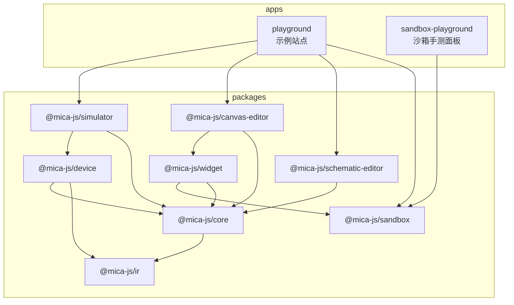
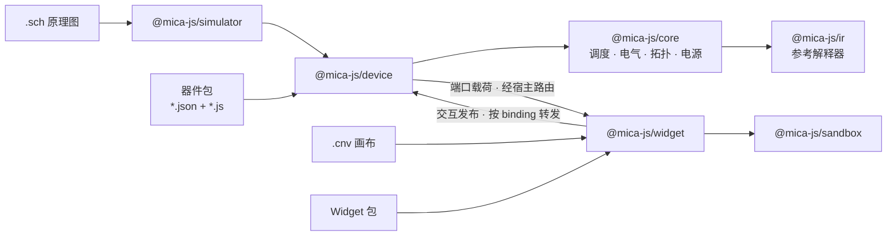

# Mica

Mica 是一个用 TypeScript 编写的开源电路仿真引擎，采用 pnpm Monorepo 组织。原理图与画布文档、器件模型、虚拟时间调度、电气网络求解、编辑器与 Widget 运行时被拆成独立包，可按需组合。

## 设计要点

- **确定性**：虚拟时间以整数皮秒表示，事件按（时间、因果轮次、顺序）稳定排序；相同的输入与驱动顺序必然得到相同结果。
- **分层组合**：依赖单向流动（`ir → core → device → simulator`，编辑器与 Widget 只依赖核心的文档格式），执行器、宿主接线与 UI 都可以替换。
- **显式能力**：指令、资源、宿主回调与观测能力都需要显式声明和授权；未实现的能力直接拒绝，不以空操作伪装成功。
- **隔离执行**：第三方 Widget 代码运行在 `iframe` + `Web Worker` 中，没有宿主 DOM、存储与网络。

## 包一览

| 包                                                       | 职责                                                                       |
| -------------------------------------------------------- | -------------------------------------------------------------------------- |
| [`@mica-js/ir`](packages/ir)                             | 领域无关 IR：建图、存储、静态校验、参考解释器与 Provider 产物              |
| [`@mica-js/core`](packages/core)                         | 仿真内核：虚拟时间、确定性调度、电气求值、连接拓扑、电源域，附文档格式入口 |
| [`@mica-js/device`](packages/device)                     | 器件层：描述解析、provider 加载、工厂上下文、实例生命周期与引脚 I/O        |
| [`@mica-js/simulator`](packages/simulator)               | 仿真器：统一 IR 电路编译/运行时（批处理 10–1000×），以及原理图器件执行器   |
| [`@mica-js/sandbox`](packages/sandbox)                   | 通用 JS 沙箱：iframe + Worker 隔离与离屏渲染合成                           |
| [`@mica-js/widget`](packages/widget)                     | Widget 契约与运行时：包加载、`WidgetHost`、图层与端口路由                  |
| [`@mica-js/canvas-editor`](packages/canvas-editor)       | 画布编辑器：`.cnv` 合成、交互命令与场景组装                                |
| [`@mica-js/schematic-editor`](packages/schematic-editor) | 原理图编辑器：`.sch` 的 Canvas 渲染与交互                                  |

## 依赖关系



## 运行时数据流



## 快速上手

```ts
import { createIRModule } from '@mica-js/ir';
import { createIRSchedulerInstance, createScheduler } from '@mica-js/core';

const module = createIRModule();
const count = module.state('count', 'u32', 0);
const tick = module.entry('tick', []);
tick.body((b) => {
  b.state.store(count, b.int.add(b.state.load(count), b.const('u32', 1)));
  b.event.at(tick, b.float.add(b.event.now(), b.const('f64', 1000)), []); // 1 ns 后再触发
  b.return([]);
});

const operations = [
  'const',
  'state.load',
  'int.add',
  'float.add',
  'state.store',
  'event.now',
  'event.at',
  'return',
];
const scheduler = createScheduler();
const instance = createIRSchedulerInstance(scheduler, {
  instanceId: 'counter',
  module,
  validation: {
    supportedInstructions: operations,
    authorizedInstructions: operations,
    resources: [{ ref: count, access: 'read-write' }],
  },
});

instance.at(tick, 0, []);
scheduler.start({ until: 10_000 });
instance.storage.loadState(count); // 11
```

各包的完整用法见对应 README；可交互的示例站点见 [apps/playground](apps/playground)。

## 仓库结构

```text
.
├── apps/
│   ├── playground/           # 各包示例站点（画布、原理图、沙箱、仿真）
│   └── sandbox-playground/   # 沙箱能力与隔离自检面板
├── packages/
│   ├── core/                 # 仿真内核与文档格式
│   ├── ir/                   # IR 模型、校验与参考解释器
│   ├── device/               # 器件层
│   ├── simulator/            # 原理图仿真执行器
│   ├── sandbox/              # iframe + Worker 沙箱
│   ├── widget/               # Widget 契约与运行时
│   ├── canvas-editor/        # 画布编辑器
│   └── schematic-editor/     # 原理图编辑器
└── scripts/                  # 仓库级校验脚本
```

## 设计文档

组件间的合同与语义（虚拟时间、电气模型、器件 IR、引脚与电源域、连接拓扑、文档格式、Widget 运行时与音频）见 [docs](./docs/README.md)。
各包的 API 使用指南见包内 `docs/`，例如 [packages/simulator/docs](./packages/simulator/docs/API.md)。

## 开发

环境要求：Node.js `^20.19.0 || >=22.12.0`，pnpm 由 `packageManager` 固定版本（`corepack enable pnpm` 即可）。

```bash
pnpm install
pnpm run build         # 构建全部包（ESM + d.ts）
pnpm run test          # 运行全部包测试
pnpm run test:e2e      # Playground 冒烟测试（Playwright）
pnpm run typecheck     # TypeScript 类型检查
pnpm run lint          # ESLint
pnpm run lint:package  # 包产物检查（publint + arethetypeswrong）
pnpm run format        # Prettier 格式化
```

Vite、Vitest 与 vite-plugin-dts 的版本通过 [pnpm catalog](pnpm-workspace.yaml) 统一管理，子包以 `catalog:` 引用。

## 许可证

[MIT](LICENSE)
