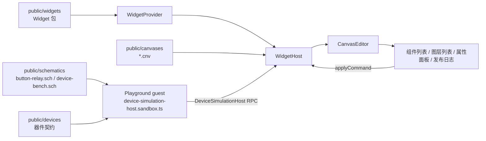

# @mica-js/playground

Mica 各包的可交互示例站点：React + Vite + Tailwind v4 + [shadcn/ui](https://ui.shadcn.com/)，哈希路由单入口，页面直接引用 workspace 包源码。

## 页面

侧栏按“概览 / 原理图 / 画布”分组；原理图与画布组下的每个示例都是独立入口，直接打开它自己的文档。

| 路由                           | 页面                          | 演示内容                                                                          |
| ------------------------------ | ----------------------------- | --------------------------------------------------------------------------------- |
| `#/`                           | 概览                          | 页面导航                                                                          |
| `#/schematic/board-properties` | 原理图 · 板级器件与属性       | `SchematicEditor`：STM32 / 8051 / LCD / NE555 的器件库、放置、连线与属性面板      |
| `#/schematic/mcu-leds`         | 原理图 · 教学 MCU 与指示灯    | `device-bench.sch`：教学 MCU 驱动两盏 LED；“双通道指示灯”画布示例挂在这张图纸上   |
| `#/schematic/button-relay`     | 原理图 · 按键、继电器与指示灯 | `button-relay.sch`：按键 S1 → 继电器 K1 → D1 / D2；“按键与指示灯”画布示例挂在这里 |
| `#/schematic/<id>?readonly`    | 只读查看器                    | 同一页以 `readOnly: true` 挂载：选择与缩放可用，编辑全部被拒                      |
| `#/canvas/button-lamp`         | 画布 · 按键与指示灯           | `CanvasEditor` + `WidgetHost`：`button-lamp.cnv`，按键 → 继电器 → 两盏灯与计数器  |
| `#/canvas/dual-lamp`           | 画布 · 双通道指示灯           | `dual-lamp.cnv`：两盏指示灯订阅教学 MCU 的 `D1.lit` / `D2.lit`                    |

只写组名（`#/schematic`、`#/canvas`）会打开该组的第一个示例。示例由 `src/examples/registry.ts` 统一登记：`SchematicExample` 带 `.sch` 资产路径，`CanvasExample` 带 `.cnv` 路径和它挂载的 `schematic`；`schematicRoute()` / `canvasRoute()` 生成侧栏与互链共用的路由。画布文档里的 `schematic` 必须等于某个原理图示例的 `document`。示例只登记这些**导航元数据**：标题与文档路径；器件、连线、端口和绑定一律来自标准 `.sch` / `.cnv` 文档本身。

新增示例：在 `src/examples/registry.ts` 的 `SCHEMATIC_EXAMPLES` / `CANVAS_EXAMPLES` 里加一项并放入对应资产；侧栏、路由和互链会自动出现。新增页面：在 `src/components/app-shell.tsx` 的 `PAGE_GROUPS` 里加一组，在 `src/App.tsx` 里渲染对应组件。

## 运行

```bash
pnpm --filter @mica-js/playground dev            # http://localhost:5173
pnpm --filter @mica-js/playground run build
pnpm --filter @mica-js/playground run typecheck
```

Playground 是演示站点：它不维护自己的测试，行为由各包测试与浏览器交互核对。

## 目录

```text
src/canvas/                   画布页纯逻辑：面板模型、组件列表、图层顺序、草稿保存
src/components/               app-shell（侧栏与分组）、画布属性面板、原理图属性面板、shadcn/ui 组件
src/examples/                 示例注册表（原理图 ↔ 画布链接与路由）
src/lib/                      哈希路由与 cn()
src/pages/                    三个页面组件（概览 / 原理图 / 画布）
src/schematic/                编辑器示例的器件注册表
src/sim/                      器件契约加载、契约 → 统一 IR 模型适配、画布设备宿主
public/assets/                示例资源（画布底图、image / binary 属性）
public/widgets/               demo widget 包：image / segment / button / lamp
public/schematics/            原理图示例资产（原理图页与画布页共用）
public/canvases/              画布示例资产，`schematic` 指向 public/schematics
public/devices/               器件契约（package.json + 每器件 JSON：pins / topics / connections / reset）
```

## 画布页



- **侧栏入口**：`#/canvas/button-lamp` 挂载 `schematics/button-relay.sch`，`#/canvas/dual-lamp` 挂载 `schematics/device-bench.sch`；工具栏的“原理图”按钮跳到对应原理图侧栏入口（同一份图纸）。
- **左侧栏**是组件列表与图层列表。组件条目来自 `public/widgets/package.json`（image / segment / button / lamp），点击即发一条 `add-instance`；图层列表按绘制顺序自上而下排列，点一行选中它，拖动一行落到另一行即发一条 `set-z`。
- **右侧栏**是宿主 UI：属性控件按 `provider.resolve(ref).definition.properties` 渲染，绑定下拉按 `definition.ports` 渲染，值一律通过 `host.applyCommand` 提交。可选端点来自正在运行仿真的 `getTopics()`（契约里的 `topics`），只按方向互补 + 载荷类型相等过滤；下拉标签用位号（`D1.lit`），提交的值仍是符号 id。
- **仿真**由 `WidgetHost` 自己的帧时钟推进：`scene.setMode('simulation')` 同时切换编辑器与宿主的模式并复位器件；`ideal-led` 把 `lamp` 通过契约的 `lit` 主题发布给指示灯 widget，`teaching-mcu` 每个 tick 翻转 GPIO。宿主按默认 `frame.stepMs = 25` 推进：每 25 ms 执行一个仿真步，器件状态按步传播；按键到指示灯之间的多级链路会在后续周期逐步落定，器件只在 topic 取值变化时发布，空转的示例只走时钟、不重绘。
- **发布日志**记录两条路径：`S1.closed`、`D1.lit` 这类设备发布，以及 `按键.press` 这类 widget 输出（即使它同时被绑定送进器件）。“按键与指示灯”示例的按键 widget 绑定 `S1.pressed`：按下后按钮模型闭合触点、继电器吸合，`D1.lit` 变亮、`D2.lit` 熄灭，`S1.pressCount` 加一。
- **保存**：每个示例有独立的草稿键 `mica-playground:canvas-draft:<id>`；`保存` / `Ctrl+S` 立即写入，`重置` 恢复该示例的 `.cnv`。

画布示例引用的器件必须由 `src/sim/device-contracts.ts` 的 `describeContract()` 解析出统一 IR 描述：全部四个类型（`ideal-led`、`teaching-mcu`、`button-ir`、`relay-ir`）都由 Playground 自己的 `src/sim/device-models.ts` 提供，仿真包不再内置任何器件。不在列表里的类型，画布设备宿主会明确报“没有统一 IR 运行时模型”，不会退回一个假模型。

## 环境模块

Playground 只提供示例环境，仿真编排留在公开包里：

- **器件库**：`src/sim/device-library.ts` 读取 `public/devices` 的契约（`package.json` + 每器件 JSON），校验 `pins` / `topics` / `connections` / `reset` 并合成符号；原理图页与画布页共用同一份库。
- **契约 → 统一 IR**：`src/sim/device-contracts.ts` 把契约转成 `DeviceDescription`；`ideal-led` / `teaching-mcu` / `button-ir` / `relay-ir` 全部由 `src/sim/device-models.ts` 实现（`description.behaviors` 生成的 IR，没有 `DeviceAccessor`）。
- **画布设备宿主**：`src/sim/device-simulation-host.sandbox.ts` 通过 `?sandbox-worker` 生成 Playground 自己的设备 guest（它带自己的器件库）；widget guest 直接用 `@mica-js/widget` 已内联的 `createWidgetHostGuestSandbox()`，不再需要构建期查询。`SandboxHostProvider` 负责创建设备 RPC、挂载 widget host，并把 `event.ports[0]` 交给 guest、把后续端口用于 widget 与设备的直连；worker 通过宿主文件系统 RPC 读取 `devices/` 契约，画布页不持有 `Circuit`。
- **主题映射**：契约 topic 用 `state` 指明载荷落在哪个设备状态（`lit → lamp`）；宿主通过通用 `DeviceAccessor.getState/setState` 收发，不需要模型专用访问器。没有 `state` 的 topic 会被明确拒绝。

## 主题与别名

`index.css` 用 shadcn 的 oklch token，顶栏切换 `.dark` 类；原理图页同时把编辑器的深 / 浅主题传给画布，使 Canvas 与页面 chrome 一起切换。

两个编辑器不注入样式：`src/main.tsx` 显式导入 `@mica-js/canvas-editor/style.css` 与 `@mica-js/schematic-editor/style.css`（开发时别名指向包的 `src/styles/editor.css`，发布后指向 `dist/style.css`）。

`vite.config.ts` 与 `tsconfig.json` 各自声明同一组别名：

- `@/*` → `src/*`（shadcn 约定）
- `@mica-js/*` → 对应包的 `src`，改包源码后刷新即生效，无需先构建。Vite 的别名按前缀匹配，`@mica-js/core` 必须排在 `@mica-js/core/canvas` / `@mica-js/core/schematic` **之后**，否则会把它们一起吞掉。
