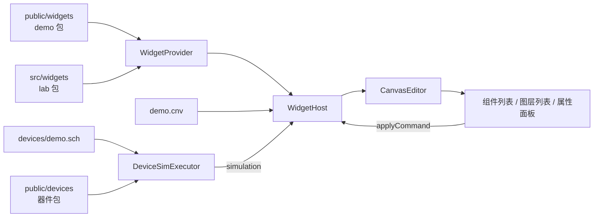

# @mica-js/playground

Mica 各包的可交互示例站点：React + Vite + Tailwind v4 + [shadcn/ui](https://ui.shadcn.com/)，哈希路由单入口，页面直接引用 workspace 包源码。

## 页面

| 路由             | 页面   | 演示内容                                                                                              |
| ---------------- | ------ | ----------------------------------------------------------------------------------------------------- |
| `#/`             | 概览   | 按能力列出的示例卡片                                                                                  |
| `#/examples/:id` | 示例页 | 注册表驱动：`kind: 'schematic'` 挂 `@mica-js/schematic-editor`，`kind: 'canvas'` 挂画布与 widget 宿主 |
| `#/sandbox`      | 沙箱   | `@mica-js/sandbox`：页面加载即启动 guest，代码编辑、重新运行 / 终止、调用与日志                       |

新增示例：在 `src/examples/<分类>/<id>/` 放一个 `index.ts`，导出一个 `ExampleDefinition` 并登记到 `src/examples/index.ts`。侧栏、首页与路由都从注册表生成，不需要改 `App.tsx`。

## 运行

```bash
pnpm --filter @mica-js/playground dev            # http://localhost:5173
pnpm --filter @mica-js/playground run build
pnpm --filter @mica-js/playground run typecheck
pnpm --filter @mica-js/playground run test       # vitest：纯逻辑（画布面板模型、器件包、widget 包）
pnpm --filter @mica-js/playground run test:e2e   # Playwright 冒烟，自带 4174 端口的 dev server
pnpm --filter @mica-js/playground run build:devices  # 改 demo.sch 布局后重算导线端点与网表
```

`playwright.config.ts` 会自己起 4174 端口的 dev server，e2e 不需要先手动启动。

## 目录

```text
e2e/                          Playwright 端到端用例
src/canvas/                   画布页纯逻辑：面板模型、组件列表、图层顺序、草稿保存
src/components/               app-shell、示例宿主（schematic / canvas）、属性面板、shadcn/ui 组件
src/examples/                 示例注册表：一个示例一个目录（文档 + 元数据），页面由注册表生成
src/lib/                      侧栏与导航、器件 / widget 注册表、cn()
src/pages/                    首页、唯一的示例页（/examples/:id）与沙箱页
src/devices/                  Playground 专用器件（按类别分目录：mcu / sensors / analog / actuators / displays / primitives）
src/widgets/                  Playground 专用 widget 包 `lab`
public/assets/                示例资源（画布底图、image / binary 属性、固件 .bin）
public/widgets/               demo widget 包与示例 demo.cnv
public/devices/               demo 器件包（push-button / counter-4bit / hex-display）与 demo.sch
scripts/build-device-demo.mjs 重算 demo.sch 的符号坐标与导线端点
```

## 画布页



- **左侧栏**是组件列表与图层列表。组件条目来自 `public/widgets/package.json` 与 `src/widgets/manifest.json`（demo 包 + lab 包），点击即发一条 `add-instance`，新实例按对角偏移级联摆放并置顶；运行模式下列表禁用。图层列表按绘制顺序自上而下排列，点一行选中它，拖动一行落到另一行即发一条 `set-z`。
- **右侧栏**是宿主 UI：属性控件按 `provider.resolve(ref).definition.properties` 渲染，绑定下拉按 `definition.ports` 渲染，值一律通过 `host.applyCommand` 提交，被拒时把诊断 message 显示在对应控件下方。
- 可选端点来自**正在运行的仿真**（`getTopics()`），面板只按方向互补 + 载荷类型相等过滤候选；下拉标签用位号（`U2.value`），提交的值仍是符号 id。
- **仿真**跑在页面同一条 JS 线程上：执行器作为 `simulation` 传给 `createWidgetHost`，器件发布按 `bindings` 直接投到 widget，widget 发布按绑定直接投给器件，页面里没有转发代码。运行模式用 100 ms 的定时器每次 `advance` 0.1 s 虚拟时间。
- **保存**：每次提交把 `serializeCanvas(document)` 与上一次成功的文本比较，不同才在 300 ms 去抖后写入 `localStorage`；`保存` 按钮与 `Ctrl/Cmd+S` 跳过去抖立即写，`导出` 下载当前文档，`重置草稿` 恢复示例。

`demo.sch` 是一条真电路：`S1`（按钮）的 A 端接 `U1`（4 位计数器）的 `CLK`，B 端接地；`U1` 的 `Q0..Q3` 接到 `U2`（数码管驱动）的 `D0..D3`；两颗芯片的 `VCC` / `GND` 接到图纸上的 5 V 与 GND 符号。按钮闭合把 `CLK` 拉到地产生下降沿，计数加一；`U2` 采样后把半字节发布成 `value` / `bits`。

## 示例

`src/examples/` 是唯一的示例来源：每个示例一个目录，`index.ts` 导出 `ExampleDefinition` 并登记到 `src/examples/index.ts`；侧栏、首页与 `/examples/:id` 都从注册表生成。`kind: 'schematic'` 的示例直接挂进 `@mica-js/schematic-editor`，`kind: 'canvas'` 的示例先加载 `schematic` 里的端点，再把 `.cnv` 文档挂进画布 + widget 宿主。

| 分类       | 示例        | 内容                                           |
| ---------- | ----------- | ---------------------------------------------- |
| 编辑器示例 | LED 闪烁    | teaching-mcu 的 GPIO 驱动 LED（原理图）        |
| 编辑器示例 | 基础 Widget | 按钮 / 开关 → `lab:indicator` → LED 的端口绑定 |
| 编辑器示例 | 简单画布    | 拖动、缩放、组件面板添加实例                   |

- **器件注册表**：`src/lib/registry.ts` 把内置样例、`packages/device/examples` 的 `mica:` 描述与 `src/devices` 的 `lab:` 包描述注册成一个 registry；编辑器只按引用查符号，页面不重复写引脚。
- **示例数据**：文档由 `src/examples/builders/schematic.ts` 的构造函数生成，导线端点从注册表的引脚几何算出，不硬编码坐标。
- **Playground 专用器件**（`src/devices/`）：每个 `lab:` 器件同时导出包描述（引脚、引脚组、端口）和统一 IR 描述（真实电气行为），因此不会与公共包产生耦合。`devices.test.ts` 直接用 `Circuit` 编译并运行每个器件，其中 `power domains` 用例覆盖 `Circuit.turnOn` / `turnOff`。
- **Playground 专用 widget**（`src/widgets/`）：`lab` 包以 `?raw` 打包成 `PackageFiles`，和 `public/widgets` 的 `demo` 包一起交给 `createPackageWidgetProvider`，画布页的组件列表同时来自两个清单。`widgets.test.ts` 会解析清单、加载每个模块并动态 `import` 一次实现源码。
- **画布资源**：`createWidgetHost` 带 `assets` provider，`file` 引用按 base URL 抓取、`inline` 引用在本侧 base64 解码，沙箱里只调 `api.assets.loadImage`。

## 主题与别名

`index.css` 用 shadcn 的 oklch token，顶栏切换 `.dark` 类；原理图页同时把编辑器的深 / 浅主题传给画布，使 Canvas 与页面 chrome 一起切换。

`vite.config.ts` 与 `tsconfig.json` 各自声明同一组别名：

- `@/*` → `src/*`（shadcn 约定）
- `@mica-js/*` → 对应包的 `src`，改包源码后刷新即生效，无需先构建。Vite 的别名按前缀匹配，`@mica-js/core` 必须排在 `@mica-js/core/canvas` / `@mica-js/core/schematic` **之后**，否则会把它们一起吞掉。
