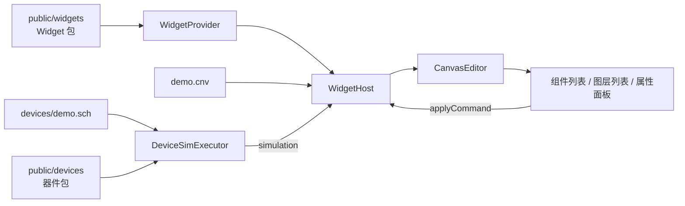

# @mica-js/playground

Mica 各包的可交互示例站点：React + Vite + Tailwind v4 + [shadcn/ui](https://ui.shadcn.com/)，哈希路由单入口，页面直接引用 workspace 包源码。

## 页面

| 路由                   | 页面         | 演示内容                                                                                             |
| ---------------------- | ------------ | ---------------------------------------------------------------------------------------------------- |
| `#/`                   | 概览         | 页面导航与 workspace 命令速查                                                                        |
| `#/canvas`             | 画布         | `createCanvasEditor`：demo widget 包、组件列表、拖动实例、运行模式、宿主属性 / 绑定面板、草稿保存    |
| `#/schematic`          | 原理图编辑器 | `@mica-js/schematic-editor`：器件库、属性面板（全部属性类型）、显示开关、回调事件流                  |
| `#/schematic?readonly` | 只读查看器   | 同一页以 `readOnly: true` 挂载：选择与缩放可用，编辑全部被拒                                         |
| `#/sandbox`            | 沙箱         | `@mica-js/sandbox`：guest 代码编辑、启动 / 终止、调用与日志                                          |
| `#/simulator`          | 仿真         | `@mica-js/simulator`：按钮 / 继电器 / 教学 MCU 三场景、启动 / 暂停 / 步进 / 复位、事件轨迹与电气观测 |

新增页面：在 `src/components/app-shell.tsx` 的 `PAGES` 里加一项（`id` 同时是路由），在 `src/App.tsx` 里渲染对应组件。

## 运行

```bash
pnpm --filter @mica-js/playground dev            # http://localhost:5173
pnpm --filter @mica-js/playground run build
pnpm --filter @mica-js/playground run typecheck
pnpm --filter @mica-js/playground run test       # vitest：纯逻辑（画布面板模型、仿真会话）
pnpm --filter @mica-js/playground run test:e2e   # Playwright 冒烟，自带 4174 端口的 dev server
pnpm --filter @mica-js/playground run build:devices  # 改 demo.sch 布局后重算导线端点与网表
```

`playwright.config.ts` 会自己起 4174 端口的 dev server，e2e 不需要先手动启动。

## 目录

```text
e2e/                          Playwright 端到端用例
src/canvas/                   画布页纯逻辑：面板模型、组件列表、图层顺序、草稿保存
src/components/               app-shell、画布属性面板、原理图属性面板、shadcn/ui 组件
src/lib/                      哈希路由与 cn()
src/pages/                    五个页面组件
src/schematic/                器件注册表、示例 .sch 与代码片段
src/sim/                      仿真页：器件 provider、符号、板级电路、三场景、会话层、轨迹
public/assets/                示例资源（画布底图、image / binary 属性）
public/widgets/               demo widget 包与示例 demo.cnv
public/devices/               demo 器件包（push-button / counter-4bit / hex-display）与 demo.sch
scripts/build-device-demo.mjs 重算 demo.sch 的符号坐标与导线端点
```

## 画布页



- **左侧栏**是组件列表与图层列表。组件条目来自 `public/widgets/package.json`，点击即发一条 `add-instance`，新实例按对角偏移级联摆放并置顶；运行模式下列表禁用。图层列表按绘制顺序自上而下排列，点一行选中它，拖动一行落到另一行即发一条 `set-z`。
- **右侧栏**是宿主 UI：属性控件按 `provider.resolve(ref).definition.properties` 渲染，绑定下拉按 `definition.ports` 渲染，值一律通过 `host.applyCommand` 提交，被拒时把诊断 message 显示在对应控件下方。
- 可选端点来自**正在运行的仿真**（`getTopics()`），面板只按方向互补 + 载荷类型相等过滤候选；下拉标签用位号（`U2.value`），提交的值仍是符号 id。
- **仿真**跑在页面同一条 JS 线程上：执行器作为 `simulation` 传给 `createWidgetHost`，器件发布按 `bindings` 直接投到 widget，widget 发布按绑定直接投给器件，页面里没有转发代码。运行模式用 100 ms 的定时器每次 `advance` 0.1 s 虚拟时间。
- **保存**：每次提交把 `serializeCanvas(document)` 与上一次成功的文本比较，不同才在 300 ms 去抖后写入 `localStorage`；`保存` 按钮与 `Ctrl/Cmd+S` 跳过去抖立即写，`导出` 下载当前文档，`重置草稿` 恢复示例。

`demo.sch` 是一条真电路：`S1`（按钮）的 A 端接 `U1`（4 位计数器）的 `CLK`，B 端接地；`U1` 的 `Q0..Q3` 接到 `U2`（数码管驱动）的 `D0..D3`；两颗芯片的 `VCC` / `GND` 接到图纸上的 5 V 与 GND 符号。按钮闭合把 `CLK` 拉到地产生下降沿，计数加一；`U2` 采样后把半字节发布成 `value` / `bits`。

## 仿真页

`#/simulator` 是 `@mica-js/simulator` 的交互调试台：用 `?raw` 读取 `packages/device/examples` 里已提交的 JSON / JS 配对，经 `parseDeviceDescription` + `loadDeviceModule` 加载，页面里不重写调度器或芯片算法。

| 场景          | 内容                                                                                                                 |
| ------------- | -------------------------------------------------------------------------------------------------------------------- |
| 理想按钮      | 触点 A–B 接在 VCC 与下拉的 `board.SENSE` 之间；画布上的按钮在沙箱里发布 `press`，经 `WidgetHost` 投递到 `S1.pressed` |
| 按钮 → 继电器 | 按钮触点把 VCC 送到 `K1.IN` / `board.COIL`，继电器在同一个 patch 内切换 COM–NO / COM–NC；触点侧由独立 `LOAD` 供电    |
| 教学 MCU      | 合成 ISA 只在块边界写 `GPIO`，经板级 `SENSE` 读出；`updateResources: ['firmware']` 授权固件的 8 B 单元更新           |

- **宿主接线**：执行器只透传 `pinHost` / `topology`，电路归本页所有；`src/sim/board.ts` 给出三块板的拓扑、电源定义与引脚意图，每次 `loadSchematic` / `reset()` 都用该运行时自己的调度器建 `createPowerRuntime`。
- **探针**（`connectionState` / `sampleDigital`）在轨迹里标为「电气观测」，并写明「宿主直读」——这些值不是器件发布。
- **工具栏**：`启动` / `暂停` 按 16 ms 墙钟节拍推进固定 10 ns 虚拟时间片；`单步` 只推进一片；`复位` 调 `executor.reset()`（按当前原理图重建实例、时钟归零），**不是**器件 reset 生命周期；`销毁` 释放执行器与 widget 宿主；`确定性回放 ×2` 用固定脚本各加载一次新会话并比较轨迹摘要。
- **能力与拒绝**：能力面板按器件描述列出引脚 / 连接 / 端口，并在一次性调度器上探测模型自己的 `reset`：理想按钮接受，继电器与教学 MCU 以 `device/lifecycle-unsupported` 拒绝。所以「复位」按钮永远只是重建实例，模型不支持的能力直接显示为「不支持」。
- **错误语义**：器件层拒绝载荷时 `advance` 抛出但执行器仍是 `ready`（时钟不推进），页面记成 `bench/delivery-rejected` 诊断；只有调度器故障才会置 `faulted`、暂停运行循环并禁用推进。

## 主题与别名

`index.css` 用 shadcn 的 oklch token，顶栏切换 `.dark` 类；原理图页同时把编辑器的深 / 浅主题传给画布，使 Canvas 与页面 chrome 一起切换。

`vite.config.ts` 与 `tsconfig.json` 各自声明同一组别名：

- `@/*` → `src/*`（shadcn 约定）
- `@mica-js/*` → 对应包的 `src`，改包源码后刷新即生效，无需先构建。Vite 的别名按前缀匹配，`@mica-js/core` 必须排在 `@mica-js/core/canvas` / `@mica-js/core/schematic` **之后**，否则会把它们一起吞掉。
