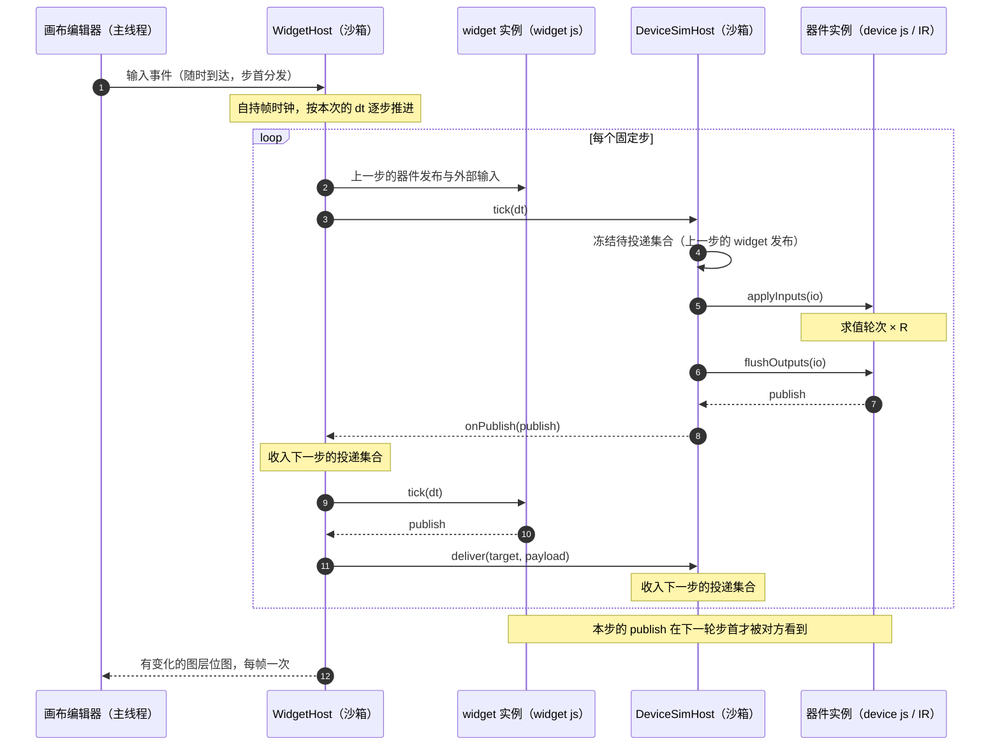

# 画布运行时

- Start Date: 2026-10-25
- Reference Issues: —（设计讨论，无对应 issue）
- Implementation PR: —（尚未实现）

规定 `.cnv` 画布在浏览器里的装配与执行：`WidgetHost` 的职责与选项、线程划分、帧与步的关系、外部资源的寻址。话题的投递语义见[器件话题投递](./0017-device-topic-delivery.md)。

## 声明

### 装配职责

`WidgetHost` 是唯一的装配点：画布文档、原理图、器件、widget 与资源都从它进来；仿真运行时由它持有，实例在哪个线程绘制也由它安排。

### 接口

```ts
interface WidgetHost {
  loadDocument(uri: URI): Promise<void>;
  applyCommand(command: CanvasCommand): void;
  reset(): Promise<void>;
  getDocument(): CanvasDocument;

  dispatch(instanceId: string, event: WidgetInputEvent): void;
  getLayers(): WidgetLayers;

  pause(): void;
  resume(): void;
  dispose(): Promise<void>;
}
```

| 方法                    | 作用                                   |
| ----------------------- | -------------------------------------- |
| `loadDocument(uri)`     | 读取并装入画布文档，成功后自动开始推进 |
| `applyCommand(command)` | 在当前快照上增量修改                   |
| `reset()`               | 重新执行一次 `loadDocument`            |
| `getDocument()`         | 当前已装入的快照                       |
| `dispatch(id, event)`   | 转交一条输入事件，在下一个步首分发     |
| `getLayers()`           | 图层视图，随推进更新                   |
| `pause()` / `resume()`  | 冻结与恢复帧时钟，不改动文档与实例状态 |
| `dispose()`             | 终止沙箱并释放全部图层位图             |

`WidgetLayers` 给画布编辑器读图层用：

```ts
interface WidgetLayer {
  readonly instanceId: string;
  readonly width: number;
  readonly height: number;
  readonly dpr: number;
  /** 最近一帧；实例尚未产出位图时为 `undefined` */
  readonly bitmap: ImageBitmap | undefined;
  /** 每产出一帧递增，用于判断是否需要重绘 */
  readonly sequence: number;
}

type WidgetLayerChange =
  | { readonly type: 'added'; readonly instanceId: string }
  | { readonly type: 'updated'; readonly instanceId: string }
  | { readonly type: 'removed'; readonly instanceId: string }
  | { readonly type: 'reordered' };

interface WidgetLayers {
  /** 按文档顺序排列 */
  list(): readonly WidgetLayer[];
  get(instanceId: string): WidgetLayer | undefined;
  subscribe(listener: (change: WidgetLayerChange) => void): () => void;
}
```

### 选项

| 选项             | 类型             | 作用                                                        |
| ---------------- | ---------------- | ----------------------------------------------------------- |
| `widgetProvider` | `WidgetProvider` | widget 定义与实现                                           |
| `deviceHost`     | `DeviceSimHost`  | 已构建的 `DeviceSimHost`；必需                              |
| `fs`             | `HostFs`         | 读取外部内容的唯一出口，见[宿主文件系统](./0019-host-fs.md) |
| `dpr`            | `number`         | 图层像素比，默认 1                                          |
| `onDiagnostic`   | 回调             | 故障上报；调用照常返回                                      |
| `onPublish`      | 回调             | 落在绑定范围之外的 widget 发布，交给调用方处理              |

前三项必需，其余可选。

`deviceHost` 由装配层用 `deviceProvider` 与 `fs` 构建后传入，`WidgetHost` 接收构建好的 `DeviceSimHost`：

```ts
const deviceHost = await createDeviceSimHost({ deviceProvider, fs });
const host = createWidgetHost({ widgetProvider, deviceHost, fs });
await host.loadDocument(uri);
```

`fs` 出现两次是因为两侧各需读取自己那部分内容（`WidgetHost` 读画布文档与 widget 资源，`DeviceSimHost` 读原理图与器件属性资源），但它是同一个对象。

### `DeviceSimHost`

`DeviceSimHost` 是可跨线程的接口：全部方法返回 Promise，同线程实现与跨线程实现具有完全相同的调用方式。因此 `WidgetHost` 与仿真可以分处不同线程，调用方用一套代码覆盖两种部署。

| 方法                       | 作用                                        |
| -------------------------- | ------------------------------------------- |
| `loadSchematic(uri)`       | 读取并装入原理图；`URI` 或 `undefined` 清空 |
| `tick(dt)`                 | 推进一个固定步，返回报告                    |
| `deliver(target, payload)` | 向器件端点投递一条消息                      |
| `onPublish(listener)`      | 订阅器件发布；注册本身是本地操作            |
| `getTopics()`              | 端点清单                                    |
| `getSimTime()`             | 当前仿真时间                                |
| `getSchematic()`           | 当前原理图                                  |
| `dispose()`                | 释放运行时                                  |

`DeviceSimHost` 的接口围绕话题与状态展开：引脚、网络与解网是运行时的内部实现，跨线程部署时同样留在 `DeviceSimHost` 一侧。

### 文档装入与推进

`loadDocument` 接收 `.cnv` 的 URI；`WidgetHost` 自己读取并解析画布文档，并把其中的原理图引用解析成绝对 URI 后交给 `DeviceSimHost`。URI 的形态由 `WidgetHost` 决定，规范只要求它可被 `fs.read` 读取。

顺序固定为：

1. 经 `fs.read` 取得 `.cnv` 字节并解析为文档；
2. `schematic` 为空时清空运行时，非空时按文档 URI 解析成绝对 URI 并调用 `loadSchematic(uri)`；
3. 运行时读取并解析该原理图，同时把每个 symbol 的 `image` / `binary` 属性解析成字节，基准是该原理图自己的 URI；
4. 解析每个实例的 widget 定义与属性资源，基准是画布文档的 URI；
5. 校验绑定的方向与载荷类型；
6. 挂载实例。

器件属性资源在第 3 步完成，因此实例创建时工厂读到的属性值已是可以直接使用的字节。widget 属性资源在第 4 步完成，同样在实例挂载之前。

端点的两个来源都在 `WidgetHost` 内部：widget 侧来自 `widgetProvider` 解析出的定义，器件侧来自 `deviceHost.getTopics()`，据此装配。

`applyCommand` 在已装入的快照上增量修改；`reset` 重新执行一次当前的 `loadDocument`。

`WidgetHost` 自己持有帧时钟并推进仿真，画布编辑器只装入文档、下发命令、读取图层。`loadDocument` 成功后自动开始推进；`pause` 冻结帧时钟，`resume` 从冻结处继续并以恢复时刻重新计时。两者都不改动已装入的文档与实例状态。

### 资源

外部内容的寻址与读取见[宿主文件系统](./0019-host-fs.md)。`WidgetHost` 与 `DeviceSimHost` 各自通过 `fs` 取得所需内容：前者读画布文档与 widget 属性资源，后者读原理图与器件属性资源，规则以该文为准。

## 运行时

### 线程划分

| 线程   | 内容                                                            |
| ------ | --------------------------------------------------------------- |
| 主线程 | 画布编辑器：图层合成、交互与属性面板                            |
| 沙箱   | `WidgetHost`、widget 实例、仿真运行时、帧时钟，四者同处一个线程 |

widget 实例加载第三方代码，因此与 `WidgetHost`、仿真一并在沙箱内运行，由沙箱把它与主线程隔开。三者之间以同线程的同步调用协作：投递、`tick` 与钩子调用都直接发生在本线程内。帧时钟也随 `WidgetHost` 留在沙箱内，推送节奏因此不受主线程调度影响。

沙箱同时承载可信任的框架代码与不可信的实例代码，因此沙箱本身按不可信内容对待：它看到的 DOM、存储与凭据都是隔离后的视图。

### 帧与步

`WidgetHost` 自己持有帧时钟：每帧决定这次推进多少，并按每次的 `dt` 调用 `deviceHost.tick(dt)`，再把发生变化的图层位图交出去。画布编辑器不参与推进。

一帧推进几步、每次的 `dt` 取多少，由 `WidgetHost` 决定；帧间隔与步长之间的换算属于它的推进策略，规范只要求每次调用的 `dt` 为正整数皮秒。

- 渲染每帧一次，与本次推进了几步无关；
- 单帧推进的步数有上限，长时间暂停后跳过积压。

`tick` 只接收时长；当前仿真时间由 `WidgetHost` 从 `DeviceSimHost` 读取，时刻的权威来源因此只有一个。返回 Promise 是因为该调用可能跨线程。

#### 一步的完整时序



`flushOutputs` 与 widget `tick` 都在本步内完成，两者产生的发布都要等下一步才被对方看到，因此谁先跑完不影响结果。

widget 的 `tick` 每步一次，渲染每帧一次。步长与步内顺序见[器件话题投递](./0017-device-topic-delivery.md)。

### 跨线程输入

指针、键盘与文本输入由画布编辑器转交。它们的到达时刻与步边界无关：先进入队列，在下一个步首统一分发，因此一条输入落在第几步取决于它到达时仿真推进到了哪里，与主线程的帧节奏无关。

文本输入与原生选择依赖 DOM，由主线程代理后转交。

### 共享地址空间

同一线程内，实例与仿真共享地址空间：沙箱限制第三方代码可用的能力，内存与 CPU 则由该线程上的两者共同占用。实例卡住会同时阻塞该沙箱内的仿真，恢复方式是重建沙箱。

## 校验

| 对象     | 规则                                                                                       |
| -------- | ------------------------------------------------------------------------------------------ |
| 文档装入 | `.cnv` 或其引用的原理图读取、解析失败时拒绝本次 `loadDocument`，文档与实例保持装入前的状态 |
| 绑定校验 | 方向取 `output → input`，两侧载荷类型保持相同；赋值失败时按 `topic/type-mismatch` 报告     |
| 端点缺失 | 目标符号或端口缺失时报告诊断，并跳过该实例的挂载                                           |
| 帧间隔   | 单帧推进步数达到上限时按上限推进，积压的部分丢弃                                           |

## 关联

- [RFC 0001](./0001-virtual-time.md)：时间值单位与换算口径。
- [RFC 0009](./0009-device-properties.md)：属性中的资源引用。
- [RFC 0010](./0010-topic-ports.md)：绑定方向与载荷类型。
- [RFC 0013](./0013-canvas-format.md)：`.cnv` 的实例、绑定与 `schematic` 引用。
- [RFC 0014](./0014-widget-definition.md)：widget 的端口声明。
- [RFC 0015](./0015-widget-js-api.md)：Widget 的上下文接口、`tick` 与文本输入。
- [RFC 0017](./0017-device-topic-delivery.md)：步长、步内顺序与话题投递。
- [RFC 0019](./0019-host-fs.md)：资源寻址与读取接口。
