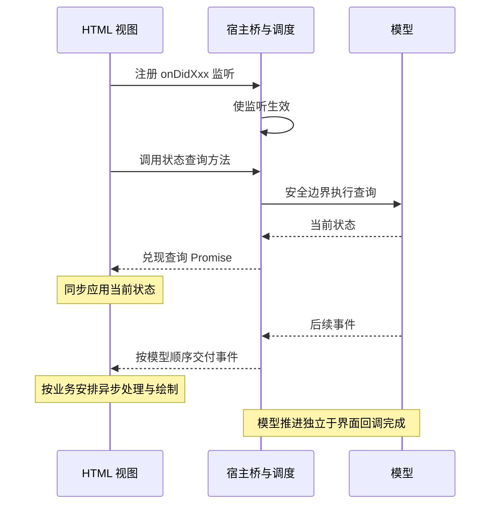

# 融合器件运行时

- Start Date: 2026-11-15
- Reference Issues: [x-botlab/xbotlab#1113](https://github.com/x-botlab/xbotlab/issues/1113)
- Implementation PR: —（尚未实现）

规定统一器件在 2D 编辑、运行和无头执行中的装配、时间推进、事件派发与生命周期。本文是融合合同组的阅读入口，接口为本轮待评审草案；实现状态以头部为准。MUST / MUST NOT 为强制要求，SHOULD 为推荐，MAY 为可选。

## 声明

### 合同与责任

| 合同                                         | 规定内容                               |
| -------------------------------------------- | -------------------------------------- |
| [RFC 0020](./0020-unified-device-package.md) | 单器件清单、ZIP / 解包发布、摘要与资源 |
| [RFC 0021](./0021-device-model-api.md)       | 类型化方法、事件、模型工厂和交付顺序   |
| [RFC 0022](./0022-device-2d-presentation.md) | 静态几何、2D 分层绘制与输入            |
| [RFC 0023](./0023-device-html-ui.md)         | 通用 HTML 视图、侧栏与浮动容器         |
| [RFC 0024](./0024-fused-schematic-format.md) | `.sch v2`、显式连接与依赖锁定          |
| [RFC 0026](./0026-firmware-properties.md)    | 固件来源、属性内地址空间与装载配置     |
| [RFC 0027](./0027-device-type-generation.md) | SDK 类型准备、全局声明与生成配置       |

- 声明模型的器件实例拥有唯一权威模型；当前运行配置选择 `2d` 或 `headless`，模型存活期间保持该选择。
- 2D 场景展示和附加 HTML 视图可同时关联本实例；模型不感知客户端身份或数量。
- 编辑态只挂载展示，不执行模型或接受模型方法；进入运行创建新模型与展示，初始为暂停。
- 运行态有 `running`、`paused`、`faulted` 状态；销毁后为 `disposed`，`faulted` 需要修复并复位。
- 模型决定虚拟状态和事件；展示决定可视内容；宿主决定文档、输入路由、合成和推进时机。
- 3D 扩展沿用 mm、右手系、`y` 向上和正面朝 `+z` 的约定；本组只预留包入口和通用 HTML 合同，3D 文档与绘制 API 后续独立设计。

### 编辑器集成

- 融合编辑器内置属性面板、场景视图、对象列表、HTML 视图侧栏与浮动面板，统一管理选择、聚焦、停靠和布局。
- 接入应用创建编辑器时提供 `viewBaseUrlTemplate` HTML 环境资源 URL 模板；隔离环境、资源代理与视图容器由编辑器内部装配，配置合同见 [RFC 0023](./0023-device-html-ui.md)。
- 一个融合编辑器拥有一份文档快照、一个命令写入口、一套撤销历史、选择与视口，原子修改语义见 [RFC 0024](./0024-fused-schematic-format.md)。
- 文档提交统一驱动几何、连接诊断、对象列表和分层合成；运行时事件只更新展示，不写回持久文档。
- 元件侧栏按实例恢复 `viewLayout`，属性 View 置顶、浮动视图使用属性标题栏 Codicons 按钮；选择与视图切换规则见 [RFC 0023](./0023-device-html-ui.md)。
- 视图布局由编辑器命令写回文档，运行与暂停期间同样允许；布局修改及其撤销只更新容器，不重建模型。
- 编辑属性后重建相关展示；位置、旋转和显示配置只改变合成，模型重建仅发生在明确的运行生命周期边界。
- 保存由宿主消费已提交快照完成；临时拖动预览、位图和模型输出不作为已保存文档内容。

### 固件项目集成

`FirmwareArtifact` 见 [RFC 0026](./0026-firmware-properties.md)，仅包含产物格式和字节。

```ts
interface FirmwareProject {
  readonly id: string;
  readonly title: string;
}
interface FirmwareProjectSource {
  list(): Promise<readonly FirmwareProject[]>;
  resolve(projectId: string): Promise<FirmwareArtifact>;
}
interface FirmwareCodeTemplate {
  readonly id: string;
  readonly title: string;
}
interface FirmwareTemplateSource {
  resolve(templateId: string): Promise<FirmwareCodeTemplate>;
  create(templateId: string): Promise<FirmwareProject | undefined>;
}
interface FirmwareEditorOptions {
  readonly projects?: FirmwareProjectSource;
  readonly templates?: FirmwareTemplateSource;
}
interface FirmwareEditorEvents {
  readonly onDidRequestOpenProject: Event<{ readonly projectId: string }>;
}
```

- 创建编辑器时可传入 `FirmwareEditorOptions.projects`，项目列表项的 `id` 为非空、区分大小写且唯一的稳定身份，`title` 为非空展示名称；读取失败或列表非法时报告 `firmware/project-list-failed` 并保留已保存引用。
- 固件下拉框按 [RFC 0026](./0026-firmware-properties.md) 列举项目与文件；宿主负责项目数据，编辑器负责选择器、图标按钮与展开的装载配置。
- 打开项目的装载配置或准备新运行时，通过 `resolve(projectId)` 获取一个确定产物；构建与产物选择由宿主负责，框架捕获字节并统一解析；复位复用运行快照，不再次请求产物。
- 获取产物失败、项目缺失、返回值格式枚举或字节类型非法时报告 `firmware/project-resolve-failed`，保留引用；解析内容的错误由 [RFC 0026](./0026-firmware-properties.md) 报告，BIN 的空间与基址由编辑器确定。
- `onDidRequestOpenProject` 使用核心 `Event`，订阅返回 Disposable；每次点击按当前值发送一次 `projectId`，宿主订阅并负责打开项目。
- 项目打开请求独立于构建、固件装载和仿真推进，不提交文档修改；编辑、运行和暂停期间均可触发。
- 模板推荐与选择由 [RFC 0026](./0026-firmware-properties.md) 的 `firmware.templates` 规定；宿主通过 `FirmwareEditorOptions.templates` 提供模板解析与项目创建，配置模板来源时 MUST 同时提供项目来源。
- `resolve(templateId)` 校验模板访问权限并返回同一稳定标识和非空标题；模板缺失、不可访问、解析失败或返回结构非法时报告 `firmware/template-resolve-failed`，不阻止其他来源选择与运行准备。
- `create(templateId)` 在创建时重新检查访问权限，成功返回非空稳定 `id` 与非空 `title` 的项目，并使该项目可通过项目来源列举和解析；取消返回 `undefined`，失败或返回项目非法时报告 `firmware/template-create-failed`。
- 模板创建按用户明确操作执行，编辑器在成功后提交项目引用；器件发布、装载、运行准备和虚拟时间推进均不触发模板解析或项目创建。

### 会话与推进

```ts
interface RuntimeState {
  readonly status: 'running' | 'paused' | 'faulted' | 'disposed';
  readonly simTime: TimePs;
}
interface FusedRuntime {
  getState(): RuntimeState;
  readonly onDidChangeState: Event<RuntimeState>;
  readonly onDidReportDiagnostic: Event<{ readonly code: string; readonly message: string }>;
  resume(): Promise<void>;
  pause(): void;
  step(): Promise<void>;
  reset(): Promise<void>;
  dispose(): Promise<void>;
}
```

- `Event` 与 `TimePs` 分别复用 `@mica-js/core/lifecycle` 和 `@mica-js/core`。
- 宿主管理新旧运行环境的异步隔离；公开接口使用所属模型代理与生命周期，隔离标识由宿主内部维护。
- 宿主在运行准备时确定正 `TimePs` 步长，会话内保持不变；时间值遵循 [RFC 0001](./0001-virtual-time.md) 的整数皮秒与取值范围。
- 推进前校验目标虚拟时间；超出核心时间范围时停止推进并明确报告，保持最后合法时间。
- 虚拟时间推进由会话状态与模型执行决定，与界面处理进度解耦。

## 运行时

### 准备与启动

1. 校验文档、锁定包、接口、几何与显式拓扑，准备模型属性资源；2D 同时准备几何声明的底图图片。
2. 创建隔离执行环境与新的展示上下文；2D 解析 `view2d.geometry` 并装配宿主绘制的底图，按可选 `view2d.entry` 创建脚本展示、准备事件监听，模型代理暂不接受调用。
3. 对声明模型的实例加载 `model.entry`，按 `model.methods`、`model.events` 及 `model.types` 校验公共接口，校验 IR 与引脚，创建模型并完成初始求解；无模型实例保持纯展示。
4. 按序交付初始化产生的事件；此时模型已可处理安全边界中的方法。
5. 执行脚本展示提供的 `initialize`，可通过模型方法取得初始显示数据；准备完成后开放用户输入，保持暂停等待运行操作。
6. `resume` 开始固定虚拟步推进；无头模式跳过展示和 HTML，模型按同一初值装配。

- 初始化期间不穿插虚拟推进；展示工厂只准备监听，初始查询在模型就绪后进行。
- 所有工厂阶段登记的监听在宿主确认激活后才创建模型；初始事件按序派发后进入展示初始化回调。
- 准备失败保留文档并明确报告，候选会话全部释放；已有活动会话在替换成功前保持原状。
- 运行期间新增 HTML 先监听、再查询当前状态，按模型产生顺序交付响应与事件；不重建或暂停已有模型等待页面资源。
- 进入运行后按当前单选实例布局自动打开已展开侧栏；切换单选释放原侧栏页面，保留浮动视图；每个新页面独立先监听再查询，不成为虚拟推进屏障。
- 代码在隔离环境执行；控制与资源通信复用 `createRpc`、typed service、既有事件机制及 transfer hooks。
- 安装与资源读取不执行器件业务代码，主编辑环境不导入模型实现。

### 电气装配

- 装配输入复用现行[板级装配合同](../spec/assembly.rst)；声明模型的实例保留文档实例 ID，类型登记到锁定包导出的 `DeviceIR` 与工厂，纯展示实例不进入内核实例列表。
- 加载模型后，在任何模型工厂执行前校验 IR 引脚集合与清单一致；二维几何使用同一组引脚 ID，文档端点的 `pin` 直接对应模型引脚名。
- 按 [RFC 0024](./0024-fused-schematic-format.md) 合并显式连接、普通网标与参考内嵌网名后，含器件引脚的每个网络生成一项内核 `NetDescription`，包含稳定网络 ID 和去重的 `{ instance, pin }` 端点。
- 同网所有参考电压一致时，将该值写入网络的 `voltage`；多个相同约束合为一个，`0` 与 `-0` 视为相同；不同电位在任何模型工厂执行前按 `net/reference-conflict` 拒绝准备。
- 未附加参考的网络省略 `voltage`；未列入装配网络的模型引脚由内核保持独立未连接网络，节点、折点和符号几何只留在文档中。
- 内部电阻支路由模型建立和更新，电阻相连的不同网络保留各自电位；供电、地和多电源域通过普通引脚的显式接线表达。
- 电气求解沿用现行[电气合同](../spec/electrical.rst)；缺少任何固定电位参考的电阻连通分量产生浮空采样，不能隐式接地或解释为逻辑低。

### 每步与事件派发

1. 在安全边界按序处理已接受的方法请求，冻结本步模型输入。
2. 推进一个固定虚拟步，完成电气传播及模型适配器的 `sync`。
3. 按产生顺序向当时活动的监听者交付独立事件快照；显示刷新独立于虚拟步。
4. 按会话状态继续调度下一步，展示回调的异步完成独立于推进。

- 事件粒度、批量发送、业务缓冲及分批查询由器件作者通过 [RFC 0021](./0021-device-model-api.md) 的方法和事件定义。
- 模型方法响应、关闭、复位和暂停操作独立于展示回调的完成。
- 明确的回调异常属于展示故障，按故障流程终止其业务监听；单纯处理缓慢不改变会话状态。
- `faulted` 与 `disposed` 下的推进请求明确拒绝。
- 无头模式按相同虚拟时间规则执行，展示事件按无监听者语义处理。

### 关闭与复位

- 展示移除、HTML 视图关闭或故障时，宿主停止向该环境交付输入并使其模型代理失效；尚未开始的请求拒绝，已完成效果保持。
- 界面交互由场景展示或 HTML 视图直接调用模型方法；关闭界面时宿主清理该环境的资源，模型保留最后已处理的业务状态。
- `pause` 与 `resume` 保留当前模型、展示和监听；暂停中的模型方法不推进时间。
- `step` 只在暂停状态执行一个固定步，完成后仍暂停。
- `reset` 停止推进并创建新的模型与展示，保留实例布局及当前打开 HTML 视图集合，重新运行启动屏障后重建这些页面。
- 退出运行释放 HTML 视图环境并保留文档布局；重新进入运行自动恢复当前单选实例的展开侧栏，浮动视图等待显式打开。
- 退出运行或销毁时释放模型、场景展示、HTML 视图、端口、订阅及位图；每个释放钩子至多调用一次。
- 释放钩子异常逐项报告，宿主继续清理其余资源；会话销毁的 Promise 明确反映清理失败。
- 已替换环境的迟到结果、事件和异步资源由宿主拦截并释放；旧模型代理失效，在途调用以 `model/disconnected` 结束。
- 超时不会撤销已执行方法，框架不自动重试；发生模型故障后不声称已回滚到故障前状态。

## 校验

| 诊断码                             | 行为                                                         |
| ---------------------------------- | ------------------------------------------------------------ |
| `runtime/invalid-time`             | 拒绝非法步长，推进越界时停止并报告                           |
| `runtime/prepare-failed`           | 保留原文档和原会话，报告准备失败                             |
| `runtime/unavailable-state`        | 当前状态不允许请求的推进操作                                 |
| `runtime/model-failed`             | 模型故障，停止推进并等待复位                                 |
| `runtime/presentation-failed`      | 标记界面故障、停输入、释放监听和展示资源；其他界面和模型继续 |
| `firmware/project-list-failed`     | 宿主项目列表读取失败或列表非法，保留引用并显示错误           |
| `firmware/project-resolve-failed`  | 项目产物无法获取或返回结构非法，保留引用并阻止运行准备       |
| `firmware/template-resolve-failed` | 推荐模板无法解析或返回结构非法，显示不可用，其他来源继续可用 |
| `firmware/template-create-failed`  | 项目创建失败或返回项目非法，保留原属性与历史并显示错误       |

### 验收条件

- [ ] 同一按钮模型在 2D 与无头中，对相同虚拟时间输入序列产生相同电气结果。
- [ ] 清单、几何和模型的引脚集合一致；引脚名不匹配及同网参考电压冲突均在任何模型工厂执行前拒绝准备。
- [ ] 四脚轻触开关保留四个外部端子，固定导通和按下连接由模型的有限电阻支路表达；松开移除受控支路并保留固定支路，文档网络不变。
- [ ] 显式接线与同名标签生成内核网络，参考电压转成固定电位；没有固定参考的分量保持浮空，不根据引脚名自动供电。
- [ ] LED 的模型输出直接驱动动态覆盖；隐藏底图、位号与接线不改变模型结果。
- [ ] `view2d.geometry` 可内联或引用 JSON，省略 `view2d.entry` 仍可显示、选择和摆放静态器件；动态覆盖与业务交互按需加载脚本。
- [ ] 编辑器按 `viewBaseUrlTemplate` 创建独立 HTML 环境，使用 `DeviceViewApi` 桥接；`view` 声明的视图可在内置侧栏与浮动面板间切换，并保留页面状态和模型绑定。
- [ ] 相同器件类型的两个实例独立保存 `viewLayout`；调整其中一个实例不改变另一个，切换选择及保存重开后分别恢复侧栏顺序、折叠、高度、停靠位置与浮动矩形，重开不自动创建浮动页面。
- [ ] 运行期间调整和撤销视图布局不重建模型；复位重建已打开 HTML 视图并保留布局，退出运行后布局仍保存在文档中。
- [ ] 固件只使用一个混合来源下拉框；选中项目时显示打开按钮，点击仅通知宿主；文件值隐藏打开项目按钮，项目列表失败或项目缺失保留引用并显示错误。
- [ ] 固件属性按 `templates` 展示推荐模板；模板缺失或无权限不阻止其他来源使用，创建成功保存项目引用，取消或失败保留原值，撤销选择保留宿主已创建的项目。
- [ ] 宿主项目服务只返回确定产物的格式和字节；BIN 在编辑器配置空间与基址，HEX 可选空间且保留数值地址，ELF 按装载段唯一匹配空间，展开不修改文档。
- [ ] 固件解析成只读分段镜像后交付模型工厂，DDL 不接收复合固件属性；运行面板展示当前会话镜像，后续构建不替换它，复位沿用相同内容。
- [ ] 先注册的监听在查询前生效，查询之后的状态事件不会被旧快照覆盖；二进制快照互不影响。
- [ ] `mica prepare` 生成 `.mica` 全局类型环境，监听和构建复用准备流程；模型按事件名 `.fire`，客户端使用核心 `Event<ModelEvent<T>>`，载荷与方法签名由清单生成。
- [ ] 异步事件回调可等待模型方法响应；历史记录查询与实时事件按业务游标去重。
- [ ] 界面回调返回未完成 Promise 时，模型仍可继续推进；串口数据由模型缓冲并按业务接口分批读取。
- [ ] 2D 通过按下、松开和移动处理交互，HTML 使用自身 DOM 事件；均直接调用模型方法，模型上下文没有客户端标识。
- [ ] 指针取消、意外丢失捕获和失焦各结束当前序列且至多交付一次归一化松开；随后丢失捕获不重复松开，关闭展示不补发业务输入或重置模型动作。
- [ ] 复位后旧代理失效、迟到结果不影响新模型或展示，HTML 视图重建，无自动方法重试。
- [ ] 细脚距封装在缩放与旋转后保持精确接线，拖动只更新几何而不重连网络。
- [ ] 内置电源与接地符号按参考记录的类型和朝向绘制，无器件包依赖；网名与电压显式保存，旋转或运行态隐藏符号均不改变电气结果。
- [ ] 符号及内嵌网名作为同一对象选择、复制和删除；删除释放其约束与网名，保留仍有连接的锚点；复制不隐式复制宿主器件，操作均可整体撤销。
- [ ] 同一发布从 ZIP、目录和 Web 读取的文件字节一致；2D 不读取 3D 资源。

## 示例



## 范围

- 本组合同按 [RFC 0020](./0020-unified-device-package.md) 与 [RFC 0024](./0024-fused-schematic-format.md) 的融合器件身份、包结构和文档版本规则加载资产。
- 器件工厂、方法和事件由 [RFC 0021](./0021-device-model-api.md) 规定，场景与 HTML 外观分别由 [RFC 0022](./0022-device-2d-presentation.md)、[RFC 0023](./0023-device-html-ui.md) 规定。

## 关联

- [RFC 0018](./0018-canvas-runtime.md)：既有分离画布装配合同；本组建立统一器件的新运行合同，既有实现不因本文发布而视为已迁移。
