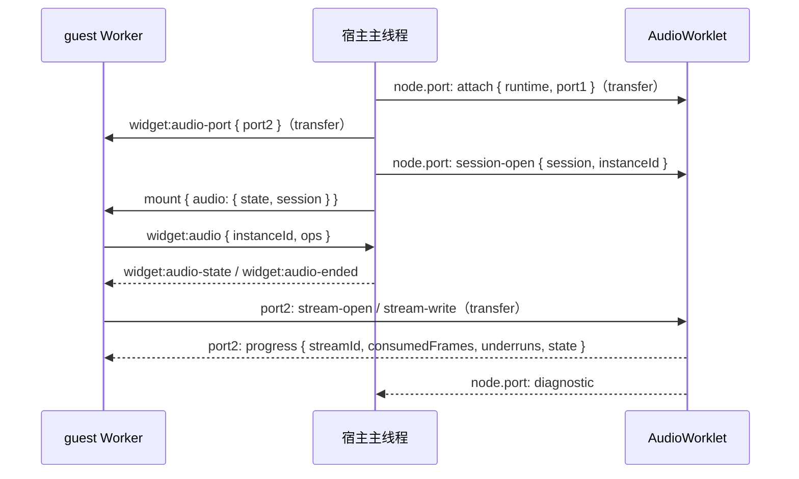

# Widget 音频 API

> **实现**：尚未实现（`packages/widget/src` 中无音频运行时）
> **相关**：[Widget JavaScript API](./widget-js-api.md) · [话题端口](./topic-ports.md) · [属性定义](./device-properties.md)

在 [Widget JavaScript API](./widget-js-api.md)之上增加实例级音频能力 `api.audio`：片段播放、振荡器与 PCM 流。Widget 在沙箱 guest 中只提交音频指令与样本，宿主负责解码、重采样、混音与播放，与「guest 离屏绘制 + 宿主合成」的画面模型对称。

数据通路只使用 `postMessage` + transferable，不使用 `SharedArrayBuffer` / `Atomics`。PCM 流经宿主下发的 `MessagePort` 从 guest Worker 直连 `AudioWorklet`，不经宿主主线程中继；背压通过 worklet 直接回传的累计消费帧数（信用）实现。

音频能力不需要在 [Widget 定义](./widget-definition.md)中声明，可用性只由宿主配置决定。

## 设计约束

| 约束                   | 结论                                                                             |
| ---------------------- | -------------------------------------------------------------------------------- |
| guest 无音频设备       | 发声全部在宿主的 `AudioContext` 中完成，guest 只发送指令与样本                   |
| 无 `SharedArrayBuffer` | guest → `AudioWorklet` 使用 transferable `ArrayBuffer`；流控用回传的累计消费帧数 |
| guest 不可信           | 宿主与 worklet 独立执行容量、格式、取值与配额检查，guest 侧检查只给作者同步反馈  |
| 宿主主线程可能卡顿     | PCM 数据与流控消息走 Worker ↔ worklet 直连端口，主线程卡顿不影响供数             |
| 不改动沙箱协议         | 使用 `widget:` 命名空间事件；`MessagePort` 作为 transferable 下发                |
| 尚无仿真时钟接入       | v1 采用实时语义：按接收顺序尽快播放                                              |

## 上下文接口

| 接口                                 | 职责                                   |
| ------------------------------------ | -------------------------------------- |
| `api.audio.state`                    | 当前音频可用状态                       |
| `api.audio.onStateChange(listener)`  | 监听状态变化，返回取消函数             |
| `api.audio.play(reference, options)` | 播放已预取的音频资源，返回声部句柄     |
| `api.audio.tone(options)`            | 创建持续振荡器，返回可调参数的声部句柄 |
| `api.audio.createStream(options)`    | 创建 PCM 流，返回流句柄                |

所有方法同步返回；句柄 ID 由 guest 分配，指令在同一 tick 内按调用顺序批量提交给宿主。参数非法属于实现错误，同步抛出；运行期失败（解码失败、配额、设备错误）异步体现在句柄状态与诊断中，不抛给调用方。

## 音频状态

| 状态          | 含义                                                            |
| ------------- | --------------------------------------------------------------- |
| `unavailable` | 宿主未配置音频，或环境不支持（非安全上下文、无 `AudioWorklet`） |
| `suspended`   | 宿主音频已配置但 `AudioContext` 未运行（等待用户手势或被挂起）  |
| `running`     | 正在输出                                                        |

- `unavailable` 时全部方法仍可调用并返回有效句柄：声部的 `ended` 以 `unavailable` 结束，流的 `write` 返回 `false`。
- `suspended` 期间：`play` 的一次性片段直接丢弃（`ended` 以 `dropped` 结束）；`tone` 保留参数，恢复后开始发声；PCM 流照常接收数据直至缓冲满，恢复后从缓冲起点播放。
- 初值通过 `api.audio.state` 读取，状态变化按发生顺序串行通知。

## 片段播放

```javascript
const voice = api.audio.play(api.props.clickSound, { volume: 0.4 });
voice.ended.then(({ reason }) => {
  /* finished | stopped | dropped | error | unavailable | disposed */
});
```

- `reference` 必须是挂载时已预取的资源引用（沿用 `api.assets` 的预取规则，形如 `{ src, mode }`）。宿主用预取得到的字节解码，字节不在 guest 与宿主之间往返。
- 解码结果按引用在宿主缓存；格式支持取决于浏览器 `decodeAudioData`（WAV、MP3、Ogg 等）。
- 未预取或解码失败：`ended` 以 `error` 结束，并按实例与来源首次上报 `widget/audio-failed`，实例继续运行。
- `loop: true` 时循环直到 `stop()`；`rate` 改变播放速度与音高。

## 振荡器

```javascript
const beep = api.audio.tone({ type: 'square', frequency: 2700, volume: 0 });
beep.set({ volume: 0.5 }, { rampMs: 5 });
beep.set({ frequency: 1800 });
beep.stop({ fadeMs: 10 });
```

- 振荡器持续存在直到 `stop()` 或实例卸载；音量为 `0` 时仍占用声部配额。
- `set()` 按调用顺序生效；`rampMs` 为参数平滑过渡时间，默认 `0` 时由宿主施加不可感知的最小平滑以避免爆音。
- 只传递参数，不传递样本；方波等波形由宿主带限合成，无混叠、无接缝。

## PCM 流

```javascript
const stream = api.audio.createStream({ sampleRate: 22050, channels: 1, format: 's16' });
const ok = stream.write(samples); // Int16Array；缓冲不足时返回 false 并整块丢弃
```

### 创建参数

| 字段         | 类型   | 合法值                | 默认值 | 含义                                  |
| ------------ | ------ | --------------------- | ------ | ------------------------------------- |
| `sampleRate` | number | `8000`–`96000` 的整数 | 必填   | 源采样率，单位 Hz                     |
| `channels`   | number | `1`、`2`              | `1`    | 声道数，多声道样本交错存放            |
| `format`     | string | `s16`、`f32`          | `f32`  | 分别对应 `Int16Array`、`Float32Array` |
| `bufferMs`   | number | `50`–`2000`           | `500`  | 宿主侧最大缓冲时长，决定容量          |
| `startMs`    | number | `0`–`bufferMs`        | `50`   | 起播与欠载后重新起播前需积累的时长    |
| `volume`     | number | `0`–`1`               | `1`    | 流音量                                |

`capacityFrames = ceil(bufferMs × sampleRate / 1000)`，`startFrames` 同理；一帧为一个采样时刻的全部声道样本。

### 写入

- `write(samples)` 接受与 `format` 匹配的类型化数组，长度为声道数的正整数倍，帧数不超过 `capacityFrames`。
- 写入范围是视图覆盖的元素范围；`write` 返回前捕获副本，调用方保留原缓冲区所有权（与 `publish` 的字节语义一致）。副本的 `ArrayBuffer` 经直连端口 transfer 给 worklet，全程只有这一次复制。
- **整块接纳或整块丢弃**：`bufferedFrames + 帧数 > capacityFrames` 时返回 `false`，不入队、不截断，`dropped` 计数加一；否则返回 `true`。返回 `true` 只表示已接纳，不表示已播放。
- 样本按写入顺序连续播放，中间没有隐式间隙；源采样率由 worklet 重采样到设备采样率，不改变时长与音高。
- `f32` 样本超出 `[-1, 1]` 时由宿主钳位，非有限值按 `0` 处理。

### 流控

worklet 维护每条流的累计消费帧数 `consumedFrames`，以约 20 ms 的间隔（以及状态变化时）经直连端口回传给 guest。guest 维护累计已接纳帧数 `writtenFrames`：

```text
bufferedFrames = writtenFrames − consumedFrames（最近一次回传值）
```

- 在途数据计入 `bufferedFrames`，因此 guest 估计值不小于真实缓冲量。
- worklet 独立执行容量检查作为安全边界：到达时超出容量的数据块整块丢弃，并按实例首次上报 `widget/audio-limit`。
- `clear()` 丢弃尚未播放的数据，被丢弃的帧计入 `consumedFrames`，保持累计算术一致。
- `onDrain(listener)` 在 `bufferedFrames` 降到 `capacityFrames / 2` 及以下时触发一次。

### 状态与统计

| 状态        | 含义                                   |
| ----------- | -------------------------------------- |
| `buffering` | 已缓冲帧数不足 `startFrames`，输出静音 |
| `playing`   | 正在输出                               |
| `ended`     | `end()` 后已播放完剩余数据             |
| `closed`    | 已关闭，不再接受写入                   |

- 初始为 `buffering`；达到 `startFrames` 后进入 `playing`，`startMs: 0` 时首块数据到达即播放。
- 欠载时输出静音补齐，`underruns` 加一并回到 `buffering`；不做时间伸缩，不回放旧数据。
- `end()` 播放完剩余数据后进入 `ended`，`ended` Promise 以 `finished` 结束；剩余数据不足 `startFrames` 时仍直接播放。
- `close()` 立即停止并丢弃剩余数据，`ended` 以 `stopped` 结束。`end()`、`close()` 幂等；关闭后 `write` 返回 `false`。
- `bufferedFrames`、`underruns`、`dropped`、`state` 为 guest 侧只读快照；`onStatus(listener)` 在状态或 `underruns` 变化时通知。

## 重采样

PCM 流由 worklet 转换到 `AudioContext.sampleRate`，采用带限插值：

- 源采样率等于设备采样率时直通，不经过滤波；`s16` 按 `sample / 32768` 转为浮点。
- 采样率不同时使用加窗 sinc 多相插值：Kaiser 窗、每侧 16 个零交叉（32 抽头），相位表不少于 256 相，相位之间对系数线性插值；截止频率取 `0.45 × min(源采样率, 设备采样率)`，阻带衰减不低于 80 dB。上、下采样使用同一套规则，下采样同时完成抗混叠。
- 转换比例固定为 `sampleRate / AudioContext.sampleRate`，不做自适应漂移补偿：源数据不是独立时钟，供数节奏由背压驱动。
- 滤波器群延迟为较低一侧采样率下的 16 个样本（22050 Hz → 48000 Hz 约 0.73 ms），计入播放延迟，不计入 `bufferedFrames`。
- 起播、欠载后恢复与 `clear()` 时重置滤波器历史；欠载起止处施加约 2 ms 的淡出、淡入。
- 片段由 `decodeAudioData` 转换到设备采样率，`rate` 由 `AudioBufferSourceNode.playbackRate` 实现；振荡器使用浏览器带限 `OscillatorNode`。两者不经过 worklet 重采样。

## 数据通路

音频指令分两条通路：低频的声部控制经宿主主线程，PCM 流经 Worker ↔ worklet 直连端口。



- 宿主为每个 guest 运行时创建一个 `MessageChannel`：`port1` 经 `AudioWorkletNode.port` transfer 给 worklet，`port2` 经 `widget:audio-port` transfer 给 guest；音频不可用时不下发端口。
- 端口在首个实例挂载前下发；guest 在端口到达前产生的流指令按顺序暂存，暂存量受各流容量约束。
- 流指令 `stream-open`、`stream-write`、`stream-clear`、`stream-volume`、`stream-end`、`stream-close` 及回传的 `progress`、`stream-ended` 全部走直连端口。PCM 只在 guest 写入时复制一次，此后一路 transfer，宿主主线程不接触样本。
- 同一端口上的消息保持顺序；声部指令与流指令分属两条通路，彼此之间不保证相对顺序，各自内部保持调用顺序。

### 挂载会话

- 宿主为每次挂载生成一次性会话令牌 `session`，先经 `node.port` 在 worklet 登记，再随 `mount` 请求交给 guest；guest 打开流时携带该令牌。
- worklet 只接受已登记令牌的 `stream-open`；实例卸载时宿主撤销令牌，worklet 关闭该会话的全部流并回传 `stream-ended { reason: 'disposed' }`。
- 令牌不复用，卸载后迟到的消息被丢弃；同一 `instanceId` 重新挂载也不会串流。
- 令牌只区分挂载代次，不构成同一 guest 内 widget 之间的隔离。

### 声部控制与混音

- guest → 宿主：`widget:audio`，每个 tick 一批 `{ instanceId, ops }`，`ops` 按调用顺序包含 `play`、`tone`、`set`、`volume`、`stop`。
- 宿主 → guest：`widget:audio-state`（状态变化）、`widget:audio-ended`（声部结束）；`mount` 请求携带初始状态，工厂执行时即可同步读取 `api.audio.state`。
- 片段使用 `AudioBufferSourceNode`，振荡器使用 `OscillatorNode`，经每实例一个 `GainNode` 汇入主增益节点。
- 全部 PCM 流在同一个 `AudioWorkletNode` 内混音，实例音量与静音由宿主经 `node.port` 下发并在 worklet 内按会话施加，输出汇入主增益节点后接入 `destination`。
- worklet 对来自 guest 的每条消息独立校验（令牌、流归属、格式、容量、配额），诊断经 `node.port` 交给宿主上报。

## 配额

| 项                                      | 上限             | 超出时                                                                     |
| --------------------------------------- | ---------------- | -------------------------------------------------------------------------- |
| 每实例同时存在的声部（`play` + `tone`） | 8                | 结束最早创建的声部（`ended` 以 `dropped` 结束），上报 `widget/audio-limit` |
| 每实例同时打开的 PCM 流                 | 4                | `createStream` 返回已关闭的流，上报 `widget/audio-limit`                   |
| 单条流缓冲                              | `capacityFrames` | `write` 返回 `false`                                                       |

宿主可通过选项收紧上述上限；`widget/audio-limit` 按实例与类别只上报一次。

## 生命周期

1. 工厂执行期间即可创建句柄；指令在工厂返回后的首个批次提交。
2. 实例卸载时宿主同步停止该实例全部声部，并撤销会话令牌使 worklet 关闭其全部流；guest 侧句柄 `ended` 以 `disposed` 结束，widget 无需在 `dispose` 中手动清理。
3. 关闭后的句柄方法为空操作，`write` 返回 `false`，不抛出异常。
4. sandbox 终止时宿主停止全部声部，通知 worklet 解除该运行时的直连端口并丢弃其全部流；新 sandbox 获得新端口。
5. `host.dispose()` 断开并释放宿主创建的音频节点与 worklet；`AudioContext` 由调用方持有，宿主不关闭它。
6. 回调（`onStateChange`、`onDrain`、`onStatus`）与其他实例回调串行执行，抛错按 `widget/deliver-failed` 处理。

## 宿主接口

```typescript
const audioContext = new AudioContext();
const host = createWidgetHost({
  provider,
  assets,
  audio: { context: audioContext }, // 可选；省略时 api.audio.state 为 'unavailable'
});

host.audio.setMuted(true);
host.audio.setInstanceVolume(instanceId, 0.5);
host.audio.suspend(); // 冻结全部实例音频（例如仿真暂停），流缓冲保留
host.audio.resume();
```

- `destination` 可选，默认 `context.destination`，便于宿主接入自己的总线或录音节点。
- worklet 模块由宿主以 blob URL 加载：宿主 CSP 的 `script-src` 需要放行 `blob:`；`AudioWorklet` 要求安全上下文（HTTPS 或 localhost）。worklet 加载失败时音频状态为 `unavailable`，并上报 `widget/audio-failed`。
- 用户手势解锁（`audioContext.resume()`）由宿主页面负责。
- `host.audio.suspend()` 不挂起调用方的 `AudioContext`：宿主停止一次性片段、静音振荡器，并令 worklet 暂停消费（输出静音、保留缓冲、停止回传进度）；期间 widget 观察到 `suspended`，`resume()` 后流从保留的缓冲继续播放。

## 时间语义

v1 为实时语义：指令到达宿主后尽快执行，PCM 按接纳顺序连续播放，与仿真时间无关。

接入仿真时钟后的扩展方向：`play` / `tone` / `set` 增加 `at?: simTime`，`write` 增加起始 `simTime`；宿主维护虚拟时间到 `AudioContext.currentTime` 的映射与抖动缓冲。仿真暂停时宿主调用 `host.audio.suspend()`，与固定步长计算一并冻结。

## 示例

### 蜂鸣器

```javascript
export default function buzzer(api) {
  let on = false;
  const tone = api.audio.tone({ type: 'square', frequency: api.props.frequency, volume: 0 });

  api.subscribe('on', (value) => {
    on = value;
    tone.set({ volume: on ? api.props.volume : 0 }, { rampMs: 5 });
    api.invalidate();
  });
  api.subscribe('frequency', (hz) => tone.set({ frequency: hz }));

  return {
    render(ctx) {
      ctx.fillStyle = on ? '#FFAA00FF' : '#444444FF';
      ctx.fillRect(0, 0, api.width, api.height);
    },
  };
}
```

### 扬声器：消费器件 PCM 话题

器件端口 `pcm` 为 `bytes`，布局在器件定义中写明：`s16` 小端、单声道、22050 Hz、每条消息约 10 ms。

```javascript
export default function speaker(api) {
  const stream = api.audio.createStream({
    sampleRate: 22050,
    channels: 1,
    format: 's16',
    bufferMs: 300,
  });

  api.subscribe('pcm', (bytes) => {
    const view = new DataView(bytes.buffer, bytes.byteOffset, bytes.byteLength);
    const samples = new Int16Array(bytes.byteLength >> 1);
    for (let i = 0; i < samples.length; i += 1) samples[i] = view.getInt16(i * 2, true);
    stream.write(samples); // false 表示宿主缓冲已满，该块被丢弃
  });

  return {};
}
```

### 合成器：拉取式写入

```javascript
export default function synth(api) {
  const sampleRate = 48000;
  const stream = api.audio.createStream({ sampleRate, format: 'f32', bufferMs: 200, startMs: 40 });
  let phase = 0;

  const fill = () => {
    const frames = Math.floor(stream.capacityFrames - stream.bufferedFrames);
    if (frames <= 0) return;
    const block = new Float32Array(frames);
    for (let i = 0; i < frames; i += 1) {
      block[i] = 0.2 * Math.sin(phase);
      phase += (2 * Math.PI * 440) / sampleRate;
    }
    stream.write(block);
  };

  stream.onDrain(fill);
  fill();
  return {};
}
```

## 诊断

| `code`                | 场景                                                                       |
| --------------------- | -------------------------------------------------------------------------- |
| `widget/audio-failed` | 资源未预取或解码失败、worklet 加载失败、音频设备错误；按实例与来源首次上报 |
| `widget/audio-limit`  | 超出声部或流配额，或宿主丢弃了超出容量的数据块；按实例与类别首次上报       |

欠载是正常运行现象，只体现在 `underruns` 统计中，不产生诊断。

## 校验

1. 资源引用为有效对象且 `src` 为非空字符串，否则同步抛出 `TypeError`。
2. `volume` 为 `[0, 1]`，`rate` 为 `[0.25, 4]`，`frequency` 为 `(0, 24000]`，`rampMs`、`fadeMs` 为 `[0, 10000]` 的有限数；类型错误抛出 `TypeError`，越界或非有限值抛出 `RangeError`。
3. `type` 只取 `sine`、`square`、`triangle`、`sawtooth`；`format` 只取 `s16`、`f32`；`channels` 只取 `1`、`2`；其他值抛出 `RangeError`。
4. `sampleRate` 为 `8000`–`96000` 的整数，`bufferMs` 为 `[50, 2000]`，`startMs` 为 `[0, bufferMs]`，否则抛出 `RangeError`。
5. 选项对象为非 null、非数组的普通对象；未知字段或显式 `undefined` 抛出 `TypeError`。
6. `write` 的参数类型与 `format` 不匹配时抛出 `TypeError`；长度为 `0`、不是声道数整数倍或超过 `capacityFrames` 时抛出 `RangeError`。
7. 监听参数必须为函数，否则抛出 `TypeError`。
8. 宿主与 worklet 对来自 guest 的全部指令重新校验（直连端口上的流指令由 worklet 校验），非法指令丢弃并上报 `widget/audio-failed`。

## 范围

本规范不包含：麦克风或音频输入；效果器、空间音频、滤波器链与向 guest 暴露 Web Audio 节点图；guest 侧解码与 `SharedArrayBuffer` 环形缓冲；与仿真时间的精确对齐；新增话题载荷类型（PCM 继续使用 `bytes`，布局由器件定义写明）。
