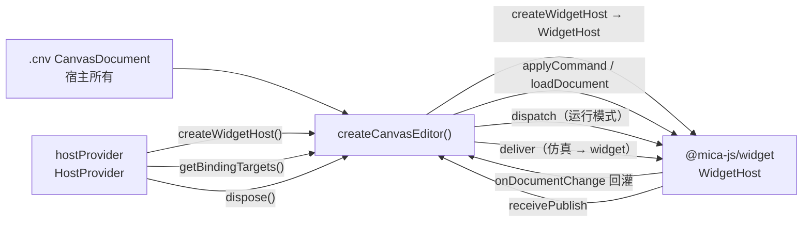
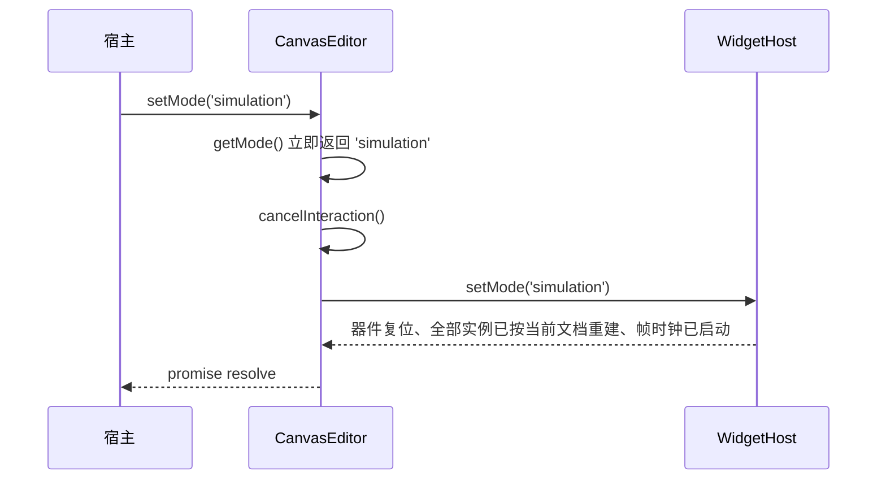

# @mica-js/canvas-editor

画布编辑器：把 `@mica-js/core/canvas` 的 `.cnv` 文档与 `WidgetLayers` 的位图合成到一块 Canvas 上，并把用户操作翻译成 `CanvasCommand`。它同时把命令交给 `WidgetHost`、把提交后的快照回灌，并把 widget 发布按绑定反查。

编辑器只负责**呈现**、**交互**与**宿主协调**。属性面板、绑定面板、组件插入面板与持久化都由宿主实现。

## 架构



## 边界

编辑器**不持有文档、不修改文档、不自己拼装宿主**：

- 文档由宿主传入；命令经 `host.applyCommand()` 应用后，宿主再把新快照回灌编辑器。
- 编辑模式只产出 `CanvasCommand`（`set-placement` / `remove-instance`），并在内部交给宿主。
- 运行模式只把命中实例的输入通过 `host.dispatch()` 转发，不产生任何命令。
- widget 的挂载、帧生成与 sandbox 生命周期属于 `@mica-js/widget` 的 `WidgetHost`；layers 由 `host.getLayers()` 提供。
- 宿主怎么创建属于应用：编辑器只向 `HostProvider` 要一个 `WidgetHost`，并在 `dispose()` 时把 provider 交回去释放。`SandboxHostProvider` 是本包给出的沙箱实现。
- 视口与选择是编辑器状态，**不写入文档**。

## 安装

```bash
pnpm add @mica-js/canvas-editor @mica-js/core @mica-js/widget
```

编辑器**不注入样式**：用一个显式的样式导入把画布容器与画布元素的样式交给应用打包器，什么时候加载、是否裁剪都由宿主决定。

```ts
import '@mica-js/canvas-editor/style.css';
```

使用 `SandboxHostProvider` 时还需要 `@mica-js/sandbox`：Provider 默认用 `@mica-js/simulator` 与 `@mica-js/widget` 自带的 guest 工厂创建两个 sandbox worker，负责设备 RPC、widget host 和两者之间的直连端口。只有应用要自带设备 guest（例如自己的器件库）时，才需要 `@mica-js/sandbox/vite` 插件与 `?sandbox-worker`。

## 快速上手

```ts
import '@mica-js/canvas-editor/style.css';
import { createCanvasEditor, type CanvasEditor } from '@mica-js/canvas-editor';
import { SandboxHostProvider } from '@mica-js/canvas-editor';
import { parseCanvas } from '@mica-js/core/canvas';

let editor: CanvasEditor | undefined;

// 1. provider 默认用包内 guest 工厂；要自带器件库时才提供 getSandboxWorker。
const hostProvider = new SandboxHostProvider({
  fs: { read: (uri) => fetchBytes(uri) }, // RFC 0019 的 HostFs
  widgetProvider, // RFC 0014 的 WidgetProvider
});

// 2. 工厂 = `new CanvasEditor(options)` + `await editor.ready`：
//    provider 建好宿主、宿主接受文档之后才 resolve。
editor = await createCanvasEditor({
  container: document.querySelector('#host')!,
  document: parseCanvas(cnvText), // 已解析的 CanvasDocument
  hostProvider,
  onChange: (document) => persist(document), // 每次提交后持久化 `.cnv`
  onSelectionChange: (ids) => renderInspector(ids),
  onDiagnostic: (diagnostic) => console.warn(diagnostic.code, diagnostic.message),
});

// 3. 绑定面板要的端点由编辑器代问 provider，不需要自己拿 device host。
const targets = await editor.getBindingTargets(); // symbol / designator / port / direction / type

// 4. 仿真时间与器件发布仍在 provider 建出的 device host 上。
const deviceHost = hostProvider.deviceHost; // await editor.ready 之后一定存在
editor.setMode('simulation');
editor.deliver({ symbol: 'mcu', port: 'value' }, '12.34', simTime);
const off = editor.onPublish((target, payload, simTime) => route(target, payload, simTime));
// 卸载：editor.dispose() 同时释放 provider 建出的 widget host 与 device host（含两个 sandbox）
await editor.dispose();
```

需要音频时，在工厂参数中提供 `getAudioWorklet`。编辑器按需创建并拥有 `AudioContext`，`@mica-js/widget` 已经把内置 worklet 做成工厂，直接用即可；销毁编辑器时编辑器关闭自己创建的上下文：

```ts
import { createWidgetAudioWorklet } from '@mica-js/widget';

editor = await createCanvasEditor({
  container,
  document: parseCanvas(cnvText),
  hostProvider,
  getAudioWorklet: createWidgetAudioWorklet,
});
```

自带 `AudioWorkletProcessor` 时按同样签名传自己的回调（`?audio-worklet` 是给自定义 worklet 准备的查询）：

```ts
import audioWorkletUrl from './audio/worklet.ts?audio-worklet';

editor = await createCanvasEditor({
  container,
  document: parseCanvas(cnvText),
  hostProvider,
  getAudioWorklet: async (context) => {
    await context.audioWorklet.addModule(audioWorkletUrl);
    return new AudioWorkletNode(context, 'mica-widget-audio');
  },
});
```

`container` 需要有确定的尺寸：编辑器把 root 撑满容器，并按 `devicePixelRatio` 放大画布。

## 工厂与类

`createCanvasEditor(options: CanvasEditorOptions): Promise<CanvasEditor>` 是便利入口：它构造
`CanvasEditor`、等 `ready` 落定后把已挂载的实例交回来；provider 建不出宿主或宿主拒绝 `document` 时 promise 以那个错误 reject，容器上不会挂任何东西。选项对象就是下面的 `CanvasEditorOptions`，类和工厂接受同一份契约。

`CanvasEditor` 本身也是公开的：需要**在 provider 建宿主 / 宿主装载期间就能销毁**编辑器时（例如 React effect 在
`ready` 落定前被清理），直接 `new CanvasEditor(options)`，构造是同步的，然后再 `await editor.ready`
并按需 `dispose()`。

## 构造选项

`CanvasEditorOptions`（`CanvasEditor` 构造器与 `createCanvasEditor` 共用）：

| 选项                | 说明                                                                        |
| ------------------- | --------------------------------------------------------------------------- |
| `container`         | 必填；编辑器只往里 append 自己的 root，并设置 `touch-action: none`          |
| `document`          | 必填；已解析的 `.cnv` 快照，编辑器先交给 `hostProvider` 建出的宿主          |
| `hostProvider`      | 必填；`HostProvider`，`ready` 期间向它要 `WidgetHost`，`dispose()` 时释放它 |
| `mode`              | `'edit'`（默认）或 `'simulation'`；首次装载文档前同步宿主模式               |
| `onChange`          | 每次宿主提交快照后调用，宿主据此持久化 `.cnv`                               |
| `onSelectionChange` | 选择变化（含宿主 `setSelection()` 触发的变化）                              |
| `onDiagnostic`      | `CanvasEditorDiagnostic`：渲染、输入、协调与回调抛出的问题都在这里上报      |
| `theme`             | `Partial<CanvasTheme>`，默认深色（`gridSize <= 0` 表示不画网格）            |

## 实例成员

| 成员                      | 说明                                                                               |
| ------------------------- | ---------------------------------------------------------------------------------- |
| `ready`                   | `Promise<void>`：provider 建好宿主、宿主接受 `document` 且编辑器已挂载后才 resolve |
| `getDocument()`           | 编辑器当前绘制的快照；命令或文档装载提交前引用不变                                 |
| `applyCommand(command)`   | 把一条 `CanvasCommand` 交给宿主；宿主拒绝时上报 `command-failed`，快照不变         |
| `loadDocument(document)`  | 装载新文档并绘制宿主提交的快照；不存在的选择 id 被丢弃，失败时保留旧文档           |
| `getBindingTargets()`     | 已装载原理图的绑定端点（`CanvasBindingTargetInfo[]`），由 provider 代查            |
| `getMode()`               | 当前模式（调用 `setMode` 后立即更新，不等重置完成）                                |
| `setMode(mode)`           | 切换模式并重置全部 widget；回到相同模式直接 resolve，不重置                        |
| `setSelection(ids)`       | 设置选择；文档里不存在的 id 会被丢弃，变化时触发 `onSelectionChange`               |
| `cancelInteraction()`     | 取消进行中的拖动 / 缩放 / 旋转 / 平移，几何回到交互前                              |
| `getState()`              | `{ mode, selection, viewport }`                                                    |
| `deliver(target, …)`      | 把载荷投递到**所有**绑定该端点的实例；`ready` 之前调用会被丢弃                     |
| `onPublish(listener)`     | 收到 `(target, payload, simTime)`；返回取消订阅函数                                |
| `receivePublish(publish)` | 接收宿主 `onPublish` 转发来的 `WidgetPublish`，无绑定时上报诊断                    |
| `focus()`                 | 把键盘焦点交还画布                                                                 |
| `dispose()`               | 同步拆 DOM 与订阅，随后 `dispose()` provider；返回的 promise 从不 reject           |

## 坐标与合成

- 文档坐标是逻辑单位：100 % 缩放下 1 单位 = 1 CSS 像素；`rotation` 为度、顺时针、绕实例中心。
- 画布按 `devicePixelRatio` 放大，绘制变换为 `setTransform(dpr * scale, 0, 0, dpr * scale, dpr * x, dpr * y)`。
- 合成顺序：网格 → 位图（`layers.list()` 顺序；`bitmap === undefined` 的实例画占位框）→ 编辑模式的实例边框 → 选中框 → 手柄。
- 编辑模式给每个实例画一圈半透明边框：透明组件本身画不出东西，没有这圈边框就找不到它的位置。运行模式不画。
- 位图按实例几何绘制：`translate(x + width/2, y + height/2)` → `rotate` → `drawImage(bitmap, -width/2, -height/2, width, height)`。
- 重绘由内部 dirty 标志与单次 `requestAnimationFrame` 合并，**空闲时不调度帧**。

## 交互

### 编辑模式

| 操作                      | 行为                                           |
| ------------------------- | ---------------------------------------------- |
| 单击实例                  | 选中（从最上层开始命中测试，含旋转）           |
| `Shift` / `Ctrl` + 单击   | 加入或移出选择                                 |
| 单击空白                  | 清空选择                                       |
| 拖动选中实例              | 移动；松手时每个实例发一条 `set-placement`     |
| 拖动 8 个手柄             | 缩放；`Shift` 保持宽高比                       |
| 拖动旋转手柄              | 旋转；`Shift` 吸附 15°                         |
| 方向键 / `Shift` + 方向键 | 移动 1 / 10 单位                               |
| `Delete` / `Backspace`    | 每个选中实例一条 `remove-instance`，并清空选择 |
| 滚轮                      | 以指针为锚点缩放（`0.1`–`8`）                  |
| `Shift` + 滚轮            | 横向平移                                       |
| 空格 + 拖动 / 中键拖动    | 平移视口                                       |
| `Cmd/Ctrl + A`            | 全选                                           |

- 按下到移动不超过 3 CSS 像素时仍是点击，不产生位移；拖动过程中的中间几何只存在于预览层。
- 松手坐标即使没有伴随最后一个 `pointermove`（快速甩动），也按松手点提交。
- 手柄只在**单选**时显示；多选只画选中框。
- 命中测试用文档几何（把指针逆变换到实例局部坐标），不读像素。
- 同时按下第二个指针会**放弃**当前手势并忽略该指针，直到第一个指针抬起。

### 运行模式

- 不产生任何命令，选中框与手柄不显示。
- 指针事件命中实例后转发实例局部坐标（已扣除位置与旋转，`(0, 0)` 是实例左上角）。
- 按下期间，按下的实例独占移动与抬起事件；抬起后路由解除，之后的移动重新命中测试，空白处不转发。
- 键盘事件转发给最近一次命中的实例；只有画布持有焦点时才会收到键事件。
- 浏览画布与编辑模式一致：滚轮以指针为锚缩放、`Shift` + 滚轮横向平移、中键或空格 + 左键拖动平移。这些视口操作**不产生命令，也不转发给 widget**（`WidgetInputEvent` 不含滚轮）。
- `CanvasEditor.setMode()` 会先把宿主切到同一模式（内部 `host.setMode()`），再重置 widget；模式相同、宿主已在该模式时退回 `host.reset()`，重复切到当前模式直接 resolve，不重置。

## 与 `WidgetHost` 协作

`CanvasEditor` 从 `hostProvider` 拿宿主，协调逻辑都在类里：

- 编辑产生的命令交给 `host.applyCommand()`；宿主拒绝时上报 `canvas-editor/command-failed`，编辑器继续画旧快照。
- `host.onDocumentChange` 与命令提交后的 `host.getDocument()` 都会回灌快照，靠引用去重，`onChange` 对每次提交只触发一次。
- `deliver(target, payload, simTime)` 按端点把载荷扇出给**所有**绑定该端点的实例；没有命中时什么也不做。
- `onPublish` 用 `instanceId` + 端口反查 `CanvasBindingTarget`；没有绑定时上报 `canvas-editor/unbound-publish`。
- `WidgetHostOptions.onPublish` 只接受一个回调，所以宿主可以用 `(publish) => editor?.receivePublish(publish)` 转发；如果宿主本身提供 `onPublish` 订阅，编辑器会在内部自动接上。
- `HostProvider.getBindingTargets()` 是 provider 为绑定面板保留的窄接口：`SandboxHostProvider` 用自己 device host 的 `getTopics()` 回答，没有器件侧的 provider 返回空数组。编辑器不把宿主交给调用方。

### 应用侧 API

属性面板、绑定面板和文件菜单不需要拿 `WidgetHost`：

- `applyCommand(command)` 把一条 `CanvasCommand` 交给宿主，效果与一次手势提交相同：快照回灌、`onChange` 触发一次。宿主拒绝时只上报 `command-failed`，编辑器继续画旧快照。`ready` 之前与 `dispose()` 之后调用都被丢弃。
- `loadDocument(document)` 把新文档交给 `host.loadDocument()`：原理图先装载，实例挂载完成后 promise 才 resolve。`onChange` 照常触发，新文档里不存在的选择 id 会被丢弃，视口与模式保留。宿主拒绝时 promise reject，宿主与编辑器都保持旧文档。`ready` 落定前调用会先等首次装载；编辑器已 `dispose()` 时什么也不做。
- `getBindingTargets()` 让 provider 报出已装载原理图的端点（`CanvasBindingTargetInfo`：`symbol`、`designator`、`port`、`direction`、`type`），绑定面板据此列出可绑定的端点；`designator` 缺省时回退为 symbol id。它先等 `ready`，`dispose()` 之后返回空数组。

诊断码以 `canvas-editor/` 开头。协调相关的有 `command-failed`（宿主拒绝命令）、`change-failed`（`onChange` 抛错）、`publish-failed`（监听器抛错）、`unbound-publish`（发布端口没有绑定），对应 `CanvasEditorCoordinationDiagnosticCode`；渲染与输入相关的有 `context-unavailable` / `render-failed` / `selection-failed` / `dispatch-failed`，释放相关的有 `dispose-failed`（provider 释放宿主失败，`dispose()` 因此仍不 reject）。全部集中在 `CanvasEditorDiagnostic` 上。

构造是同步的，建宿主与装载文档都是异步的：构造器先建好编辑器状态，把「向 provider 要宿主 → 同步初始模式（默认 `edit`）→ `host.loadDocument(options.document)`」存进 `ready`；编辑模式首次装载时器件保持初始状态，只有仿真模式推进器件时间；宿主接受文档之后才创建 root、绑定输入监听与 `ResizeObserver`，所以 provider 建不出宿主或宿主校验失败时 `ready` reject、容器上不会挂任何东西。`createCanvasEditor()` 只是把这两步合起来：构造 + `await ready`。

### 切换模式的时序



切换模式必须同时切换宿主模式：帧时钟只由宿主持有，`dispatch` 的输入要等到下一个步首才分发，宿主留在编辑模式时仿真既不推进，输入也永远留在队列里。`host.setMode()` 自己会停表、复位器件并重建实例，所以编辑器只在宿主已处于目标模式时才调 `host.reset()`。

重置会丢弃实例并重建工厂实例，所以按键不会停在按下、数码管不会停在最后一个值；模块本身不重新求值，因此 widget 的实例状态要放在工厂闭包里。重置失败时 promise reject，编辑器回退到原模式。选择与视口保持不变（实例 id 未变）。

## 内部结构

| 文件                                | 职责                                                                                                          |
| ----------------------------------- | ------------------------------------------------------------------------------------------------------------- |
| `src/geometry.ts`                   | 命中测试（含旋转）、包围盒、手柄位置、缩放与旋转计算（无 DOM）                                                |
| `src/viewport.ts`                   | `screenToDocument` / `documentToScreen` / 平移 / 缩放与限幅（无 DOM）                                         |
| `src/session.ts`                    | 交互状态机：`idle → pressed → dragging/scaling/rotating/panning`                                              |
| `src/render/grid.ts`                | 网格步长与主 / 次网格线判定（无 DOM）                                                                         |
| `src/render/renderer.ts`            | 网格、位图、选中框与手柄的 Canvas 绘制                                                                        |
| `src/editor/canvas-editor.ts`       | `CanvasEditor` 类（构造/`ready`、DOM 绑定、rAF、命令 ↔ 宿主）与 `createCanvasEditor` 工厂                     |
| `src/host/provider.ts`              | `HostProvider`：编辑器唯一认识的宿主来源                                                                      |
| `src/host/sandbox-host-provider.ts` | `SandboxHostProvider`：device guest → `DeviceSimulationHost` → `WidgetHost`，接好两者间的直连端口，并负责释放 |
| `src/styles/editor.css`             | 编辑器 chrome 样式，构建发布为 `dist/style.css`（由宿主显式 `import '@mica-js/canvas-editor/style.css'`）     |

纯逻辑模块不依赖 DOM，单测跑在 node 环境。
