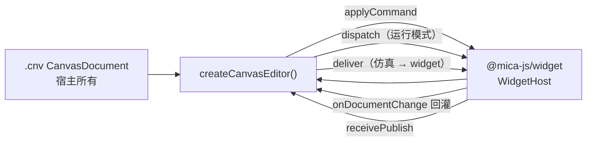
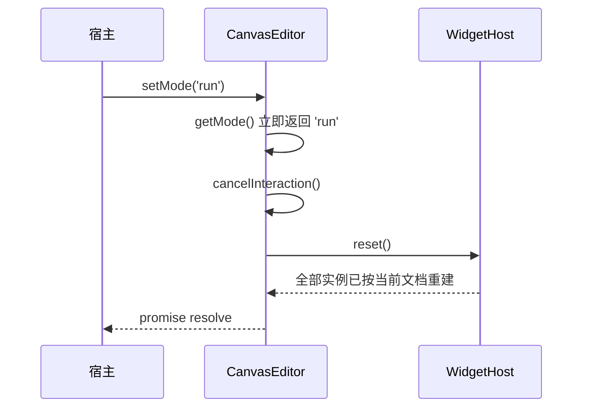

# @mica-js/canvas-editor

画布编辑器：把 `@mica-js/core/canvas` 的 `.cnv` 文档与 `WidgetLayers` 的位图合成到一块 Canvas 上，并把用户操作翻译成 `CanvasCommand`。它同时把命令交给 `WidgetHost`、把提交后的快照回灌，并把 widget 发布按绑定反查。

编辑器只负责**呈现**、**交互**与**宿主协调**。属性面板、绑定面板、组件插入面板与持久化都由宿主实现。

## 架构



## 边界

编辑器**不持有文档、不修改文档、不启动 sandbox**：

- 文档由宿主传入；命令经 `host.applyCommand()` 应用后，宿主再把新快照回灌编辑器。
- 编辑模式只产出 `CanvasCommand`（`set-placement` / `remove-instance`），并在内部交给宿主。
- 运行模式只把命中实例的输入通过 `host.dispatch()` 转发，不产生任何命令。
- widget 的挂载、帧生成与 sandbox 生命周期属于 `@mica-js/widget` 的 `WidgetHost`；layers 由 `host.getLayers()` 提供。
- 视口与选择是编辑器状态，**不写入文档**。

## 安装

```bash
pnpm add @mica-js/canvas-editor @mica-js/core @mica-js/widget
```

## 快速上手

```ts
import { createCanvasEditor, type CanvasEditor } from '@mica-js/canvas-editor';
import { parseCanvas } from '@mica-js/core/canvas';
import { createWidgetHost } from '@mica-js/widget';

let editor: CanvasEditor | undefined;
const host = createWidgetHost({
  provider,
  assets,
  onDiagnostic: (diagnostic) => console.warn(diagnostic.code, diagnostic.message),
  // `WidgetHostOptions.onPublish` 只接受一个回调；转发给编辑器后由它按绑定反查。
  onPublish: (publish) => editor?.receivePublish(publish),
});

editor = await createCanvasEditor({
  container: document.querySelector('#host')!,
  document: parseCanvas(cnvText), // 已解析的 CanvasDocument
  host,
  onChange: (document) => persist(document), // 每次提交后持久化 `.cnv`
  onSelectionChange: (ids) => renderInspector(ids),
  onDiagnostic: (diagnostic) => console.warn(diagnostic.code, diagnostic.message),
});

editor.setMode('run');
editor.deliver({ symbol: 'mcu', port: 'value' }, '12.34', simTime);
const off = editor.onPublish((target, payload, simTime) => route(target, payload, simTime));
// 卸载：editor.destroy() 只拆编辑器与自己的订阅；host.dispose() 由宿主决定
```

`container` 需要有确定的尺寸：编辑器把 root 撑满容器，并按 `devicePixelRatio` 放大画布。

## 挂载选项

| 选项                | 说明                                                                   |
| ------------------- | ---------------------------------------------------------------------- |
| `container`         | 必填；编辑器只往里 append 自己的 root，并设置 `touch-action: none`     |
| `document`          | 必填；已解析的 `.cnv` 快照，编辑器先交给 `host.loadDocument()`         |
| `host`              | 必填；`WidgetHost`，编辑器通过它取 layers、应用命令、分发输入与重置    |
| `mode`              | `'edit'`（默认）或 `'run'`                                             |
| `onChange`          | 每次宿主提交快照后调用，宿主据此持久化 `.cnv`                          |
| `onSelectionChange` | 选择变化（含宿主 `setSelection()` 触发的变化）                         |
| `onDiagnostic`      | `CanvasEditorDiagnostic`：渲染、输入、协调与回调抛出的问题都在这里上报 |
| `theme`             | `Partial<CanvasTheme>`，默认深色（`gridSize <= 0` 表示不画网格）       |

## 返回值

| 成员                      | 说明                                                                    |
| ------------------------- | ----------------------------------------------------------------------- |
| `getDocument()`           | 编辑器当前绘制的快照；命令提交前引用不变                                |
| `getMode()`               | 当前模式（调用 `setMode` 后立即更新，不等重置完成）                     |
| `setMode(mode)`           | 切换模式并重置全部 widget；回到相同模式直接 resolve，不重置             |
| `setSelection(ids)`       | 设置选择；文档里不存在的 id 会被丢弃，变化时触发 `onSelectionChange`    |
| `cancelInteraction()`     | 取消进行中的拖动 / 缩放 / 旋转 / 平移，几何回到交互前                   |
| `getState()`              | `{ mode, selection, viewport }`                                         |
| `deliver(target, …)`      | 把载荷投递到**所有**绑定该端点的实例；没有命中时什么也不做              |
| `onPublish(listener)`     | 收到 `(target, payload, simTime)`；返回取消订阅函数                     |
| `receivePublish(publish)` | 接收宿主 `onPublish` 转发来的 `WidgetPublish`，无绑定时上报诊断         |
| `focus()`                 | 把键盘焦点交还画布                                                      |
| `destroy()`               | 解绑监听、取消订阅、移除 root 并还原容器样式；**不会** `dispose()` 宿主 |

## 坐标与合成

- 文档坐标是逻辑单位：100 % 缩放下 1 单位 = 1 CSS 像素；`rotation` 为度、顺时针、绕实例中心。
- 画布按 `devicePixelRatio` 放大，绘制变换为 `setTransform(dpr * scale, 0, 0, dpr * scale, dpr * x, dpr * y)`。
- 合成顺序：网格 → 位图（`layers.list()` 顺序；`bitmap === undefined` 的实例画占位框）→ 编辑模式的实例边框 → 选中框 → 手柄。
- 编辑模式给每个实例画一圈半透明边框：透明组件本身画不出东西，没有这圈边框就找不到它的位置。运行模式不画。
- 位图按实例几何绘制：`translate(x + width/2, y + height/2)` → `rotate` → `drawImage(bitmap, -width/2, -height/2, width, height)`。
- 重绘由内部 dirty 标志与单次 `requestAnimationFrame` 合并，**空闲时不调度帧**。

## 交互

### 编辑模式

| 操作                      | 行为                                           |
| ------------------------- | ---------------------------------------------- |
| 单击实例                  | 选中（从最上层开始命中测试，含旋转）           |
| `Shift` / `Ctrl` + 单击   | 加入或移出选择                                 |
| 单击空白                  | 清空选择                                       |
| 拖动选中实例              | 移动；松手时每个实例发一条 `set-placement`     |
| 拖动 8 个手柄             | 缩放；`Shift` 保持宽高比                       |
| 拖动旋转手柄              | 旋转；`Shift` 吸附 15°                         |
| 方向键 / `Shift` + 方向键 | 移动 1 / 10 单位                               |
| `Delete` / `Backspace`    | 每个选中实例一条 `remove-instance`，并清空选择 |
| 滚轮                      | 以指针为锚点缩放（`0.1`–`8`）                  |
| `Shift` + 滚轮            | 横向平移                                       |
| 空格 + 拖动 / 中键拖动    | 平移视口                                       |
| `Cmd/Ctrl + A`            | 全选                                           |

- 按下到移动不超过 3 CSS 像素时仍是点击，不产生位移；拖动过程中的中间几何只存在于预览层。
- 松手坐标即使没有伴随最后一个 `pointermove`（快速甩动），也按松手点提交。
- 手柄只在**单选**时显示；多选只画选中框。
- 命中测试用文档几何（把指针逆变换到实例局部坐标），不读像素。
- 同时按下第二个指针会**放弃**当前手势并忽略该指针，直到第一个指针抬起。

### 运行模式

- 不产生任何命令，选中框与手柄不显示。
- 指针事件命中实例后转发实例局部坐标（已扣除位置与旋转，`(0, 0)` 是实例左上角）。
- 按下期间，按下的实例独占移动与抬起事件；抬起后路由解除，之后的移动重新命中测试，空白处不转发。
- 键盘事件转发给最近一次命中的实例；只有画布持有焦点时才会收到键事件。
- 浏览画布与编辑模式一致：滚轮以指针为锚缩放、`Shift` + 滚轮横向平移、中键或空格 + 左键拖动平移。这些视口操作**不产生命令，也不转发给 widget**（`WidgetInputEvent` 不含滚轮）。
- `CanvasEditor.setMode()` 会重置 widget（内部 `host.reset()`）；重复切到当前模式直接 resolve，不重置。

## 与 `WidgetHost` 协作

`createCanvasEditor` 直接接收宿主，协调逻辑都在包内：

- 编辑产生的命令交给 `host.applyCommand()`；宿主拒绝时上报 `canvas-editor/command-failed`，编辑器继续画旧快照。
- `host.onDocumentChange` 与命令提交后的 `host.getDocument()` 都会回灌快照，靠引用去重，`onChange` 对每次提交只触发一次。
- `deliver(target, payload, simTime)` 按端点把载荷扇出给**所有**绑定该端点的实例；没有命中时什么也不做。
- `onPublish` 用 `instanceId` + 端口反查 `CanvasBindingTarget`；没有绑定时上报 `canvas-editor/unbound-publish`。
- `WidgetHostOptions.onPublish` 只接受一个回调，所以宿主可以用 `(publish) => editor?.receivePublish(publish)` 转发；如果宿主本身提供 `onPublish` 订阅，编辑器会在内部自动接上。

诊断码以 `canvas-editor/` 开头。协调相关的有 `command-failed`（宿主拒绝命令）、`change-failed`（`onChange` 抛错）、`publish-failed`（监听器抛错）、`unbound-publish`（发布端口没有绑定），对应 `CanvasEditorCoordinationDiagnosticCode`；渲染与输入相关的有 `context-unavailable` / `render-failed` / `selection-failed` / `dispatch-failed`。全部集中在 `CanvasEditorDiagnostic` 上。

`createCanvasEditor` 是异步的：它先 `await host.loadDocument(options.document)`，再挂载编辑器；宿主校验失败时直接抛出且不挂载。

### 切换模式的时序



重置会丢弃实例并重建工厂实例，所以按键不会停在按下、数码管不会停在最后一个值；模块本身不重新求值，因此 widget 的实例状态要放在工厂闭包里。重置失败时 promise reject，编辑器回退到原模式。选择与视口保持不变（实例 id 未变）。

## 内部结构

| 文件                     | 职责                                                                       |
| ------------------------ | -------------------------------------------------------------------------- |
| `src/geometry.ts`        | 命中测试（含旋转）、包围盒、手柄位置、缩放与旋转计算（无 DOM）             |
| `src/viewport.ts`        | `screenToDocument` / `documentToScreen` / 平移 / 缩放与限幅（无 DOM）      |
| `src/session.ts`         | 交互状态机：`idle → pressed → dragging/scaling/rotating/panning`           |
| `src/render/grid.ts`     | 网格步长与主 / 次网格线判定（无 DOM）                                      |
| `src/render/renderer.ts` | 网格、位图、选中框与手柄的 Canvas 绘制                                     |
| `src/editor/mount.ts`    | `createCanvasEditor`：DOM 绑定、rAF 调度、命令 ↔ 宿主、端口投递 / 发布反查 |
| `src/styles.ts`          | 注入的 `<style>`（画布容器与画布元素）                                     |

纯逻辑模块不依赖 DOM，单测跑在 node 环境。
