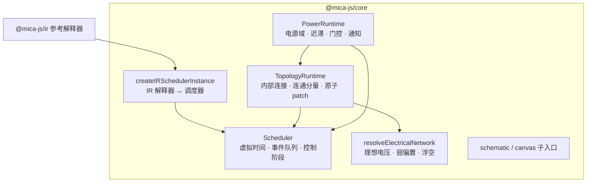
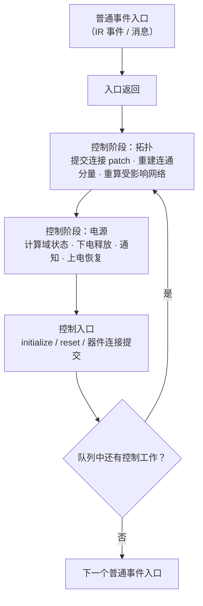

# @mica-js/core

Mica 仿真内核：整数皮秒虚拟时间与确定性事件调度，并在其上提供电气网络求值、连接拓扑与电源域门控。同一包的子入口还提供原理图 `.sch` 与画布 `.cnv` 的文档格式。

## 入口

| 入口                      | 内容                                                 |
| ------------------------- | ---------------------------------------------------- |
| `@mica-js/core`           | 仿真内核：时间、调度、电气求值、连接拓扑、电源域     |
| `@mica-js/core/schematic` | `.sch`：解析、序列化、拓扑推导、编辑命令、器件注册表 |
| `@mica-js/core/canvas`    | `.cnv`：widget 实例、属性覆盖、端口绑定与绑定校验    |

## 架构



## 安装

```bash
pnpm add @mica-js/core
```

## 快速上手

```ts
import { createIRModule } from '@mica-js/ir';
import { createIRSchedulerInstance, createScheduler } from '@mica-js/core';

const module = createIRModule();
const count = module.state('count', 'u32', 0);
const tick = module.entry('tick', []);
tick.body((b) => {
  b.state.store(count, b.int.add(b.state.load(count), b.const('u32', 1)));
  b.event.at(tick, b.float.add(b.event.now(), b.const('f64', 1000)), []); // 1 ns 后再触发
  b.return([]);
});

const operations = [
  'const',
  'state.load',
  'int.add',
  'float.add',
  'state.store',
  'event.now',
  'event.at',
  'return',
];
const scheduler = createScheduler();
const instance = createIRSchedulerInstance(scheduler, {
  instanceId: 'counter',
  module,
  validation: {
    supportedInstructions: operations,
    authorizedInstructions: operations,
    resources: [{ ref: count, access: 'read-write' }],
  },
});

instance.at(tick, 0, []);
const report = scheduler.start({ until: 10_000 });
// report = { timePs: 10000, executed: 11, reason: 'until' }
instance.storage.loadState(count); // 11
```

## 时间

- `TimePs` 是 `number` 的品牌类型，`timePs(value)` 在运行时校验并构造。
- 合法范围是 `0..MAX_TIME_PS`（含两端），`MAX_TIME_PS = 7_200_000_000_000_000`，即两小时。
- `toTimePs(value, unit)` 接受非负整数，单位取 `ps` / `ns` / `us` / `ms` / `s`。
- `addTime(left, right)` 与 `subtractTime(later, earlier)` 检查全部输入与结果；负差、加法或换算越界都会被拒绝。
- 非 `number`、非有限值或非整数先抛 `TypeError`，负值或超过上限抛 `RangeError`，不做隐式转换。`-0` 规范化为 `+0`。
- 时间约束只作用于时间接口；普通 IR `f64` 仍可为非整数、`NaN` 或无穷。

## 调度器

`createScheduler({ maxStepsPerEntry?, maxEntriesPerTime? })` 返回同步驱动的调度器，两个预算默认各为 1,000,000。

| 成员                                             | 说明                                                        |
| ------------------------------------------------ | ----------------------------------------------------------- |
| `now`                                            | 当前虚拟时间（皮秒）                                        |
| `state`                                          | `'paused'` / `'running'` / `'faulted'`                      |
| `error`                                          | 进入 `faulted` 时的 `SchedulerError`                        |
| `start({ until?, maxEntries? })`                 | 同步推进，返回 `{ timePs, executed, reason }`               |
| `step()`                                         | 恰好执行一个入口，优先控制工作                              |
| `pause()`                                        | 当前入口返回后停止，不中断入口                              |
| `addInstance({ instanceId, targets, executor })` | 登记一个可信执行实例，返回 `SchedulerInstance`              |
| `enqueueControl(instance, target, args)`         | 登记控制工作（仅供可信内核）                                |
| `enqueueMessage(instance, target, args)`         | 在当前虚拟时间接纳普通消息，返回实例内单调递增的 message ID |
| `destroyInstance(instance)`                      | 在入口边界停止输入、取消待执行工作并释放实例                |

- `reason` 为 `empty` / `until` / `entry-limit` / `paused`。本包没有墙钟循环、异步后台运行器或 UI 运行器。
- `until` 包含端点：只有该时刻所有可运行工作完成后才停下。未给 `until` 时，空队列不额外推进时间。
- `maxEntries` 用于分段驱动；`maxEntries = 0` 不执行、不推进。禁止嵌套 `start` / `step`。

### 顺序与阶段



- 普通事件按 `(timePs, round, sequence)` 稳定排列。同刻反馈进入后续普通轮次，不递归调用：已排 A/C，A 安排 B，执行顺序为 A/C/B。
- 每个入口返回后先执行公共控制工作，再恢复普通队列：A 产生控制工作 P 而 C 已排队，执行顺序为 A/P/C。
- 控制工作产生的新控制变化进入后续控制轮次，全部完成后才恢复普通队列。
- 顺序不取决于事件 ID 或墙钟；因果轮次与顺序号使用私有精确计数，不会因长期累计溢出。

### 预算与暂停

- 单个入口的参考步骤数与同一虚拟时刻的入口次数（普通 + 控制）各有上限，可配置为非负安全整数，`0` 表示禁止执行。
- 入口次数跨暂停、步进与分段驱动保留，只在时间真正变化时重置。
- 超限在下一步骤 / 下一个入口效果前暂停并给出诊断，不会偷偷推进 1 ps。
- `pause()` 与 `step()` 都不清除故障；`faulted` 状态下的 `start` / `step` / `cancel` 继续被拒绝。

### 事件 ID

- 每个实例独立使用非零 `u32` 事件 ID，`0` 表示没有事件。
- 首次从 1 递增；存在空闲 ID 时按**释放 FIFO** 复用，不按数值排序。
- 待执行的事件可取消；正在执行的事件在正常返回后才释放 ID，失败不是正常返回。
- `cancel(0)`、取消已释放且未复用的 ID、取消正在执行的事件都是 no-op；未分配或非法 ID 报错。
- 数字 ID 被复用后不提供代际保护，旧副本取消的是新事件。

### 销毁

`destroyInstance(handle)` 在入口边界停止输入并取消普通 / 控制待执行工作，不中断当前入口。完成后调度器删除该实例记录，释放 target、executor 及 IR 适配器的解释器与存储；反复创建 / 销毁不会累积。

即使调度器已进入 `faulted`，仍可对存在的实例调用 `destroyInstance` 完成清理——它只释放资源，不恢复执行能力。实例身份与 ID 编号空间永久保留、不复用。

## IR 适配器

`createIRSchedulerInstance(scheduler, { instanceId, module, validation, executors? })` 为既有 `@mica-js/ir` 参考解释器接入**同一个**调度队列与 ID 分配器：

```ts
const instance = createIRSchedulerInstance(scheduler, {
  instanceId: 'example',
  module,
  validation: { supportedInstructions, authorizedInstructions, resources },
});
```

返回值包含只读 `instance: SchedulerInstance`、`storage: IRStorage`，以及：

| 成员                              | 说明                                        |
| --------------------------------- | ------------------------------------------- |
| `at(entry, deadline, args)`       | 安排普通事件，返回事件 ID                   |
| `cancel(id)`                      | 取消待执行事件                              |
| `enqueueControl(lifecycle, args)` | 登记控制入口（仅供可信内核）                |
| `enqueueMessage(entry, args)`     | 在当前虚拟时间接纳普通消息，返回 message ID |

- `validation` 必须由可信宿主提供，适配器不会自动放宽指令支持或资源权限。
- 入口与生命周期在创建时固定身份与签名；接纳前完整检查目标、期限与全部标量参数，成功后按值捕获（含 `FloatBits` 独立副本与原始位模式）。
- 普通函数、同名伪造引用、跨实例 / 模块目标、错误类别或参数、过去期限均被拒绝。
- 销毁使用 `scheduler.destroyInstance(instance.instance)`。

### 领域执行器

`executors` 注册可信的领域指令同步执行器，未注册的领域指令在链接期被拒绝：

```ts
interface IRInstructionExecutor {
  readonly op: string;
  execute(request: {
    instruction: InstructionNode;
    operands: readonly RuntimeScalar[];
    context: IRExecutionContext;
  }): readonly RuntimeScalar[];
}
```

执行器只应在当前调度入口内同步工作，例如 `connection.apply` 把捕获的 bool 列表一次性提交给 `TopologyRuntime.submit()`，由拓扑在下一个控制阶段原子应用。核心不导入连接领域类型。

### 低层执行接口

`addInstance` 直接登记 `SchedulerExecutor`，是**可信内核后端合同**，不是器件作者的 JS 回调协议，也不是安全沙箱：

- `SchedulerTarget` 声明 `name`、`kind: 'event' | 'control'` 与 `params`；按登记对象身份接纳，不按名称匹配外来对象。
- `SchedulerExecutionContext` 提供 `instanceId`、`timePs`、`phase`、`eventId`、`messageId`、`remainingSteps` 与 `consumeSteps(count?)`。
- 后端必须在每个参考 IR 步骤效果提交前计数，不能用优化后的机器指令数替代；它不能抢占任意 JS 死循环。
- 拒绝 async / generator、Promise / thenable 结果与重入执行。

`enqueueControl` 是可信内核唯一的控制入口，器件与 Provider 无权自行创建控制工作。`enqueueMessage` 接纳普通 `event` 类别入口的消息：时间固定为当前虚拟时间，不分配事件 ID、不可取消、不推进时间，并按 `(timePs, round, sequence)` 在当前普通轮次之后执行。

## 电气网络

`resolveElectricalNetwork({ networkId, pins })` 是纯函数：接收已连接到同一网络的引脚快照，返回求值结果，不读取原理图、不维护拓扑。

```ts
import { resolveElectricalNetwork } from '@mica-js/core';

const result = resolveElectricalNetwork({
  networkId: 'data',
  pins: [
    {
      instanceId: 'mcu',
      pinName: 'P0',
      powerReady: true,
      mode: 'push-pull',
      outputEnabled: true,
      pull: 'none',
      digitalIntent: true,
      model: {
        kind: 'ideal-voltage',
        minVoltage: 0,
        maxVoltage: 3.3,
        lowVoltage: 0,
        highVoltage: 3.3,
      },
    },
  ],
});
// result.state === 'driven'，result.voltage === 3.3
```

### 引脚输入

| 字段                     | 语义                                                   |
| ------------------------ | ------------------------------------------------------ |
| `instanceId` / `pinName` | 非空字符串；同一网络内必须唯一                         |
| `powerReady`             | 供电就绪；`false` 释放主动驱动与内部偏置               |
| `mode`                   | `high-z` / `push-pull` / `open-drain` / `analog`       |
| `outputEnabled`          | 主动输出使能，不影响内部上下拉                         |
| `pull`                   | `none` / `up` / `down`，独立于模式与输出意图           |
| `digitalIntent?`         | 数字意图；缺省表示未就绪，`false` / `true` 对应 0 / 1  |
| `voltageIntent?`         | 电压意图；缺省表示未就绪，`0` 也是就绪电压             |
| `model`                  | `ideal-voltage` 模型：min / max / low / high 电压（V） |

`high-z`、使能关闭或模式所需意图未就绪时释放主动驱动。推挽取 low / high，开漏只有 `false` 拉低、`true` 释放，`analog` 取电压意图。

### 结果与相容性

- **强贡献优先于弱偏置**。最高优先级的电压满足 `max - min <= 0.001` 时相容，取最低值；全部为弱贡献时使用同一规则。
- 计算直接使用 f64，不添加 epsilon 也不舍入：`3.301 - 3.3 > 0.001`，这组电压冲突。
- `state: 'driven'` 返回 `voltage`、`strength: 'strong' | 'weak'` 与全部生效贡献。
- `state: 'floating'` 表示没有物理电压，`digitalFallback: false` 只是浮空数字默认值。
- 结果与贡献递归冻结，并与调用方输入分离；贡献按身份字典序排列，同实体 drive 在 pull 之前。

### 校验与冲突

- 先校验完整快照，门控关闭或模式未选中也不能隐藏非法保存意图。
- 模型只接受 `kind: 'ideal-voltage'`：min / max 有限且 `min <= max`，low / high 在范围内且 `low <= high`，就绪电压意图也必须在范围内。
- 未知字段或模型（包括电阻、阻抗）、枚举或类型错误抛 `TypeError`；越界或范围倒置抛 `RangeError`。
- 驱动或偏置不相容时同步抛 `ElectricalConflictError`，其 `network` 与 `contributions` 保存冻结的冲突现场。**冲突不是浮空。**

## 连接拓扑

`createTopologyRuntime(scheduler, definition, options)` 管理实例内部连接、外部导线与网络连通分量，并在控制阶段原子提交连接 patch 后只重算受影响网络。

```ts
const runtime = createTopologyRuntime(
  scheduler,
  {
    pins: [
      { instanceId: 'sw', pinName: 'A', kind: 'signal' },
      { instanceId: 'sw', pinName: 'B', kind: 'signal' },
      { instanceId: 'mcu', pinName: 'P0', kind: 'signal' },
    ],
    wires: [
      {
        wireId: 'w1',
        pins: [
          { instanceId: 'sw', pinName: 'B' },
          { instanceId: 'mcu', pinName: 'P0' },
        ],
      },
    ],
    connections: [{ instanceId: 'sw', connectionId: 'contact', pins: ['A', 'B'], initial: 'open' }],
  },
  { instanceId: 'topology', pinStates, floating: { seed: 12345, supplyVoltage: () => 3.3 } },
);

runtime.submit({ instanceId: 'sw', connections: [{ connectionId: 'contact', state: 'closed' }] });
scheduler.start();
```

示例省略了 `pinStates` 的逐引脚内容：构造时必须为每个声明引脚提供一份已提交状态。

### 定义

- `pins`：`instanceId`、`pinName` 与 `signal` / `power` / `gnd` 类别；同一身份只能声明一次。
- `wires`：运行期不可增删。成员连成同一网络，支持跨实例、环路与并行路径；`globalGnd: true` 表示接入显式全局 GND。
- `connections`：实例内部可控触点，端点必须是同一实例的两个互异引脚；初始状态缺省 `open`。
- 未被任何导线或闭合触点连接的引脚仍是单引脚网络。
- `networkId` 由分量内字典序最小的成员生成：`net:<instanceId>/<pinName>`，其中 `%` 与 `/` 会被转义。
- `groundReady` 仅在分量同时含 `gnd` 引脚与 `globalGnd` 导线时为 `true`。

### 提交与查询

| 成员                              | 说明                                                   |
| --------------------------------- | ------------------------------------------------------ |
| `submit(patch)`                   | 校验并按值捕获一批连接更新，排入控制阶段               |
| `updatePinStates(states)`         | 部分更新引脚快照，排入控制阶段                         |
| `refresh(pins?)`                  | 请求解析点（缺省重算全部网络）                         |
| `connectionState(instanceId, id)` | 已提交的连接状态                                       |
| `networks()` / `networkOf(pin)`   | 已提交的网络与成员                                     |
| `floatingInput(pin)`              | 该引脚的浮空状态（未配置 `floating` 时为 `undefined`） |
| `destroy()`                       | 释放运行时                                             |

- `submit` 在调用时整批校验并按值捕获；空列表、重复连接、未知实例 / 连接、非法状态或声明直接抛错，不产生队列项。
- 提交不等于生效：普通入口内的 patch 在入口返回后应用；控制入口内的 patch 进入后续控制轮次。
- 驱动冲突时保留已提交连接状态与新分量，受影响网络的 `result` 为 `undefined`，随后抛出 `ElectricalConflictError`，调度器进入 `faulted`。

### 浮空接线

启用 `floating` 后，每个引脚惰性建立独立的 `createFloatingInput(seed, instanceId, pinName)`。网络每次从非浮空进入浮空即调用 `beginFloating`；业务读取通过 `floatingInput(pin).sample(V_D, now)` 取值。未配置 `seed` 时不产生浮空值。

## 电源域

`createPowerRuntime(scheduler, definition, options)` 在拓扑层之上实现电源域供电 / 接地条件、迟滞就绪、引脚门控、数字采样与通知。

```ts
const power = createPowerRuntime(
  scheduler,
  {
    topology: { pins, wires, connections },
    devices: [
      {
        instanceId: 'mcu',
        powerDomains: {
          core: { supply: 'VDD', ground: 'GND', voltage: { turnOn: 3, turnOff: 2 } },
        },
        pins: { P0: { powerDomain: 'core', levels: { low: 0.3, high: 0.7 } } },
      },
    ],
  },
  { instanceId: 'power', pinStates, observer: { onPowerDomainChange: () => {} } },
);

scheduler.start();
```

示例中的 `pins`、`wires`、`connections` 与 `pinStates` 均为节选；`pinStates` 同样要求每个声明引脚一条完整状态。

### 定义与校验

- `supply` / `ground` 必须是同一实例的 `power` / `gnd` 引脚；`turnOn > turnOff >= 0` 且均为有限数。
- `dependsOn` 只能引用同一器件的域，唯一、无自依赖且无环。
- `pins.<id>.powerDomain` 只用于 `signal` 引脚，`levels` 必须与它同时提供且 `0 <= low < high <= 1`。
- 域 ID 在器件内稳定、唯一且大小写敏感。

### 状态与迟滞

每个域维护 `{ state, voltage, groundReady, dependenciesReady }`：

- 接地未就绪、电压为 `null` 或任一依赖关闭 → `off`；
- `voltage <= turnOff` → `off`；`voltage >= turnOn` → `on`；
- 介于两者之间时保持原状态（迟滞）。

`groundReady` 由 `ground` 引脚所在分量是否接入显式全局 GND 决定，全局 GND 固定 0 V。下电原因保留为 `ground-not-ready` / `supply-indeterminate` / `dependency-off` / `below-turn-off`。

### 门控与意图

- 绑定域的 signal 引脚由运行时拥有 `powerReady`，宿主提交的同名字段被忽略。
- 域 `off` 时提交 `powerReady: false`，释放主动驱动与内部上下拉；域 `on` 时按最新持有意图恢复。
- `pinIntent(pin)` 返回最后提交的持有意图，`networkOf(pin)` 返回实际网络结果，两者分离。
- 上电先完成观察者通知，再把门控更新排入后续拓扑轮次；解析完成前 `pinGate(pin).ready === false`（`opening`）。
- `pinGate` 的原因取 `powered` / `opening` / `domain-off` / `no-domain`。

### 数字采样

- 有 `levels` 的引脚按域电压取 `low * V_D` / `high * V_D` 门限；无 `levels` 时使用引脚模型的绝对 `lowVoltage` / `highVoltage`。
- 默认三态解释：`<= low` 为 0，`>= high` 为 1，区间内返回逻辑记忆并标记 `threshold-range`；可切换为二态。
- 门控期间返回 `{ value: 0, ready: false, source: 'gated' }`；浮空数字返回 0 且 `source: 'floating'`，逻辑记忆不变。
- 采样 `power` / `gnd` 引脚会抛 `RangeError`；ADC 量化、滤波、PWM 平均等行为由器件模型表达。

### 变化通知

- `addDigitalPinObserver(observer)` 注册数字引脚变化观察者，返回幂等 disposer；多个观察者按注册顺序调用。
- 每次电气解析阶段结束后同步通知一次，只包含 `(value, ready, source)` 发生变化的 signal 引脚，按拓扑声明顺序稳定排列。
- `observer.onPowerDomainChange(changes, snapshot)` 每批域变化回调一次：先全部下电、再全部上电；下电依赖方优先，上电前置域优先。
- 回调中只能入队或读取，不得同步重入器件入口；观察者抛错立即停止后续通知并传播到当前调度入口。

### 传播预算

同一虚拟时间最多 `maxPropagationRounds`（默认 10,000）个电源传播入口。超限时从控制入口抛出 `PowerFeedbackError`（含 `timePs`、`rounds`、`maxRounds` 与完整域快照），调度器进入 `faulted`，已提交状态与意图不会被静默丢弃。

## 子入口：原理图

```ts
import { loadSchematic, parseSchematic, serializeSchematic } from '@mica-js/core/schematic';

const loaded = loadSchematic(text, { devices }); // { document, topology }
const document = parseSchematic(text); // 解析 + 校验，失败抛 SchematicError
const json = serializeSchematic(document); // 固定字段顺序的 .sch JSON
```

- 文件名即原理图标识，顶层没有 `id`；`symbols`、`wires`、`junctions` 的 `id` 必须是 UUID v4。
- 拓扑按位号、网名与连接关系合并网络；纯绘图分量保留为几何数据。
- 编辑命令（`applySchematicCommand`）、命中测试、导线段拖动与交点合并不依赖 DOM；`SchematicEditor` 只做编排。
- `createDeviceRegistry` 把器件的 `designatorPrefix` 与引脚声明合成为符号几何与位号。
- 属性类型包括 `string` / `number` / `integer` / `boolean` / `enum` / `color` / `image` / `binary`；`image` / `binary` 的值是资源引用 `{ src, mode }`。

## 子入口：画布

```ts
import { applyCanvasCommand, parseCanvas, serializeCanvas } from '@mica-js/core/canvas';

const canvas = parseCanvas(text); // version / schematic / widgets
const next = applyCanvasCommand(canvas, {
  type: 'set-property',
  instanceId,
  key: 'label',
  value: 'hello',
}); // 纯函数：返回新文档，原文档不变
```

- `widgets` 数组顺序即绘制顺序；实例保存位置、尺寸、旋转、属性覆盖与端口绑定。
- canvas 以工程根相对路径为标识；可选的 `schematic` 只声明仿真绑定。
- 编辑命令包括 `add-instance` / `remove-instance`、`set-placement` / `set-z`、`set-property` / `unset-property`、`set-binding` 与 `set-schematic`。
- `validateCanvasBindings(document, { catalog })` 收集诊断且从不抛错；`assertCanvasBindings` 在有 error 时抛 `SchematicError`。
- 绑定方向必须互补（widget `input` 接器件 `output`），载荷类型必须相同，否则报 `topic/type-mismatch`。

## 错误

- 时间错误为 `TypeError` / `RangeError`；执行时包装为 `SchedulerError` 并保留 `cause`。
- `SchedulerError` 只读字段包括 `code`、`instanceId`、`targetName`、`timePs`、`phase`、`eventId`、`steps`、`entriesAtTime`、`cause`。
- `SchedulerErrorCode`：`invalid-options`、`invalid-instance`、`invalid-target`、`invalid-argument`、`invalid-event-id`、`event-id-exhausted`、`reentrant-execution`、`executor-contract`、`entry-budget-exhausted`、`time-budget-exhausted`、`execution-failed`、`scheduler-faulted`。

## 边界

- 不提供墙钟映射、异步后台循环或 UI 运行器。
- 电气层只支持理想强电压与弱偏置，不支持连续电路、电阻、阻抗、负载或积分。
- 拓扑层不解析原理图、不实现 IR 指令或运行期增删外部导线；它只消费宿主提交的引脚快照与静态导线。
- 电源层不实现协议栈、掉电后的寄存器 / Flash / reset 语义，也不实现连续电路求解。
- 不提供持久化调度快照、跨实例迁移或 JIT。
