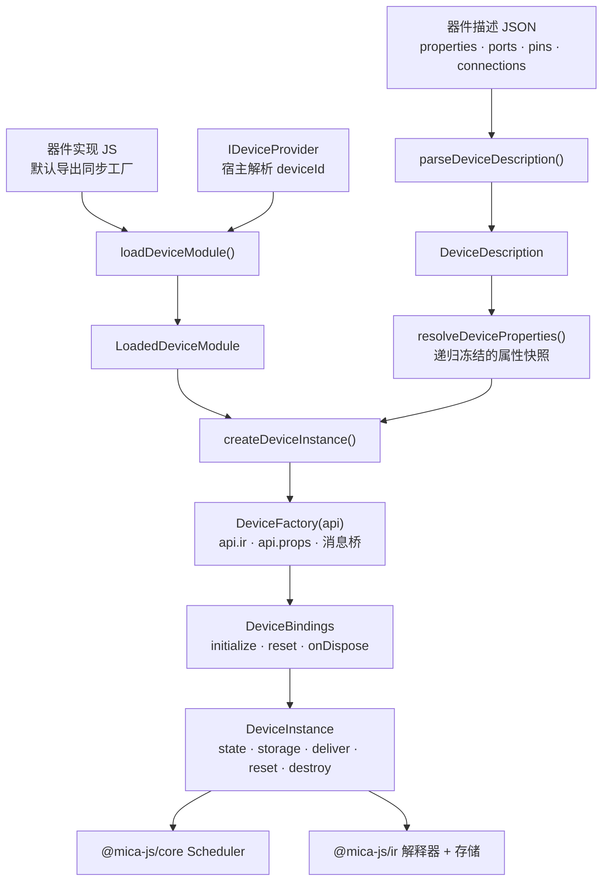
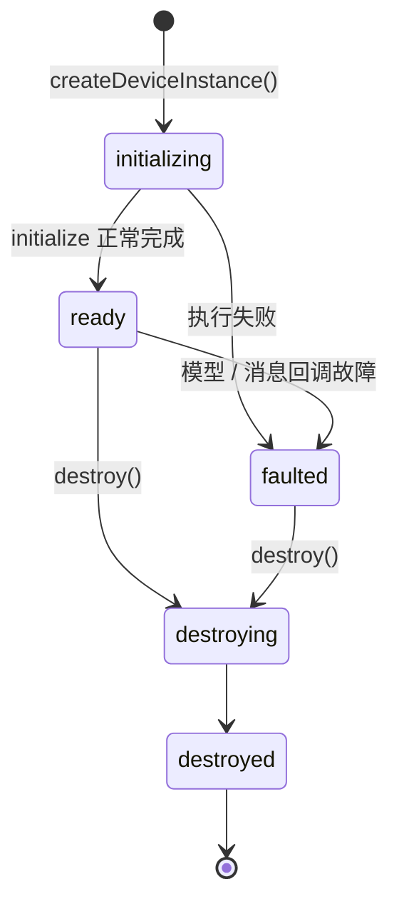
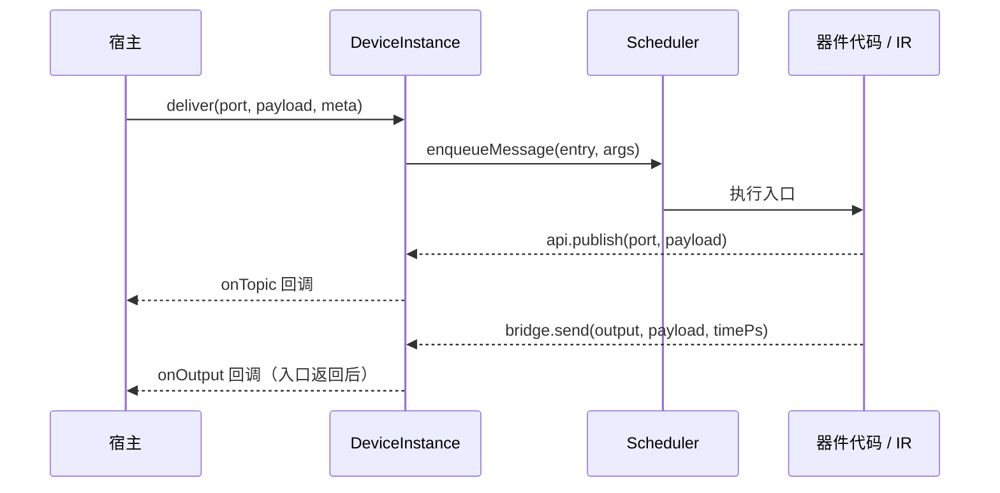

# @mica-js/device

器件层：解析已加载的器件描述、通过宿主 `IDeviceProvider` 加载同步 JS 工厂，并为每个实例提供独立只读的属性快照、工厂上下文与内核驱动的生命周期。

文件定位、文件读取、缺失文件诊断与 JSON 语法解析由宿主 provider 负责，本包不扫描文件系统。

## 架构



## 安装

```bash
pnpm add @mica-js/device
```

## 快速上手

```ts
import { createScheduler } from '@mica-js/core';
import { createDeviceInstance, loadDeviceModule, parseDeviceDescription } from '@mica-js/device';

const provider = {
  resolve: (deviceId: string) => ({
    definition: parseDeviceDescription(loadJson(deviceId), { name: deviceId }),
    code: loadSource(deviceId),
  }),
};

const loaded = await loadDeviceModule('acme:display', provider);
const scheduler = createScheduler();
const instance = createDeviceInstance(loaded, scheduler, { instanceId: 'u1' });

scheduler.start(); // initialize 在控制阶段执行
instance.state; // 'ready'
```

## 公共入口

| 导出                                             | 作用                                                      |
| ------------------------------------------------ | --------------------------------------------------------- |
| `parseDeviceDescription()`                       | 解析定义对象与 metadata，返回 `DeviceDescription`         |
| `loadDeviceModule()`                             | 通过 `IDeviceProvider` 取得定义与代码，加载并校验默认导出 |
| `resolveDeviceProperties()`                      | 按描述默认值与覆盖值生成独立、递归冻结的属性快照          |
| `createDeviceInstance()`                         | 调用一次工厂、校验绑定与 IR、安装实例并入队 initialize    |
| `DeviceError`                                    | 带 `code`、`deviceId`、`pointer` 的设备层错误             |
| `BackpressureError`                              | 有界队列或槽位不足的预期拒绝，带 `operation`              |
| `IDeviceProvider` / `DeviceDefinition`           | 宿主实现的模块来源                                        |
| `DeviceAPI` / `DeviceBindings`                   | 工厂上下文与生命周期绑定                                  |
| `DeviceInstance` / `DeviceInstanceOptions`       | 宿主实例句柄与创建选项                                    |
| `DevicePinHost`                                  | 引脚意图、采样与数字变化观察的窄接口                      |
| `PinRef` / `PinOperations` / `ObserveOperations` | `b.pin` / `b.observe` 的静态引用与建图类型                |
| `ConnectionRef` / `ConnectionOperations`         | `b.connection` 的静态句柄与操作组                         |

不导出文件路径 helper、文件缺失错误码、JSON 语法错误码或属性更新接口。

## Provider 合同

```ts
interface IDeviceProvider {
  resolve(deviceId: string): DeviceDefinition | undefined | Promise<DeviceDefinition | undefined>;
}
```

- `deviceId` 是不透明字符串（例如 `zerobit:stm32f103c8t6`），本包不解析其格式。
- `resolve` 返回 `undefined` 表示器件不存在，`loadDeviceModule` 报 `device/device-unknown`。
- provider 抛出的 `DeviceError` 原样传播；其他异常包装为 `device/provider-failed` 并保留 `cause`。
- `definition` 必须是已经由 `parseDeviceDescription` 解析的 `DeviceDescription`；`loadDeviceModule` 只做运行时形状检查，不二次解析。
- `code` 是器件实现的 ES 模块源码，provider 应提供自包含模块；相对导入不在本层解析。
- 同一 provider 实例内一个 device id 只加载一次模块。

## 描述解析

```ts
import { parseDeviceDescription } from '@mica-js/device';

const description = parseDeviceDescription(
  {
    properties: {
      label: { type: 'string', default: 'Display' },
      speed: { type: 'number', default: 72, min: 1, max: 170, unit: 'MHz' },
    },
    ports: {
      frame: { direction: 'output', type: 'bytes<rgb565>' },
    },
    pins: {
      VDD: { kind: 'power', side: 'top' },
      GND: { kind: 'gnd', side: 'bottom' },
      A: { kind: 'signal' },
      B: { kind: 'signal' },
      OUT: { kind: 'signal', side: 'right' },
      IN: { kind: 'signal', powerDomain: 'io', levels: { low: 0.3, high: 0.7 } },
    },
    pinGroups: { data: { pins: ['OUT', 'IN'] } },
    connections: { contact: { pins: ['A', 'B'], initial: 'open' } },
    designatorPrefix: 'U',
  },
  { name: 'acme:display', displayName: '显示屏', description: '示例显示器件' },
);
```

| 字段               | 规则                                                                                     |
| ------------------ | ---------------------------------------------------------------------------------------- |
| `metadata.name`    | 必填；`displayName` 缺省回退 `name`；`description` 可选                                  |
| `properties`       | 复用 `@mica-js/core/schematic` 的属性实现；不可用的描述被忽略，不猜测类型                |
| `ports`            | `direction` 为 `input` / `output`，`type` 取自 `@mica-js/core/canvas` 的 `PAYLOAD_TYPES` |
| `pins`             | `kind` 为 `power` / `gnd` / `signal`，`side` 缺省 `left`                                 |
| `pinGroups`        | 成员非空、唯一且引用已声明引脚；只保存固定顺序，不做电气推断                             |
| `connections`      | 每项只含 `pins` / `initial`；`pins` 是两个互异且已声明的引脚 ID                          |
| `designatorPrefix` | 去除首尾空白；空字符串视为未声明                                                         |

- `powerDomain` 只允许出现在 `signal` 引脚，`levels` 必须与它同时出现且 `0 <= low < high <= 1`。
- 引脚键与成员名大小写精确、不得为空；`initial` 取 `open` / `closed`，省略时 `open`。
- 顶层未知字段被忽略；定义、`properties`、`ports`、引脚与连接都必须是纯对象（`Map`、`Set`、`Date`、class 实例不会被当作空记录）。

## 属性快照

```ts
import { resolveDeviceProperties } from '@mica-js/device';

const props = resolveDeviceProperties(description, { label: 'LCD' });
// props 已深拷贝并递归冻结
```

- 按描述填默认值、校验覆盖值；颜色归一化为大写 `#RRGGBBAA`。
- 未声明的覆盖键静默忽略；无有效默认值且无覆盖时省略该键。
- 每次调用返回独立对象，外部覆盖对象或描述后续修改都不会影响已生成的快照。
- 快照在实例创建时固定，运行期不可修改，也没有 `onPropsChanged`；需要另一组属性时由宿主显式创建新实例。

## 工厂上下文

```ts
interface DeviceFactory {
  (api: DeviceAPI): DeviceBindings;
}

interface DeviceAPI {
  readonly props: DevicePropertySnapshot;
  readonly ir: DeviceIRDeclarations;
  subscribe(port: string, callback: MessageCallback<TopicPayload, TopicMetadata>): Unsubscribe;
  publish(port: string, payload: TopicPayload): void;
  post<P extends readonly ScalarType[]>(entry: EntryRef<P>, args: ScalarArgs<P>): Promise<void>;
  postBytes(
    entry: EntryRef<readonly ['u32', 'u32']>,
    inbox: InboxRef,
    bytes: Uint8Array,
  ): Promise<void>;
  onOutput(output: OutputRef, callback: MessageCallback<unknown, IROutputMetadata>): Unsubscribe;
  onOutput(
    output: BytesOutputRef,
    callback: MessageCallback<Uint8Array, IROutputMetadata>,
  ): Unsubscribe;
  updateBytes(resource: BytesRef, offset: number, bytes: Uint8Array): Promise<void>;
}

interface DeviceBindings {
  readonly initialize?: LifecycleRef<readonly []>;
  readonly reset?: LifecycleRef<readonly []>;
  readonly onDispose?: () => void;
}
```

- 同步工厂每次创建只调用一次。`api.ir` 暴露 `state/array/bytes/inbox/func/entry/lifecycle/provider` 与 `pin(id)` / `connection(id)` / `observeDigital(name, descriptor)`；工厂返回**或抛出**后立即封闭，后续声明或结构写入报 `device/factory-closed`。
- 工厂不能通过上下文取得原始 `IRModule`、执行器或调度器；`subscribe` / `onOutput` 登记同样只在工厂期间开放。
- `api.ir.provider` 沿用 IR provider 合同：生成回调在首次派发时执行，产物经同一 `validateIR` 与解释器校验并在实例内缓存；资源版本变化后按需重生成。
- 工厂返回值必须是纯对象，只允许 `initialize` / `reset` / `onDispose` 三个字段。生命周期引用必须属于本次工厂声明的模块、类别为 `lifecycle`、零参数；同一引用同时绑定 initialize 与 reset 被拒绝。
- `onDispose` 必须是同步普通函数（拒绝 async / generator / class），运行时还要求返回 `undefined`。
- 工厂返回 Promise 或默认导出为 async 时分别报 `device/factory-async`。

```ts
export default function button(api) {
  const contact = api.ir.connection('contact');
  const pressed = api.ir.state('pressed', 'bool', false);
  const initialize = api.ir.lifecycle('initialize', []);
  const setPressed = api.ir.entry('setPressed', ['bool']);

  api.subscribe('pressed', (payload) => {
    void api.post(setPressed, [Boolean(payload)]);
  });

  setPressed.body((b, [closed]) => {
    b.state.store(pressed, closed);
    b.connection.apply([{ connection: contact, closed }]);
    b.return([]);
  });

  initialize.body((b) => {
    b.connection.apply([{ connection: contact, closed: b.const('bool', false) }]);
    b.return([]);
  });

  return { initialize };
}
```

## 实例生命周期



- initialize 只作为公共控制工作入队，由 `scheduler.start()` / `step()` 驱动，不在工厂内同步执行。没有 initialize 时创建即 `ready`。
- `createDeviceInstance` 只有在工厂返回、绑定校验与真实 `validateIR` / 链接全部通过后才安装调度器实例并入队 initialize。任何前置失败不留下实例、队列任务或解释器引用。
- IR 校验 / 链接失败统一报 `device/link-failed` 并保留 `cause`。
- 引脚初始状态只在链接成功后提交；提交失败会销毁已安装实例并报 `device/pin-io-unavailable`。
- `reset()` 只入队已绑定的 reset 控制工作，不重新执行 initialize、不取消既有事件、不重建实例。未绑定报 `device/lifecycle-unsupported`；`initializing`、`faulted`、`destroying`、`destroyed` 状态拒绝 reset。
- 模型故障使调度器进入 `faulted` 并暂停，不自动销毁、不调用 `onDispose`。`destroy()` 在 faulted 状态下仍可清理实例。
- `destroy()` 只允许在调度器非 `running` 的入口边界调用：先停止新输入与执行，再清理事件、队列、实例与内核引用，最后调用一次 `onDispose`。重复调用幂等。
- `instance.storage` 是受控句柄；销毁后 getter 与所有存储访问器都抛 `device/instance-destroyed`。

## 话题与输出桥接

```ts
interface DeviceMessagingOptions {
  readonly postCapacity?: number; // 默认 64
  readonly publishCapacity?: number; // 默认 64
  readonly deliveryCapacity?: number; // 默认 64
  readonly updateCapacity?: number; // 默认 64
  readonly outputByteBudget?: number; // 默认 65536
}
```

- `subscribe` 只接受描述中声明为 `input` 的端口，不同 callback 可注册多个监听器；同一 callback 重复注册同一端口报 `device/topic-subscription`。`publish` 只接受 `output` 端口。
- 载荷校验是**表示层**的：布尔、有限数值、字符串、固定键的 `vec2d` / `vec3d`、`Uint8Array`。`bytes<rgb565>` 等布局校验属于宿主或格式层。字节载荷在捕获时复制，每个监听器收到独立副本。
- `post(entry, args)` 只接受本实例声明的普通 entry；Promise 完成表示**已接纳**，不表示入口已执行。它不推进时间、不创建事件、不形成等待栈。
- `postBytes(entry, inbox, bytes)` 要求 entry 签名 `[u32, u32]`。接纳时预留 inbox 连续范围、复制字节并把 `offset` / `length` 交给 entry；entry 返回、故障或销毁时释放。容量不足抛 `BackpressureError`，不覆盖未消费数据。
- `onOutput(output, callback)` 为每个 IR 输出登记唯一消费者，重复绑定报 `device/output-consumer`。回调在入口返回后执行，`meta.timePs` 是 `bridge.send` 捕获时的虚拟时间。
- `updateBytes(resource, offset, bytes)` 对可写 `bytes` 资源，或由 `DeviceInstanceOptions.updateResources` 按名称额外授权的只读 `bytes` 资源生效；授权不会让该资源变成可执行普通 `bytes.store` 的写资源。
- 宿主用 `instance.deliver(port, payload, { simTime })` 投递输入话题，用 `onTopic` 接收 `api.publish`。`onTopic` 必须是同步且返回 `undefined` 的函数。
- 初始化期间的输入与 IR 输出暂存于有界队列：initialize 成功后先按捕获顺序通知输出，再按接纳顺序投递输入。



工厂 / initialize 完成前调用 `post` / `postBytes` / `publish` / `updateBytes` 报 `device/not-active`；故障或销毁中报 `device/instance-busy`；销毁后报 `device/instance-destroyed`。

## 引脚声明与数字 I/O

```ts
const factory: DeviceFactory = (api) => {
  const out = api.ir.pin('OUT');
  const input = api.ir.pin('IN');
  const last = api.ir.state('last', 'u32', 0);

  const initialize = api.ir.lifecycle('initialize', []);
  initialize.body((b) => {
    b.pin.configure(out, { mode: 'push-pull', outputEnabled: true, pull: 'none' });
    b.pin.writeDigital(out, b.const('bool', true));
    b.state.store(last, b.pin.sampleDigital(input));
    b.return([]);
  });

  return { initialize };
};
```

- `api.ir.pin(id)` 只接受本器件 `pins` 中声明的 id，未知或空 id 报 `device/pin-unknown`。同一 id 重复调用返回同一静态引用，跨实例 / 跨模块引用在建图时拒绝。
- `b.pin.configure` 降低为 `pin.configure`（mode 0/1/2/3，pull 0/1/2），`b.pin.writeDigital` 降低为 `pin.write_digital`，`b.pin.sampleDigital` 降低为 `pin.sample_digital` 并返回规范 `u32`（bit 0 为电平）。
- 只有 `kind: 'signal'` 引脚允许配置、写入与采样；`power` / `gnd` 引脚在构建器与链接校验两处拒绝。
- 写入与配置保存器件侧持有意图，并在操作点通过 `DevicePinHost.updatePinStates` 提交完整引脚状态；电气结果在下一拓扑 / 电源控制阶段（同一虚拟时刻）生效。同一入口内后续采样读取的是上一已提交解析结果。
- `DevicePinHost` 是 `@mica-js/core` 电源运行时公开能力的窄接口（`pinIntent` / `updatePinStates` / `sampleDigital`，以及可选的 `addDigitalPinObserver`），`PowerRuntime` 可直接传入。
- 缺少 host、host 未声明被引用引脚或宿主不支持变化观察时，创建期分别报 `device/pin-io-unavailable` 与 `device/observe-unavailable`。
- 驱动冲突沿电气层路径上抛并使调度器进入 `faulted`；本层不新增冲突码、仲裁或部分提交。
- 销毁时按链接期捕获的宿主意图尽力恢复被引用引脚，避免已销毁实例继续驱动电路。

## 数字边沿观察

```ts
const trigger = api.ir.pin('IN');
const capture = api.ir.pin('CAP');

const onEdge = api.ir.entry('onEdge', ['u8', 'u32']);
onEdge.body((b, [edge, level]) => {
  b.state.store(lastEdge, edge);
  b.state.store(lastLevel, level);
  b.return([]);
});

const observer = api.ir.observeDigital('edge', { trigger, captures: [capture], target: onEdge });
const initialize = api.ir.lifecycle('initialize', []);
initialize.body((b) => {
  b.observe.configure(observer, { enabled: true, edges: 'both' });
  b.return([]);
});
```

- `api.ir.observeDigital(name, { trigger, captures, target })` 只接受已声明的 `signal` 引脚；`captures` 可为空并按声明顺序形成 `u32` 载荷。
- 目标必须是普通 entry，链接期要求签名恰为 `['u8', ...u32 × captures.length]`。错误签名、目标类别或重复观察名报 `device/observe-binding`；未知 / 跨实例 / 非 signal 引脚报 `device/observe-pin`。
- `b.observe.configure(observer, { enabled, edges })` 降低为 `observe.configure`：`bool` 启用位与 `u8` 边沿编码（1 rising / 2 falling / 3 both）。非法参数报 `device/observe-config`。
- 载荷固定为 `[u8 边沿编码, ...按 captures 声明顺序的 u32]`；边沿编码只描述本次匹配的 rising / falling，不把 `both` 写入载荷。
- 初始禁用；每次显式 `configure` 都在提交点重建基线并原子更新启用位与边沿。首次启用、门控 / 待定区间恢复、浮空进出与显式配置都只重建基线，不投递边沿。
- 观察走 `scheduler.enqueueMessage` 的普通入口队列：不推进时间、不形成等待栈、不同步重入器件或其他实例。
- 关闭观察不撤销已入队消息，也不补发关闭期间的跃迁。
- 仅实现数字边沿观察；`edges=0` 状态观察、模拟量观察、组观察与任意比较器明确拒绝。

## 连接提交

```ts
const initialize = api.ir.lifecycle('initialize', []);
const pressed = api.ir.state('pressed', 'bool', false);
const contact = api.ir.connection('contact');

initialize.body((b) => {
  b.connection.apply([{ connection: contact, closed: b.state.load(pressed) }]);
  b.return([]);
});
```

- `api.ir.connection(id)` 只解析描述中已声明的连接，返回静态 `ConnectionRef`；重复调用返回同一句柄。不存在、空 ID 或在工厂封闭后调用分别报 `device/connection-unknown` / `device/connection-invalid` / `device/factory-closed`。
- `b.connection.apply([{ connection, closed }])` 把建图时固定的列表降低为一份 `connection.apply` 指令：`static-list` 连接引用与等长 `value-list` bool SSA。空列表、重复连接、非 bool SSA、跨实例句柄与未知连接都被拒绝。
- 未绑定 `DeviceInstanceOptions.connections.topology` 时，含 `connection.apply` 的程序在链接期报 `device/connection-unavailable`。绑定时，使用的连接必须由该拓扑为当前 `instanceId` 声明。
- 执行 apply 时按值捕获全部 bool，只调用一次 `topology.submit({ instanceId, connections })`；拓扑在下一个合法控制阶段整体应用，同一入口的后续指令不能假定新拓扑已解析。

## 示例器件

`examples/` 提供三个完整的器件作者模型，与包实现分离，不随包发布：

| 示例           | 行为                                                                            |
| -------------- | ------------------------------------------------------------------------------- |
| `ideal-button` | 话题 `pressed` 驱动被动双向触点 `contact`；initialize 与 reset 复位为断开       |
| `ideal-relay`  | `IN` 边沿经 `observeDigital` 捕获，`apply` 在同一 patch 原子切换常开 / 常闭触点 |
| `teaching-mcu` | 两字节合成 ISA，按 PC 生成基本块，块末写 GPIO 并安排下一次入口                  |

详见 [examples/README.md](examples/README.md)。

## 错误码

| 错误码                          | 含义                                                      |
| ------------------------------- | --------------------------------------------------------- |
| `device/device-unknown`         | provider 返回 `undefined`，或 device id 为空              |
| `device/provider-failed`        | provider 抛非 `DeviceError`、未实现 `resolve` 或结果违约  |
| `device/description-schema`     | 定义容器、metadata 或 `designatorPrefix` 形状错误         |
| `device/implementation-import`  | 代码字符串不是可加载的 ES 模块                            |
| `device/implementation-export`  | 默认导出不是普通同步函数                                  |
| `device/implementation-async`   | 默认导出声明为 async / async generator                    |
| `device/factory-failed`         | 工厂抛出非 `DeviceError`、不是普通函数或调用失败          |
| `device/factory-async`          | 工厂为 async，或返回 Promise / thenable                   |
| `device/factory-closed`         | 工厂返回 / 抛出后尝试继续声明或写入 `api.ir`              |
| `device/lifecycle-binding`      | 返回值、字段、生命周期引用、重复绑定或 `onDispose` 不合法 |
| `device/lifecycle-unsupported`  | 未绑定 reset 却请求复位                                   |
| `device/pin-unknown`            | `api.ir.pin` 引用未声明或空的引脚 id                      |
| `device/pin-io-unavailable`     | 使用引脚 I/O 但缺少 pin host，或宿主未声明被引用引脚      |
| `device/observe-pin`            | 观察 trigger / capture 引脚未知、跨实例或不是 `signal`    |
| `device/observe-binding`        | 重复观察名、非法描述符或目标签名不匹配                    |
| `device/observe-config`         | 非法 `observe.configure` 参数                             |
| `device/observe-unavailable`    | 存在观察绑定但宿主不支持数字变化观察                      |
| `device/connection-unknown`     | 连接 ID 未声明或不属于当前拓扑                            |
| `device/connection-invalid`     | 空连接 ID 或非法连接操作                                  |
| `device/connection-unavailable` | 未绑定拓扑或拓扑已销毁                                    |
| `device/link-failed`            | IR 校验、链接或不支持的指令                               |
| `device/instance-invalid`       | 创建选项、已加载模块、调度器或实例标识不合法              |
| `device/instance-busy`          | 非法生命周期操作或重入冲突                                |
| `device/instance-destroyed`     | 销毁后访问 `storage`、请求 reset 或提交消息               |
| `device/dispose-failed`         | 清理完成后 `onDispose` 抛错或返回非法值                   |
| `device/topic-unknown`          | 引用了描述中不存在的端口                                  |
| `device/topic-direction`        | 输入 / 输出方向与操作不匹配                               |
| `device/topic-payload`          | 载荷表示或 `simTime` 元数据不合法                         |
| `device/topic-subscription`     | 同一 callback 重复注册同一输入端口                        |
| `device/output-unknown`         | 引用了本次工厂未声明的输出                                |
| `device/output-consumer`        | 同一 IR 输出重复登记消费者                                |
| `device/message-target`         | `post` / `postBytes` 目标不是普通 entry 或签名不合法      |
| `device/inbox-reference`        | `postBytes` 的 inbox 不是本次工厂声明的 inbox             |
| `device/update-target`          | `updateBytes` 目标不是可更新字节资源或参数越界            |
| `device/not-active`             | 工厂或 initialize 尚未完成时执行消息操作                  |
| `device/message-callback`       | 回调抛错、返回 thenable 或其他非法值                      |

## 边界

- 不负责文件定位、读取与 JSON 解析；provider 决定模块来源。
- 不提供 WASM 回退或第二种实现加载来源。
- `loadDeviceModule` 在宿主 realm 执行 provider 代码，**不是沙箱**；器件包必须可信。
- 模拟观察、状态观察（`edges=0`）、电压读写、`get_*` / `set_*`、引脚组 I/O 与协议栈不在作者面。
- 不做话题路由、重放、ACK 或跨实例广播；普通消息投递不推进客体时间。
