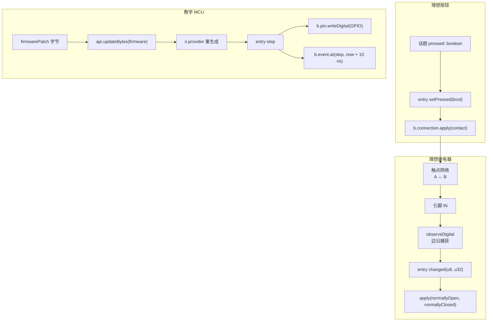

# 器件作者示例

本目录存放三个已提交的器件模型，作为器件作者面的可执行参考。每个器件遵循同目录同名配对：描述 `<id>.json` 与实现 `<id>.js`，由宿主 `IDeviceProvider` 读取两份文件，`loadDeviceModule` 只导入实现源码。

这些文件不是 `@mica-js/device` 的包实现：它们位于 `src/` 之外，也不从包入口导出，因此不会随包发布。

| 器件       | 目录            | 行为                                                                                                                                                                                              |
| ---------- | --------------- | ------------------------------------------------------------------------------------------------------------------------------------------------------------------------------------------------- |
| 理想按钮   | `ideal-button/` | 引脚 `A` / `B`、连接 `contact`（初始 open）、输入话题 `pressed`；`b.connection.apply` 接通 / 断开被动双向触点；initialize 与 reset 都复位为断开，任何引脚都不被驱动                               |
| 理想继电器 | `ideal-relay/`  | 引脚 `IN` / `COM` / `NO` / `NC`、连接 `normallyOpen` / `normallyClosed`；`b.pin.sampleDigital(IN)` 建立初始触点并启用 `observeDigital`；捕获到的电平在同一 patch 内原子切换两路触点；不声明 reset |
| 教学 MCU   | `teaching-mcu/` | 引脚 `GPIO`、输入话题 `firmwarePatch`；两字节合成 ISA（`0x10` ADD、`0x20` JMP、`0x30` JNZ、`0x00` HALT），Provider 按 PC 生成一个基本块，块末写 GPIO 并安排下一次入口                             |

按钮与继电器只使用公开的器件作者面：`api.ir` 静态声明、`b.pin`、`b.observe`、`b.connection`、`api.subscribe` / `api.post` 与生命周期绑定；没有运行期 JS 解码引脚协议，也没有用宿主输出代替被动触点。

教学 MCU 另外使用 `ir.provider` 的受追踪读取、`b.pin.writeDigital`、`b.event.at` 与 `api.updateBytes`。固件固定为 12 B、按 8 B 版本单元划分；`firmwarePatch` 接受字节载荷并从偏移 0 更新固件。

## 数据流

## 宿主要求

示例只描述器件本身，板级接线由宿主提供：

- 按钮与继电器需要一个电气网络把触点串进电路；供电轨、上拉 / 下拉与电源域绑定都属于宿主侧电路，不是器件模型的一部分。
- 继电器依赖「同刻多份控制工作按实例注册顺序执行」，因此多颗器件的 `initialize` 补丁顺序是确定的。
- 教学 MCU 需要宿主通过 `updateResources: ['firmware']` 授予固件更新权限，并把 `GPIO` 接入一个由 5 V 供电、带下拉的逻辑域。它不依赖真实芯片的电气时序。

## 限制

- 按钮与继电器只覆盖理想模型语义：无抖动、无接触电阻、无机械延迟、无线圈电流或吸合阈值。
- 教学 MCU 只覆盖块边界的合成 ISA 语义：每条合成指令计 10,000 ps，GPIO 是块末 `r0` 最低位的教学调试镜像。它不是 AVR / 8051 等真实 ISA，不模拟中断、流水线、MMIO 或逐周期时序。
- 固件声明为 `readonly: true`，客体生成代码只读取它；`readonly` 本身不授予更新权限，也不允许普通客体写入。
