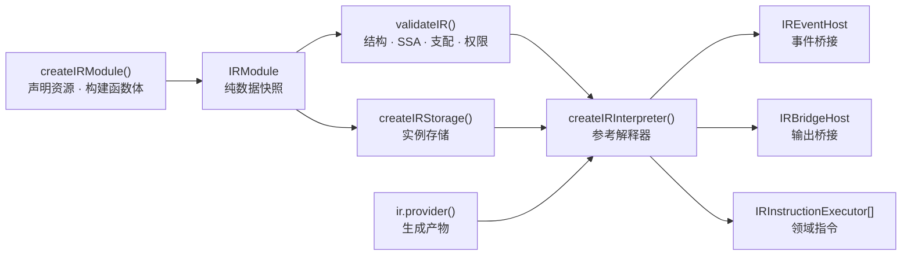

# @mica-js/ir

领域无关的 IR：同步类型化建图器、实例存储、静态校验与参考解释器。不导入任何领域类型——引脚、连接、电源等都通过显式声明与可信执行器接入。

## 架构



## 安装

```bash
pnpm add @mica-js/ir
```

## 快速上手

```ts
import { createIRInterpreter, createIRModule } from '@mica-js/ir';

const module = createIRModule();
const count = module.state('count', 'u32', 0);
const increment = module.func('increment', { params: ['u32'], results: ['u32'] });
increment.body((b, [delta]) => {
  const next = b.int.add(b.state.load(count), delta);
  b.state.store(count, next);
  b.return([next]);
});

const operations = ['state.load', 'int.add', 'state.store', 'return'];
const runtime = createIRInterpreter(module, {
  validation: {
    supportedInstructions: operations,
    authorizedInstructions: operations,
    resources: [{ ref: count, access: 'read-write' }],
  },
});

runtime.execute(increment, [3], { instanceId: 'counter', virtualTime: 0 });
runtime.storage.loadState(count); // 3
```

## 公共入口

唯一公开入口为 `@mica-js/ir`，构建产物为 `dist/index.js`（ESM）与 `.d.ts`。

| 导出                                          | 作用                                                               |
| --------------------------------------------- | ------------------------------------------------------------------ |
| `createIRModule(options?)`                    | 创建独立的声明 / 建图上下文，返回 `IRModule`                       |
| `createIRStorage(module, options?)`           | 为声明资源创建独立实例存储；`updateResources` 显式授予字节更新权限 |
| `createIRInterpreter(module, options)`        | 创建经快照与校验的参考解释器，拥有独立 `storage`                   |
| `validateIR(input, options)`                  | 静态检查，返回 `IRValidationResult` 与 `IRDiagnostic`              |
| `evaluateScalarInstruction(instruction, ops)` | 求值单个整数 / 布尔节点                                            |
| `evaluateFloatInstruction(instruction, ops)`  | 求值单个浮点节点                                                   |

引用类别之间不可互换：`StateRef`、`ArrayRef`、`BytesRef`、`InboxRef` 各自独立，`EntryRef`、`LifecycleRef` 与普通 `FunctionRef` 在类型与运行期都不同，`OutputRef` / `BytesOutputRef`、`ProviderRef` / `GeneratedFunction` 同理。

## 建图

```ts
import { createIRModule } from '@mica-js/ir';

const ir = createIRModule();
const count = ir.state('count', 'u32', 0);

const add = ir.func('add', { params: ['u32', 'u32'], results: ['u32'] });
add.body((b, [left, right]) => b.return([b.int.add(left, right)]));

const run = ir.entry('run', ['u32']);
run.body((b, [value]) => {
  const [sum] = b.call(add, [value, b.const('u32', 1)]);
  b.state.store(count, sum);
  b.return([]);
});
```

- 先用 `ir.func` / `ir.entry` / `ir.lifecycle` 声明引用，再用一次 `.body(callback)` 定义函数体。`.body` 同步执行：async / generator 回调在调用前被拒绝，普通函数返回 Promise 也会同步拒绝。
- 普通函数通过 `b.call(target, args)` 同步调用，结果始终按列表返回。入口与生命周期没有普通返回值，也不能被 `call`。
- 基本块：`b.block(types)` 只创建目标块，`b.at(block, callback)` 才进入该块并在回调后恢复插入位置。
- 每个块必须以 `return` / `jump` / `branch` / `trap` 终结。回调抛错、返回 Promise 或未终结都会使整个函数构建失效。
- 块参数是循环与合流的唯一显式传值方式，没有隐式 phi 或可变局部变量。

```ts
const choose = ir.func('choose', { params: ['bool'], results: ['u32'] });
choose.body((b, [condition]) => {
  const yes = b.block([]);
  const no = b.block([]);
  const join = b.block(['u32']);
  b.branch(condition, { target: yes, args: [] }, { target: no, args: [] });
  b.at(yes, (inner) => inner.jump(join, [inner.const('u32', 1)]));
  b.at(no, (inner) => inner.jump(join, [inner.const('u32', 2)]));
  b.at(join, (inner, [result]) => inner.return([result]));
});
```

### 统一内存模型

状态、数组、字节区与输入槽位共用 `MemoryDefinition`：

- `kind` 区分 `state`、`array`、`bytes`、`inbox`。
- `state` / `array` 用 `layout.kind: 'scalar'`，固定元素类型与长度（状态长度为 1）。
- `bytes` / `inbox` 用 `layout.kind: 'bytes'`，固定字节容量，`unitBytes` 记录版本单元粒度。
- `bytes` 的 `readonly` 只限制普通 `bytes.store` / `bytes.copy`；`inbox` 只能读取。
- 声明初值会被复制，整数越界或 bool / 数值混用会被拒绝。

### 领域扩展

领域包可在自己的包内声明静态句柄与显式指令，核心不导入域类型：

```ts
const led = ir.domainDeclaration('led', 'status');
const setLed = ir.domainInstruction('led.set', {
  operands: [
    { kind: 'static', category: 'led' },
    { kind: 'value', type: 'bool' },
  ],
  results: [],
});

ir.entry('enable', ['bool']).body((b, [on]) => {
  b.invoke(setLed, [led, on]);
  b.return([]);
});
```

`invoke` 只生成已声明的显式指令，并校验操作数类别、标量类型与结果布局；不提供 `call(hostFunction)` 或任意运行期 JS 回调扩展。领域静态引用与普通资源一样需要显式授权，静态链接时还须由后端提供可信的 `IRInstructionValidator`。

### 构建器扩展

`createIRModule({ builderExtensions })` 让领域包为每个构建器附加命名空间：

```ts
const extension: IRBuilderExtension = {
  namespace: 'pin',
  create(b) {
    return { sample: () => b.invoke(sampleInstruction, [pinHandle])[0] };
  },
};
const module = createIRModule({ builderExtensions: [extension] });
```

- 命名空间不得与内建成员冲突，同一模块内不得重复。
- `create` 必须同步，返回的方法也必须是同步函数。
- 扩展对每个普通、生命周期及嵌套块构建器分别创建，因而可共享模块级指令声明。

## 实例存储

```ts
import { createIRStorage } from '@mica-js/ir';

const storage = createIRStorage(ir);
storage.storeState(count, 1);
storage.storeBytes('u16', 'little', ram, 1, 0x1234);
storage.copy(ram, 4, input, 0, 8);
```

- 索引、偏移与长度按 `u32` 检查；多字节访问先验证完整范围，非对齐访问合法。
- 单次操作先完成类别、权限、范围与值校验再提交字节，失败不留部分写入；此前成功的写入不回滚。
- `bytes.copy` 先取源快照，同资源重叠复制按复制前的取值；零长度仍校验端点与目标可写。
- 每次 `createIRStorage` 都从声明初值复制独立 buffer，实例、声明与输入数组之间互不别名。
- `state.load` / `array.load` / `bytes.load` 返回 `StorageValue<T>`：`bool` 为 `boolean`、整数为 `number`、浮点为 `FloatBits` 原始位模式。
- 普通 `store` / `copy` 只改内容、不改版本；版本化更新需独立授权。
- 失败抛 `IRStorageError`，`code` 为 `invalid-resource`、`invalid-value`、`invalid-argument`、`out-of-bounds`、`readonly-resource`、`unauthorized-resource` 或 `allocation-failure`。

## 逐指令求值

`evaluateScalarInstruction(instruction, operands)` 消费建图器产出的节点，不引入第二套指令类型。`operands` 按 SSA 操作数出现顺序提供已求值标量（literal 不占位）；不写回 SSA、不访问存储、不执行控制流。

```ts
const multiply = ir.functions[0]!.body!.entry.instructions[0]!;
evaluateScalarInstruction(multiply, [4294967295, 4294967295]); // 1
```

- 支持 `u8/i8/u16/i16/u32/i32` 的 `int.add/sub/mul/div/rem/and/or/xor/not`、全部 `int.cmp` 谓词、`int.shl/lshr/ashr` 与 `int.zext/sext/trunc/reinterpret`，以及 `bool.not/and/or/xor`、`const`、`select`。
- 加减乘与有符号商溢出按位宽回绕；除法向零截断；除零 / 取余零报错。
- 移位数为严格 `u32`，不对位宽取模；`count >= width` 时左移 / 逻辑右移为零，算术右移按符号填充。
- 内部使用精确 `bigint` 与显式定宽归一化，公开标量仍是 `number | boolean`。
- 失败抛 `IRScalarEvaluationError`：`unsupported-instruction`、`invalid-instruction`、`invalid-operand`、`division-by-zero`、`conversion-out-of-range`。

### 浮点

`evaluateFloatInstruction(instruction, operands)` 复用同一指令模型：

- `FloatBits = { type, bits }` 保存原始位（f32 8 位、f64 16 位十六进制）；`RuntimeScalar = boolean | number | FloatBits`。
- 支持 `const` / `const.bits` / `select`、`float.add/sub/mul/div/fma/cmp/isNaN/isFinite`、`convert.intToFloat/floatToInt/float` 与 f32/f64 ↔ u32/i32 的 `bitcast`。
- 内部用无依赖 BigInt 精确计算，按目标精度取最近值、居中取偶数舍入；FMA 不舍入中间乘积，保留次正规数与有符号零。
- 算术与精度转换产生的 NaN 规范为 `0x7fc00000` / `0x7ff8000000000000`；`const.bits`、`select` 与 bitcast 保留原始位。
- 需要保留 NaN 载荷或符号位时必须传 `FloatBits`，不要经 JS number 往返。

## 静态校验

`validateIR(input, options)` 是统一静态检查入口。`input` 需具备 `memories`、`functions`、`domainDeclarations`、`instructions` 四个列表（可直接传 `IRModule`）；它检查当前表示，不调用建图方法。

```ts
const result = validateIR(ir, {
  supportedInstructions: ['const', 'state.store', 'return'],
  authorizedInstructions: ['const', 'state.store', 'return'],
  resources: [{ ref: count, access: 'write' }],
});
// result.ok；否则读 result.diagnostics
```

策略必须由可信宿主提供，不应采信客体自称的能力：

- `supportedInstructions`（后端支持）与 `authorizedInstructions`（实例获准）精确匹配，必须包含所用的终结名；没有默认全支持、通配符或自动授权。
- `resources` 按句柄身份授予 `read` / `write` / `read-write` / `update`。
- 领域扩展的静态声明与指令也在此校验。

## 参考解释器

`createIRInterpreter(module, options)` 捕获私有执行快照、调用 `validateIR`，再用 `createIRStorage` 建立独占存储；原模型后续修改不影响已创建的实例。

| 选项           | 说明                                      |
| -------------- | ----------------------------------------- |
| `validation`   | 必填；静态校验策略                        |
| `maxSteps`     | 单次 `execute` 的步骤预算，默认 1,000,000 |
| `eventHost`    | 事件桥接，见下                            |
| `bridge`       | 输出桥接，见下                            |
| `executors`    | 可信领域指令执行器                        |
| `stepObserver` | 每步效果前的同步钩子                      |

`execute(target, args, context)` 同步执行 `FunctionRef` / `EntryRef` / `LifecycleRef`，返回 `{ values, steps }`。`context = { instanceId, virtualTime }` 必填：实例标识非空，虚拟时间为非负安全整数皮秒，仅用于诊断。

- 存储跨成功执行保留，每次 `execute` 使用独立预算。
- 普通调用与块跳转不推进虚拟时间、不创建事件、不形成等待 / 恢复对象。
- API 面向可信宿主，不是隔离恶意 JS getter 的沙箱。

### 预算

- 每条规范化指令与终结符各计一步；参数绑定与调用帧不计费，未选中的分支不计。
- 普通调用共享顶层 `execute` 的剩余预算，先检查再开始下一步。
- `steps` 计已开始的步骤（故障步骤计入，被预算拦截的不计入）。

### 错误与提交

`IRExecutionError` 暴露 `code`、`context`、`location`、`callStack`、`steps`、`diagnostics`、`cause`。`callStack` 由外到内排列。

| `code`                    | 含义                              |
| ------------------------- | --------------------------------- |
| `invalid-options`         | 非法解释器配置 / 预算             |
| `validation-failed`       | 模型或显式策略未通过静态校验      |
| `invalid-target`          | 顶层目标不属于此解释器的模块快照  |
| `invalid-argument`        | 执行前实参或上下文非法            |
| `budget-exhausted`        | 下一步骤超出预算                  |
| `trap`                    | 模型显式终结异常                  |
| `evaluation-failed`       | 单节点运算失败                    |
| `storage-failed`          | 存储分配或访问失败                |
| `unsupported-instruction` | 静态扩展合法但没有执行实现        |
| `instance-faulted`        | 实例此前已故障，不允许再执行      |
| `provider-failed`         | Provider 生成、产物或依赖检查失败 |

- 存储操作沿用完整范围校验与原子提交：失败操作无部分写入，已提交效果不回滚。
- 预算、求值、存储或 trap 故障会锁定实例，后续 `execute` 抛 `instance-faulted`；没有 reset / resume。
- 非法目标、参数或 context 等调用前错误不消耗步骤、不锁定实例。

### 领域指令执行器

```ts
const runtime = createIRInterpreter(module, {
  validation,
  executors: [
    {
      op: 'led.apply',
      execute({ instruction, operands, context }) {
        return []; // 同步完成所属领域的原子效果
      },
    },
  ],
});
```

- `IRInstructionExecutor` 是可信同步宿主扩展，不是任意 JS 回调面；`op` 不能与核心指令同名，重复注册报 `invalid-options`。
- 执行器在参数绑定后按节点调用一次，接收模型快照中的指令与按值解析的 SSA 操作数（`ssa-list` 按元素顺序展开）。
- 返回值数量与声明结果类型逐项校验；返回 Promise、generator、数量或类型不符均使本次执行失败。
- 解释器创建时扫描所有可达与不可达指令；某领域指令没有执行器时整体链接失败，不会把不支持的能力当作空操作。

### 事件桥接

```ts
interface IREventHost {
  now(): number;
  at(target: EntryRef, deadline: number, args: readonly RuntimeScalar[]): number;
  cancel(id: number): void;
}
```

- `event.now` 无操作数，返回 `f64`；`event.at` 编码静态普通入口、SSA `f64` 期限与 SSA 参数，返回 `u32`；`event.cancel` 接收一个 SSA `u32`，无结果。
- 目标必须属于同一模块且签名匹配；生命周期与普通函数目标被拒绝。这些名称不能被领域声明覆盖。
- 三条指令仍需显式的 `supportedInstructions` 与 `authorizedInstructions` 授权。
- 没有 `eventHost` 的解释器在创建时拒绝含事件指令的模块，诊断带 IR 位置。
- 时间校验只发生在该事件边界：期限必须是 `[0, 7_200_000_000_000_000]` 内的有限整数皮秒，`-0` 归一化为 0。

### 输出桥接

`module.output(name, { params, capacity })` 与 `module.outputBytes(name, { maxBytes, capacity })` 声明静态、有界的输出端点。构建器提供：

```ts
output<P extends readonly ScalarType[]>(output: OutputRef<P>, args: Values<P>): Value<'bool'>;
outputBytes(
  output: BytesOutputRef,
  region: ReadableBytesRef,
  offset: Value<'u32'>,
  length: Value<'u32'>,
): Value<'bool'>;
```

它们分别降低为 `bridge.send` 与 `bridge.send_bytes`：

```ts
interface IRBridgeHost {
  send(output: OutputRef, payload: readonly (boolean | number)[], timePs: number): boolean;
  sendBytes(output: BytesOutputRef, bytes: Uint8Array, timePs: number): boolean;
}
```

- 可选 `bridge` 在指令位置同步接收已捕获数据与虚拟时间；没有 bridge 的解释器在创建时拒绝含 bridge 指令的模块。
- 标量输出参数在宿主边界转换为 JS `boolean` / `number`（浮点解码为 number），字节输出先校验读取范围与 `maxBytes` 再快照。
- 范围、读取权限与 `maxBytes` 非法属于模型错误；只有合法载荷下的队列 / 字节预算不足由 host 返回 `false`。

### Provider 产物

`ir.provider(name, descriptor, generate)` 声明按 key 生成、依赖跟踪、实例内缓存的产物：

```ts
const code = ir.provider(
  'code',
  {
    keyTypes: ['u32'],
    params: [],
    results: [],
    reads: [firmware], // 生成期受追踪读取的授权上限
    imports: [pc, r0, helper], // 产物可引用的静态引用
  },
  (gen, [address]) => {
    const bytes = gen.readBytes(firmware, address, 2); // 独立副本
    return gen.function((b) => {
      b.state.store(r0, b.const('u32', bytes[1]));
      b.state.store(pc, b.const('u32', address + 2));
      b.call(helper, []);
      b.return([]);
    });
  },
);
step.body((b) => b.dispatch(code, [b.state.load(pc)], []));
```

- `gen.readBytes` / `readState` / `readArray` 只接受 `reads` 中的资源，并登记实际覆盖的版本单元；`readBytes` 校验 JS 整数范围并返回独立副本。
- 生成回调同步执行，只创建当前产物：不能动态声明资源 / 函数 / 入口，也不能经可信 storage 句柄写入。每次生成最多一次 `gen.function`，且必须返回该句柄；生成失败不进入缓存。
- 产物仍由 `validateIR` 与 imports 白名单校验：只能引用 `imports` 中的静态引用，不能调用领域指令。
- `dispatch` 是终结指令：按规范化的 key 取得产物，并在当前入口、步数预算与虚拟时间中尾转移；`provider.results` 必须与当前函数结果完全一致。
- 每次派发校验该产物的全部依赖，失效时按当前内容重新生成；缓存命中不重新生成，也不重放已提交效果。
- key 在生成回调中是 JS 标量；缓存身份按 provider 与精确编码（bool、整数、浮点 canonical 位串）区分，运行时 args 不参与。缓存按解释器实例隔离，当前实现不做驱逐。
- `b.checkpoint(provider, key, args)` 只存在于生成产物构建器：它检查当前产物的完整依赖，失效时丢弃旧产物剩余步骤，以当前 SSA key / args 尾派发恢复目标。已提交的存储、事件、输出与时间效果保留且不重放。
- checkpoint 不固化产物：恢复时按当前资源版本重新生成。只支持内存内实例恢复，不提供磁盘格式、跨进程 / 跨实例迁移或 JIT 重放。
- 失败抛 `IRProviderError`（`invalid-provider`、`key-mismatch`、`unauthorized-read`、`invalid-read`、`generation-failed`、`invalid-artifact`、`import-violation`、`dependency-changed`、`illegal-operation`、`recovery-failed`），解释器包装为 `provider-failed` 并保留 `cause`、调用位置与产物诊断。

## 版本化资源更新

```ts
updateBytes(destination, destinationOffset, source, sourceOffset, length): undefined;
fillBytes(destination, offset, length, value): undefined;
```

- 目标是静态字节区（可 readonly，不可 inbox），源可为字节区或 inbox。
- 独立存储用 `createIRStorage(module, { updateResources })` 授予更新权限；构造时捕获名单、拒绝 inbox 与外模块资源。
- `update` grant、源 `read` grant、指令支持 / 授权分别核验；完整范围检查先于任何提交，重叠更新使用源快照。
- 单元边界为 `floor(offset / unitBytes)`，声明后固定；非零更新为覆盖的每个单元产生新版本 token。
- 依赖 token 是不透明对象，只在本实例内有效；过期、伪造、跨资源 / 实例或非法形状返回 `false`，空集合为 `true`。
- 普通 `bytes.store` / `bytes.copy` 不改变字节单元版本；state / array 使用整资源单元并随普通写入推进。

```ts
interface IRStorage {
  updateBytes(
    destination: BytesRef,
    destinationOffset: number,
    source: ReadableBytesRef,
    sourceOffset: number,
    length: number,
  ): void;
  fillBytes(destination: BytesRef, offset: number, length: number, value: number): void;
  readVersionedBytes(ref: ReadableBytesRef, offset: number, length: number): IRVersionedBytes;
  validateDependencies(dependencies: readonly IRResourceDependency[]): boolean;
  writeInbox(ref: InboxRef, offset: number, bytes: Uint8Array): void;
  updateBytesFromBytes(ref: BytesRef, offset: number, bytes: Uint8Array): void;
}
```

`writeInbox` 是可信宿主写入 inbox 的唯一通道；IR 自身的 inbox 读取保持只读。

## 执行能力总览

| 能力                                    | 入口                                                 |
| --------------------------------------- | ---------------------------------------------------- |
| 整数 / 布尔 / 浮点 / `select` / `const` | 解释器内建                                           |
| 存储读写                                | `state.*` / `array.*` / `bytes.*`                    |
| 版本化更新                              | `resource.update_bytes` / `resource.fill_bytes`      |
| 事件                                    | `event.now/at/cancel` + `IREventHost`                |
| 输出                                    | `bridge.send` / `bridge.send_bytes` + `IRBridgeHost` |
| 调用与控制流                            | `call` / `return` / `jump` / `branch` / `trap`       |
| Provider 生成与恢复                     | `ir.provider` / `dispatch` / `checkpoint`            |
| 领域指令                                | `executors` 显式注册                                 |

## 边界

- 不提供事件调度器、话题路由、通知队列、持久化快照或 JIT——这些由 `@mica-js/core`、`@mica-js/device` 等上层包组合。
- 校验通过不代表已经执行；未实现的能力显式拒绝，不以空操作伪装成功。
- 解释器不隔离恶意代码：领域句柄、执行器与存储访问都面向可信宿主。
