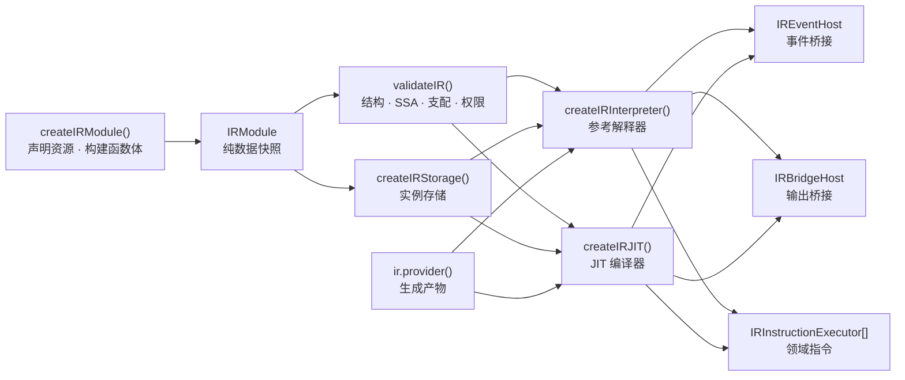

# @mica-js/ir

领域无关的 IR：同步类型化建图器、实例存储、静态校验、参考解释器与 JIT 编译器。不导入任何领域类型——引脚、连接、电源等都通过显式声明与可信执行器接入。

## 架构



## 安装

```bash
pnpm add @mica-js/ir
```

## 快速上手

```ts
import { createIRInterpreter, createIRModule } from '@mica-js/ir';

const module = createIRModule();
const count = module.state('count', 'u32', 0);
const increment = module.func('increment', { params: ['u32'], results: ['u32'] });
increment.body((b, [delta]) => {
  const next = b.int.add(b.state.load(count), delta);
  b.state.store(count, next);
  b.return([next]);
});

const operations = ['state.load', 'int.add', 'state.store', 'return'];
const runtime = createIRInterpreter(module, {
  validation: {
    supportedInstructions: operations,
    authorizedInstructions: operations,
    resources: [{ ref: count, access: 'read-write' }],
  },
});

runtime.execute(increment, [3], { instanceId: 'counter', virtualTime: 0 });
runtime.storage.loadState(count); // 3
```

**JIT 使用同样的 API**，只需将 `createIRInterpreter` 替换为 `createIRJIT`，结果、步数、错误与参考解释器完全等价。

## 公共入口

唯一公开入口为 `@mica-js/ir`，构建生成 `dist/index.js`（ESM）与声明文件。

| 导出                                          | 作用                                                                                                                                            |
| --------------------------------------------- | ----------------------------------------------------------------------------------------------------------------------------------------------- |
| `createIRModule()`                            | 创建独立的模块声明/建图上下文，返回 `IRModule`                                                                                                  |
| `createIRStorage(module, options?)`           | 为声明资源创建一份独立实例存储；`updateResources` 显式授予字节更新权限，默认无授权                                                              |
| `createIRInterpreter(module, options)`        | 创建经快照与校验的参考解释器，拥有独立 `storage`                                                                                                |
| `createIRJIT(module, options)`                | 创建经同样快照与校验的 JIT 执行引擎，拥有独立 `storage`；与参考解释器结果、步数与错误等价                                                       |
| `validateIR(input, options)`                  | 返回 `IRValidationResult`，通过 `IRDiagnostic` / `IRDiagnosticLocation` 报告静态错误                                                            |
| `evaluateScalarInstruction(instruction, ops)` | 求值单个整数/布尔节点，失败抛 `IRScalarEvaluationError`                                                                                         |
| `evaluateFloatInstruction(instruction, ops)`  | 求值单个浮点节点，失败抛 `IRFloatEvaluationError`                                                                                               |
| `IRProviderError`                             | Provider 声明、生成、产物与缓存失败，带稳定 `code` 与产物诊断                                                                                   |
| 类型                                          | `IRDeclarations`、`FunctionBuilder<R>`、`IRModule`、`ProviderRef` / `GeneratedFunction`、`FunctionRef` / `EntryRef` / `LifecycleRef` 等引用类别 |

`StateRef`、`ArrayRef`、`BytesRef`、`InboxRef` 不可互换；`EntryRef`、`LifecycleRef` 与普通 `FunctionRef` 在类型和运行期都保持独立，`OutputRef` 与 `BytesOutputRef`、`ProviderRef` 与 `GeneratedFunction` 同样是独立的静态类别。

## 建图

```ts
import { createIRModule } from '@mica-js/ir';

const ir = createIRModule();
const count = ir.state('count', 'u32', 0);

const add = ir.func('add', { params: ['u32', 'u32'], results: ['u32'] });
add.body((b, [left, right]) => b.return([b.int.add(left, right)]));

const run = ir.entry('run', ['u32']);
run.body((b, [value]) => {
  const [sum] = b.call(add, [value, b.const('u32', 1)]);
  b.state.store(count, sum);
  b.return([]);
});
```

- 函数先通过 `ir.func` / `ir.entry` / `ir.lifecycle` 声明引用，再用一次 `.body(callback)` 定义函数体；`.body` 同步执行，async/generator 回调在调用前即被拒绝，普通函数返回 Promise 也会同步拒绝。
- 普通函数通过 `b.call(target, args)` 同步调用，结果始终按列表返回（零/单/多结果）；入口与生命周期没有普通返回值，也不能被 `call`。
- 基本块：`b.block(types)` 只创建目标块，`b.at(block, callback)` 才进入该块并在回调后恢复插入位置。每个块必须以 `return` / `jump` / `branch` / `trap` 终结；回调抛错、返回 Promise 或未终结都会使整个函数构建失效，需重新 `.body`。
- 块参数是循环与合流的唯一显式传值方式，不提供隐式 phi 或可变局部变量。
- `GeneratedFunctionBuilder<R>` 继承 `dispatch`，并由 `gen.function` 传入；另提供 `checkpoint(provider, key, args)` 标记产物内的合法恢复边界（#61）。

```ts
const choose = ir.func('choose', { params: ['bool'], results: ['u32'] });
choose.body((b, [condition]) => {
  const yes = b.block([]);
  const no = b.block([]);
  const join = b.block(['u32']);
  b.branch(condition, { target: yes, args: [] }, { target: no, args: [] });
  b.at(yes, (inner) => inner.jump(join, [inner.const('u32', 1)]));
  b.at(no, (inner) => inner.jump(join, [inner.const('u32', 2)]));
  b.at(join, (inner, [result]) => inner.return([result]));
});
```

### 统一内存模型

状态、数组、字节区与输入槽位共用 `MemoryDefinition`（`module.memories`）：

- `kind` 区分 `state`、`array`、`bytes`、`inbox`。
- `state` / `array`：`layout.kind: 'scalar'`，固定元素类型与长度（状态长度为 1）。
- `bytes` / `inbox`：`layout.kind: 'bytes'`，固定字节容量，`unitBytes` 记录版本单元粒度。
- `bytes` 的 `readonly` 只限制普通 `bytes.store` / `bytes.copy`；`inbox` 只能读取。
- 声明初值会被复制，整数越界或 bool/数值混用会被拒绝。

### 领域扩展

领域模块可在自己的包中声明静态句柄与显式指令，核心不导入引脚、电源等域类型：

```ts
const led = ir.domainDeclaration('led', 'status');
const setLed = ir.domainInstruction('led.set', {
  operands: [
    { kind: 'static', category: 'led' },
    { kind: 'value', type: 'bool' },
  ],
  results: [],
});

ir.entry('enable', ['bool']).body((b, [on]) => {
  b.invoke(setLed, [led, on]);
  b.return([]);
});
```

`invoke` 只生成已声明的显式指令，并校验操作数类别、标量类型与结果布局；不提供 `call(hostFunction)` 或任意运行期 JS 回调扩展。领域静态引用与普通资源一样需要显式授权；静态链接时还须由后端提供可信的 `IRInstructionValidator`，否则按 `unsupported-instruction` 拒绝。

领域模块可以通过 `createIRModule({ builderExtensions })` 在自己的包内为每个构建器附加命名空间，核心不导入领域类型：

```ts
let module: IRModule;
let pin: StaticRef<'pin'> | undefined;
let sample: DomainInstruction | undefined;
const extension: IRBuilderExtension = {
  namespace: 'pin',
  create(b) {
    // 指令与静态句柄在每个模块内只声明一次；扩展可在首次创建构建器时惰性声明。
    pin ??= module.domainDeclaration('pin', 'OUT');
    sample ??= module.domainInstruction('pin.sample', {
      operands: [{ kind: 'static', category: 'pin' }],
      results: ['u32'],
    });
    return { sample: () => b.invoke(sample!, [pin!])[0] };
  },
};
module = createIRModule({ builderExtensions: [extension] });
// 领域类型模块可在自己的 d.ts 中增强 FunctionBuilder，使 b.pin.sample() 获得类型。
```

命名空间不得与内建成员冲突，同一模块内不得重复；`create` 必须同步，返回的方法也必须是同步函数。扩展可以对每个普通、生命周期及嵌套块构建器分别创建命名空间，因而可共享模块级指令声明。

参考解释器通过 `IRInterpreterOptions.executors` 接收可信的领域指令执行器：

```ts
interface IRInstructionExecution {
  readonly instruction: InstructionNode;
  readonly operands: readonly RuntimeScalar[];
  readonly context: IRExecutionContext;
}
interface IRInstructionExecutor {
  readonly op: string;
  execute(request: IRInstructionExecution): readonly RuntimeScalar[];
}
```

`op` 必须是本模块已声明且非核心的指令，同名执行器只能注册一次；执行方法按创建时捕获的接收者同步调用。`request.operands` 只包含按指令顺序展开的 SSA 运行时值；静态引用与字面量从 `request.instruction.operands` 读取。结果数量与类型必须精确匹配指令声明，否则以 `evaluation-failed` 失败并保留 cause、位置与调用栈；没有执行器的声明指令仍按 `unsupported-instruction` 拒绝。核心指令、终结指令和 `eventHost` 不能被领域执行器替换。核心 `event.now/at/cancel` 由核心分派；其他 `event.*` 必须声明为领域指令并注册执行器，分派时先检查执行器，未注册时在创建期按 `unsupported-instruction` 拒绝，不会静默落入核心事件路径。

领域指令还支持分组列表操作数，用于一条指令携带固定长度而运行期按值捕获的批量数据：

```ts
const apply = ir.domainInstruction('led.apply', {
  operands: [
    { kind: 'static-list', category: 'led', minLength: 1 },
    { kind: 'value-list', type: 'bool', minLength: 1 },
  ],
  results: [],
});

ir.entry('apply', ['bool']).body((b, [on]) => {
  b.invoke(apply, [
    [first, second],
    [on, b.bool.not(on)],
  ]);
  b.return([]);
});
```

列表操作数在 IR 节点中保留为 `static-list` / `ssa-list`，不会展开成 JS 对象数组；`minLength` 在建图、静态校验与解释器链接期共同检查。列表元素仍逐项校验类别、类型、模块归属与资源授权；元素数量对应关系由所属领域的可信校验器负责。

## 实例存储

```ts
import { createIRModule, createIRStorage } from '@mica-js/ir';

const ir = createIRModule();
const counter = ir.state('counter', 'u32', 0);
const ram = ir.bytes('ram', new Uint8Array(16), { readonly: false });
const input = ir.inbox('input', 8);

const storage = createIRStorage(ir);
storage.storeState(counter, 1);
storage.storeBytes('u16', 'little', ram, 1, 0x1234);
storage.copy(ram, 4, input, 0, 8);
```

- 索引、偏移与长度按 u32 检查；多字节访问先验证完整范围，非对齐访问合法。
- 单次操作先完成类别、权限、范围与值校验再提交字节，失败不留部分写入；此前成功的写入不回滚。
- `bytes.copy` 先取源快照，同资源重叠复制按复制前取值；零长度仍校验端点与目标可写。
- 每次 `createIRStorage` 都从声明初值复制独立 buffer，实例、声明与输入 `Uint8Array` 之间互不别名。
- 普通 `store` / `copy` 只改内容、不改版本；版本化更新需独立授权（见下）。
- `state.load` / `array.load` / `bytes.load` 返回 `StorageValue<T>`：`bool` 为 `boolean`、整数为 `number`、浮点为 `FloatBits` 原始位模式。
- 失败抛 `IRStorageError`，`code` 为 `invalid-resource`、`invalid-value`、`invalid-argument`、`out-of-bounds`、`readonly-resource`、`unauthorized-resource` 或 `allocation-failure`。`validateIR` 负责静态核验，存储负责运行期检查，二者互不替代。

## 逐指令求值

`evaluateScalarInstruction(instruction, operands)` 消费建图器/内存模型的节点，不引入另一套指令类型；`operands` 按 SSA 操作数出现顺序提供已求值标量（literal 不占位）。不写回 SSA、不访问存储、不执行控制流。

```ts
import { createIRModule, evaluateScalarInstruction } from '@mica-js/ir';

const ir = createIRModule();
ir.func('multiply', { params: ['u32', 'u32'], results: ['u32'] }).body((b, [a, c]) =>
  b.return([b.int.mul(a, c)]),
);
const multiply = ir.functions[0]!.body!.entry.instructions[0]!;
evaluateScalarInstruction(multiply, [4294967295, 4294967295]); // 1
```

- 支持 `u8/i8/u16/i16/u32/i32` 的 `int.add/sub/mul/div/rem/and/or/xor/not`、`int.cmp` 全部 predicate、`int.shl/lshr/ashr` 及 `int.zext/sext/trunc/reinterpret`；`bool.not/and/or/xor`、`const`、`select`。
- 加减乘与有符号商溢出按位宽回绕；除法向零截断；除零/取余零报错。
- 移位数严格为 `u32`，不对位宽取模；`count >= width` 时左移/逻辑右移为零，算术右移按符号填充。
- 内部使用精确 `bigint` 与显式定宽归一化，避免 JS 位运算的 32 位截断；公开标量仍为 `number | boolean`。
- 失败抛 `IRScalarEvaluationError`：`unsupported-instruction`、`invalid-instruction`、`invalid-operand`、`division-by-zero`。

### 浮点

`evaluateFloatInstruction(instruction, operands)` 复用同一指令模型，只求值单个节点：

- `FloatBits = { type; bits }` 保存原始位（f32 8 位、f64 16 位十六进制，`0x` 前缀）；`RuntimeScalar = boolean | number | FloatBits`。
- 支持 `const` / `const.bits` / `select`、`float.add/sub/mul/div/fma/cmp/isNaN/isFinite`、`convert.intToFloat/floatToInt/float` 及 f32/64 与 u32/i32 间的 `bitcast`。
- 内部用无依赖 BigInt 精确计算，按目标精度最近值、居中取偶数舍入；FMA 不舍入中间乘积，保留次正规数与有符号零。
- 算术与精度转换产生的 NaN 规范为 `0x7fc00000` / `0x7ff8000000000000`；`const.bits`、`select` 与 bitcast 保留原始位。
- 浮点输出始终为 `FloatBits`；需要保留 NaN 载荷/符号位时必须传 `FloatBits`，不要经 JS number 往返。
- SSA 中的浮点值一律冻结：`const.bits` 返回冻结的 `FloatBits`，宿主经 executor operands 或函数返回值拿到同一对象时不能就地修改。
- 失败抛 `IRFloatEvaluationError`：`integer-overflow`、`invalid-instruction`、`invalid-operand`、`unsupported-operation`。

```ts
import { createIRModule, evaluateFloatInstruction } from '@mica-js/ir';

const module = createIRModule();
module
  .func('fused', { params: ['f32', 'f32', 'f32'], results: ['f32'] })
  .body((b, [a, c, d]) => b.return([b.float.fma(a, c, d)]));
const instruction = module.functions[0]!.body!.entry.instructions[0]!;
evaluateFloatInstruction(instruction, [1 + 2 ** -23, 1 - 2 ** -23, -1]);
// { type: 'f32', bits: '0xa8800000' }，即 -2^-46；非融合结果为正零。
```

## 静态校验

`validateIR(input, options)` 是统一静态检查入口：`input` 需具备 `memories`、`functions`、`domainDeclarations`、`instructions` 四个列表（可直接传 `IRModule`）。它校验当前表示，不调用建图方法，也不以 builder 的隐藏记录替代检查。

```ts
import { createIRModule, validateIR } from '@mica-js/ir';

const ir = createIRModule();
const count = ir.state('count', 'u32', 0);
ir.entry('run', []).body((b) => {
  b.state.store(count, b.const('u32', 1));
  b.return([]);
});

const result = validateIR(ir, {
  supportedInstructions: ['const', 'state.store', 'return'],
  authorizedInstructions: ['const', 'state.store', 'return'],
  resources: [{ ref: count, access: 'write' }],
});
// result.ok；否则读 result.diagnostics。
```

策略必须由可信宿主提供，不应采信客体自称的能力：

- `supportedInstructions`（后端支持）与 `authorizedInstructions`（实例获准）精确匹配，且必须包含所用的终结名；没有默认全支持、通配符或自动授权。
- `resources` 按句柄身份授予 `read` / `write` / `read-write` / `update`。
- 领域扩展的静态声明与指令也在此校验。

## 参考解释器

```ts
import { createIRInterpreter, createIRModule } from '@mica-js/ir';

const module = createIRModule();
const count = module.state('count', 'u32', 0);
const increment = module.func('increment', { params: ['u32'], results: ['u32'] });
increment.body((b, [delta]) => {
  const next = b.int.add(b.state.load(count), delta);
  b.state.store(count, next);
  b.return([next]);
});

const runtime = createIRInterpreter(module, {
  validation: {
    supportedInstructions: ['state.load', 'int.add', 'state.store', 'return'],
    authorizedInstructions: ['state.load', 'int.add', 'state.store', 'return'],
    resources: [{ ref: count, access: 'read-write' }],
  },
  maxSteps: 1_000_000,
});
const result = runtime.execute(increment, [3], { instanceId: 'counter', virtualTime: 1000 });
// { values: [3], steps: 4 }
runtime.storage.loadState(count); // 3
```

- `createIRInterpreter` 捕获私有执行快照，调用 `validateIR`，再用 `createIRStorage` 建独占存储；原模型后续修改不影响已创建的实例。
- `IRInterpreterOptions` 包含必填 `validation: IRValidationOptions` 和可选 `maxSteps: number`、`eventHost: IREventHost`、`bridge: IRBridgeHost`、`stepObserver: IRStepObserver`、`stepBudget: IRStepBudget`、`executors: readonly IRInstructionExecutor[]`；API 面向可信宿主，不是隔离恶意 JS getter/validator 的沙箱。
- `execute(target, args, context)` 同步执行 `FunctionRef` / `EntryRef` / `LifecycleRef`，返回 `{ values, steps }`。`context = { instanceId, virtualTime }` 必填：实例标识非空，虚拟时间为非负安全整数皮秒，仅用于诊断。
- 存储跨成功执行保留；每次 `execute` 使用独立预算。普通调用和块跳转不推进虚拟时间、不创建事件、不形成等待/恢复对象；显式 event 指令通过下述可信宿主桥接。

### 确定预算

- `maxSteps` 默认 1,000,000，必须是非负安全整数；`0` 在首步前拒绝。
- 每条规范化指令与终结符各计一步；参数绑定与调用帧不计费，未选中的分支不计。
- 普通调用共享顶层 `execute` 的剩余预算，先检查再开始下一步；`steps` 计已开始步骤（故障步骤计入，被预算拦截的不计入）。

### 错误与提交

`IRExecutionError` 暴露 `code`、`context`、`location`、`callStack`、`steps`、`diagnostics`、`cause`。`location` 含 `functionIndex`、`blockIndex`、`instructionIndex?` 与名称；`callStack` 由外到内排列。

| `IRExecutionErrorCode`    | 含义                             |
| ------------------------- | -------------------------------- |
| `invalid-options`         | 非法解释器配置/预算              |
| `validation-failed`       | 模型或显式策略未通过静态校验     |
| `invalid-target`          | 顶层目标不属于此解释器的模块快照 |
| `invalid-argument`        | 执行前实参或上下文非法           |
| `budget-exhausted`        | 下一步骤超出预算                 |
| `trap`                    | 模型显式终结异常                 |
| `evaluation-failed`       | 单节点运算失败                   |
| `storage-failed`          | 存储分配或访问失败               |
| `unsupported-instruction` | 静态扩展合法但没有执行实现       |
| `instance-faulted`        | 实例此前已发生故障，不允许再执行 |

- 存储操作沿用完整范围校验与原子提交：失败操作无部分写入，已提交效果不回滚。
- 预算、求值、存储或 trap 故障会锁定实例，后续 `execute` 抛 `instance-faulted`；无 reset/resume，也不支持失败入口中途恢复。
- 非法目标、参数或 context 等调用前错误不消耗步骤、不锁定实例。
- 执行能力包括现有整数/布尔/浮点/存储指令、`resource.update_bytes` / `resource.fill_bytes`、核心 `event.now/at/cancel`、`bridge.send` / `bridge.send_bytes`、普通 `call`、`return/jump/branch/trap`、按声明生成的 Provider `dispatch` 产物，以及通过 `executors` 显式注册的领域指令。没有执行器的领域指令在执行前以 `unsupported-instruction` 拒绝；产物 `checkpoint` 在失效时于当前入口与预算内尾派发恢复目标，其他保留能力仍静态拒绝。

### 领域指令执行（#57）

```ts
const runtime = createIRInterpreter(module, {
  validation,
  executors: [
    {
      op: 'led.apply',
      execute({ instruction, operands, context }) {
        // 同步完成所属领域的原子效果；operands 只含按节点顺序解析的 SSA 值。
        return [];
      },
    },
  ],
});
```

- `IRInstructionExecutor` 是可信同步宿主扩展，不是任意 JS 回调面；`op` 不能与核心指令同名，重复注册报 `invalid-options`。
- 执行器在参数绑定后按节点调用一次，接收模型快照中的指令与按值解析的 SSA 操作数（`ssa-list` 按元素顺序展开）。返回值数量与声明结果类型逐项校验；返回 Promise、generator、数量或类型不符均使本次执行失败。
- 解释器创建时扫描所有可达与不可达指令；某领域指令没有执行器时整体链接失败，不会把不支持的能力当作空操作。
- 执行器抛错沿用 `evaluation-failed`、位置、调用栈与 `cause`；已提交效果不回滚，实例随后进入 faulted。执行器需要自行保证其声明范围内的原子性与调度语义。

### 事件与宿主桥接（#48）

`FunctionBuilder.event: EventOperations` provides core operations (also inherited by `GeneratedFunctionBuilder`):

```ts
interface EventOperations {
  now(): Value<'f64'>;
  at<const P extends readonly ScalarType[]>(
    target: EntryRef<P>,
    deadline: Value<'f64'>,
    args: Values<NoInfer<P>>,
  ): Value<'u32'>;
  cancel(id: Value<'u32'>): void;
}
interface IREventHost {
  now(): number;
  at(target: EntryRef, deadline: number, args: readonly RuntimeScalar[]): number;
  cancel(id: number): void;
}
interface IRStepObserver {
  beforeStep(context: IRExecutionContext): void;
}
```

`event.now` has no operands and returns f64; `event.at` encodes a static ordinary entry, an SSA f64 deadline, and SSA arguments, returning u32; `event.cancel` takes one SSA u32 and has no results. Targets must belong to the same module and match the entry parameter signature; lifecycle and ordinary function targets are rejected. These names cannot be redefined by domain declarations or extension validators. All three still require explicit supportedInstructions and authorizedInstructions grants.

The optional interpreter `eventHost` is a trusted synchronous scheduler bridge; domain instructions use the separate, explicitly registered `executors` option and are never routed through `eventHost`. Executor lookup precedes core `event.` dispatch, so a declared domain instruction in that namespace either runs through its executor or is rejected at creation. Every event node, including unreachable ones, requires a host at interpreter creation; otherwise `unsupported-instruction` includes its IR location. The interpreter does not import core. `event.now` validates host time; `event.at` validates the complete target, captures all scalar arguments by value (including exact FloatBits), decodes f64 deadlines using the existing IEEE representation, rejects past deadlines against host.now(), and checks the returned ID is a nonzero u32. `event.cancel` validates u32 and passes 0 through; the host owns its no-op behavior and event queue/ID lifecycle.

Time validation applies only at this event boundary, not to ordinary f64 values: time must be a finite integer number in `[0, 7_200_000_000_000_000]` picoseconds, with negative zero normalized to zero. Non-number/non-finite/fractional values cause TypeError before range checking; out-of-range or past times cause RangeError, retained as the evaluation failure cause.

The optional `stepObserver.beforeStep` runs once before each reference step effect, including calls and terminators, using the captured execution context. Existing maxSteps checks and the default 1,000,000-step budget are unchanged; no observer is invoked for a step blocked by maxSteps. Hook method identities, receivers, and option values are captured at creation without executing hooks. Async/generator methods are rejected as invalid-options; Promise/thenable or generator results and thrown hook errors fail execution with existing error codes, retaining cause, location, and IR callStack. Previously committed effects remain and the interpreter faults as usual. A host must implement its own operations atomically when required.

`src/event.test.ts` tests real IR execution, validation, capture, time/ID boundaries, synchronous hooks, and step effects; `src/event.type-test.ts` checks the approved API and invalid signatures.

### 批量计步协议 `stepBudget`

```ts
interface IRStepBudget {
  remaining(context: IRExecutionContext): number;
  consume(context: IRExecutionContext, steps: number): void;
}
```

`IRInterpreterOptions.stepBudget` 是 `stepObserver` 之外的可选计步协议，两者**互斥**：同时提供时创建期以 `invalid-options` / `stepObserver and stepBudget are mutually exclusive` 拒绝。它面向可以把多步合并为一次调用的引擎（JIT）：引擎可以在任意时刻用 `remaining(ctx)` 读取额度，也可以把累计的 `p` 步合并为一次 `consume(ctx, p)`，因此宿主必须实现以下义务（J0 H1–H4）：

- **H1** `consume(ctx, n)` 与连续 `n` 次 `consume(ctx, 1)` 等价，`n` 为正安全整数；
- **H2** `remaining(ctx)` 不多报：返回 `r` 时，紧接着的 `r` 次 `consume(ctx, 1)` 都会成功；
- **H3** 两个方法都不读写 IR 存储；
- **H4** 两个方法都不重入 `execute`。

参考解释器是该协议的语义定义：每一步都按「`maxSteps` 检查 → `consume(ctx, 1)` → 计步 → 执行」的顺序恰好调用一次 `consume`，**从不调用** `remaining`，也不检查 `consume` 的返回值。被 `maxSteps` 拦截的步骤不会调用 `consume`；`consume` 抛错时 `steps` 不包含该步，错误按其他 hook 的路径包装（非 `IRExecutionError` 为 `evaluation-failed`，`IRExecutionError` 保留原 code），`location` 指向该步，实例随即 faulted，已提交效果不回滚。`remaining`/`consume` 与其他 hook 一样在创建期经 `captureHook` 捕获：非函数、async/generator 方法以 `invalid-options` / `Expected synchronous interpreter hooks` 拒绝，返回 Promise/thenable 或 generator 时按 `evaluation-failed` 失败。

### 输出与消息桥接（#54）

`IRDeclarations.output` / `IRDeclarations.outputBytes` 声明静态、有界的输出端点；`IRModule.outputs` 返回 `OutputDefinition` 列表。`FunctionBuilder` 增加：

```ts
output<P extends readonly ScalarType[]>(output: OutputRef<P>, args: Values<P>): Value<'bool'>;
outputBytes(
  output: BytesOutputRef,
  region: ReadableBytesRef,
  offset: Value<'u32'>,
  length: Value<'u32'>,
): Value<'bool'>;
```

它们分别降低为 `bridge.send`（`[static scalar-output, ...ssa params]` → `bool`）与 `bridge.send_bytes`（`[static bytes-output, static readable bytes/inbox, ssa u32 offset, ssa u32 length]` → `bool`）。静态引用、操作数数量与 SSA 类型由 `validateIR` 检查；这些指令属于核心保留名称，不能被 domain 声明覆盖。

```ts
interface IRBridgeHost {
  send(output: OutputRef, payload: readonly (boolean | number)[], timePs: number): boolean;
  sendBytes(output: BytesOutputRef, bytes: Uint8Array, timePs: number): boolean;
}
```

可选 `IRInterpreterOptions.bridge` 在指令位置同步接收已捕获数据与虚拟时间；没有 bridge host 的解释器在创建时拒绝含 bridge 指令的模块。标量输出参数在 host 边界转换为 JS `boolean`/`number`（浮点解码为 number），字节输出先校验读取范围与 `maxBytes` 再快照。完整范围、读取权限与 `maxBytes` 非法是模型错误；只有合法载荷下的队列/字节预算不足由 host 返回 `false`。宿主返回值在写入 `bool` 结果前经 `captureArgument('bool')` 捕获：返回非 boolean（例如 `1`、`undefined`、`'true'`）时以 `evaluation-failed` 失败，`steps` 与 `location` 指向该 `bridge.send` / `bridge.send_bytes` 指令，解释器随即 faulted。解释器不执行 JS，队列与通知时机由 device 层负责。

`src/output.test.ts` 覆盖真实 builder/validate/interpreter 链、标量/字节捕获、零长度、`false` 结果、范围与 `maxBytes` 拒绝；`src/output.type-test.ts` 检查正反类型签名。

### Provider 生成与缓存（#60）

`ir.provider(name, descriptor, generate)` 声明固定 key/参数/结果布局、生成期获准读取与产物可引用引用；`IRModule.providers` 只暴露声明数据，生成回调保留在内部元数据。

```ts
const code = ir.provider(
  'code',
  {
    keyTypes: ['u32'],
    params: [],
    results: [],
    reads: [firmware], // 生成期受追踪读取的授权上限
    imports: [pc, r0, helper], // 产物可引用的静态引用
  },
  (gen, [address]) => {
    const bytes = gen.readBytes(firmware, address, 2); // 独立副本
    return gen.function((b) => {
      b.state.store(r0, b.const('u32', bytes[1]));
      b.state.store(pc, b.const('u32', address + 2));
      b.call(helper, []);
      b.return([]);
    });
  },
);
step.body((b) => b.dispatch(code, [b.state.load(pc)], []));
```

- `gen.readBytes` / `readState` / `readArray` 只接受 `reads` 中的资源，不按读取权限推断整资源依赖，并登记实际覆盖的版本单元；`readBytes` 校验 JS 整数范围并返回独立 `Uint8Array` 副本。未授权、越界/非法长度分别以 `unauthorized-read` / `invalid-read` 拒绝。
- 生成回调同步执行；只创建当前产物，不能动态声明资源/函数/入口，也不能经可信 storage 句柄写入。每次生成最多一次 `gen.function`，且必须返回该句柄；生成失败不进入缓存。
- 产物仍由 `validateIR`（结构、SSA、支配、终结、资源 grant）与 imports 白名单校验：只能引用 `imports` 中的静态引用，不能调用领域指令，可使用参考解释器已实现的核心指令。产物执行与静态代码共用同一指令实现和 storage。
- `dispatch` 是终结指令：按规范化的 key 取得产物，并在当前入口、步数预算与虚拟时间中尾转移；`provider.results` 必须与当前函数结果完全一致。每次派发校验该产物的全部依赖，失效时按当前内容重新生成；缓存命中不重新生成，也不重放已提交效果。
- key 在生成回调中是 JS 标量；缓存身份按 provider 与精确编码（bool、整数、浮点 canonical 位串）区分，运行时 args 不参与。缓存按解释器实例隔离；v0.1 不实现驱逐/上限。
- state/array 以整资源单元跟踪，普通 `storeState` / `storeArray` 与宿主 `writeInbox` 推进版本；`reads` 中出现 writable bytes 在声明期拒绝（普通 `bytes.store` 不推进版本）。相同值写入允许保守失效。
- 产物直接或经 `imports` 调用链写入其生成读取的资源时，必须在同一块内、该写入之后提供 `checkpoint`；两者之间只允许写非 `reads` 的 state/array。恢复 key/args 与恢复状态值应在失效写入前算好，不能把 `const` 或纯计算夹在中间；无法证明恢复正确时产物校验以 `unsupported-provider` 拒绝。
- `b.checkpoint(provider, key, args)` 只存在于生成产物构建器；普通函数中出现以 `invalid-checkpoint` 拒绝。它检查当前产物的完整依赖：有效则继续下一条；失效则丢弃旧产物剩余步骤，以当前 SSA key/args 尾派发恢复目标。已提交的存储、事件、输出与时间效果保留且不重放，当前入口预算与虚拟时间不变。
- 恢复目标可为当前 provider 自身，或 `imports` 中的其他 provider；其 key/参数与结果布局必须与当前产物匹配，否则分别以 `provider-key-mismatch` / `signature-mismatch` / `provider-import-violation` 拒绝。目标结果布局不匹配、checkpoint 出现在非法位置或依赖 token 无法证明属于当前实例时，运行期以 `recovery-failed` 拒绝。
- checkpoint 不固化生成产物：恢复时按当前资源版本重新生成。缓存、宿主对象与进行中的调用帧不进入 checkpoint；恢复所需客体状态必须已写回 IR 资源。只支持内存内实例恢复，不提供磁盘格式、跨进程/跨实例迁移、快照/restore 或重放。
- 失败抛 `IRProviderError`（`invalid-provider`、`key-mismatch`、`unauthorized-read`、`invalid-read`、`generation-failed`、`invalid-artifact`、`import-violation`、`dependency-changed`、`illegal-operation`、`recovery-failed`），解释器包装为 `provider-failed` 并保留 `cause`、调用位置与产物诊断。

`src/provider.test.ts`、`src/provider-runtime.test.ts`、`src/provider-storage.test.ts`、`src/provider-checkpoint.test.ts` 与 `src/provider.type-test.ts` 覆盖声明/链接、真实生成与缓存轨迹、版本失效、key 规范化、受追踪读取副本与越界、生成期非法操作、产物 imports、checkpoint 恢复与恢复边界。

## JIT 执行引擎

```ts
import { createIRJIT, createIRModule } from '@mica-js/ir';

const runtime = createIRJIT(module, {
  validation,
  maxSteps: 1_000_000,
  jit: { tier: 'auto', codegen: 'auto', warmup: 'lazy', artifactWarmup: 1 },
});
runtime.execute(increment, [3], { instanceId: 'counter', virtualTime: 1000 });
```

`createIRJIT(module, options)` 与 `createIRInterpreter` 使用相同的 `IRInterpreterOptions` 与 `IRInterpreter` 接口（`storage` + `execute`），返回对象同样被冻结。创建流程先调用共享的 `prepareEngine`，因此非法选项、校验诊断、未实现指令等错误与参考解释器完全一致。

- **等价契约**：同一目标与实参下，`execute` 的 `values`、`steps`、`IRExecutionError` 的 `code`/`message`/`location`/`callStack`/`steps`/`diagnostics` 与参考解释器逐项相同；效果提交与 faulted 语义也相同。
- **懒编译**：创建期只做快照、校验与 MIR 降级，不调用 `new Function`。模型函数在第一次被调用时编译并替换 `H.fns` 槽；Provider 产物在堆帧层预热 `artifactWarmup` 次后编译。`warmup: 'eager'` 会在创建期编译全部模型函数，Provider 产物仍在首次派发时开始预热。
- **分层重编译（Tier-1 → Tier-2）**：`tierUpThreshold > 0` 时首次编译只产出 Tier-1（不含内联）。每个函数序言与堆帧层都会为调用计数；达到阈值后同步编译 Tier-2（内联 + 按剖析/循环深度偏置的块布局）并替换 `H.fns[i]`。当前正在执行的 Tier-1 激活继续跑完（没有 OSR），之后的调用进入 Tier-2。`tierUpThreshold: 0` 表示首次编译直接产出 Tier-2；`optimizations.inline: false` 可关闭内联。
- **内联（`inline`）**：只内联非递归（不同调用图 SCC）、摘要 `hasTransfer = false`（无 `dispatch` / checkpoint 恢复）且 MIR 指令数 ≤ 120 的被调函数；内联后函数不超过「原大小 × 4 + 200」，嵌套深度 ≤ 4。调用点优先按 Tier-1 热度、再按静态循环深度、最后按被调函数大小选取。
- **虚拟帧**：内联进来的位置保留被调函数的位置对象，并记录 `locs.parent` 与 `locs.inlineFrames`。错误展开时沿父链逐层生成 `callStack`，`location`、`steps` 与未内联的参考解释器完全一致；`stepsAfter` 仍按调用者的步段计算。
- **尾派发**：`dispatch` 与失效 checkpoint 通过 `TAIL` 哨兵和 `rt.runTail()` 蹦床执行，派发链不增长 JS 栈；产物以 `artifact.index` / `artifact.name` 降级，因此错误位置与调用栈和参考一致。
- **依赖与重编译**：产物按对象身份缓存编译结果；每次派发先校验该产物的依赖 token，并递归检查它可能调用到的 Provider 产物链（深层依赖）。依赖失效时重新生成产物并编译新产物，已升级的产物保持 Tier-2 重编译。
- **计步**：`maxSteps`、`stepObserver`、`stepBudget` 与参考解释器语义相同；预算模式下会在宿主边界与执行结束时合并提交已开始的步骤。
- **CSP 回落**：创建时探测 `new Function`。`codegen: 'auto'`（默认）在不可用时静默返回共享同一 `storage` 的参考解释器；`codegen: 'require'` 以 `invalid-options` / `JIT code generation is unavailable in this environment` 拒绝。创建后懒编译若失败，后续执行也回落到参考解释器。
- **`IRJITTuning`**：
  - `tier`：`'auto'`（默认）、`'heap'`（只用参考解释器）、`'compiled'`；
  - `codegen`：`'auto'`（默认）、`'require'`；
  - `warmup`：`'lazy'`（默认）、`'eager'`；
  - `artifactWarmup`：非负安全整数，默认 1；产物先在堆帧层执行该次数，然后编译（`0` 表示首次派发即编译）；
  - `tierUpThreshold`：非负安全整数，默认 1000；Tier-1 调用计数达到该值后重编译为 Tier-2，`0` 表示首次编译即 Tier-2；
  - `maxCompiledDepth`：正安全整数，默认 1000；超过时以新的编译段继续执行；
  - `optimizations`：`inline`（默认开启）；传入未知键报 `invalid-options`；
  - `debug.verify`：降级后运行 MIR verifier，默认 `false`。
- **已知限制**：没有 OSR；只运行一次的长循环函数不会在运行中升级到 Tier-2。DBT 负载的产物会被反复执行，不受影响。
- 推荐把 JIT 与 `stepBudget` 一起使用：批量计步让宿主以更少的回调完成同等预算核算，同时保留 `maxSteps` 的安全上限。

## 性能基准（#150）

`packages/ir/bench/m3.bench.ts` 是 M3 类客体 DBT 的吞吐基准，结构与 device 包 teaching-mcu 的写法一致：

- 16 × `u32` 客体寄存器、`n`/`z`/`c`/`v` 四个标志位与 256 KiB 字节内存；
- `blocks` Provider 按客体 `pc` 从只读 flash 解码基本块（每块 8 条指令），启动时预生成 16 个块；
- 每个块以 `dispatch blocks(nextPc)` 尾派发到下一块，形成客体循环；
- 块内把已执行指令数累加到 `cycles`，达到 `sliceEnd` 后写回 `pc`、调用 `event.at(step, …)` 并返回宿主（teaching-mcu 式的批量事件）；
- 基准测量**客体指令/秒**：`M inst/s = ops/sec × (每条 op 的客体指令数 / 1_000_000)`。

```bash
pnpm --filter @mica-js/ir bench
```

JIT 条目使用当前默认配置的 `createIRJIT`（`jit-default`），参考解释器作为对照。JIT 每条 op 执行 1,024,000 条客体指令（128 条/圈的客体环 × 8,000 圈）；参考解释器每条 op 执行 1,024 条（8 圈），因此两者的 `ops/sec` 不能直接比较，需先换算为 M inst/s。

### 基线结果

记录环境：Node v24.18.0；AMD Ryzen 5 5600G（6C/12T，最高 3.9 GHz）；Windows x64；2026-10-23。

| 引擎          | ops/sec | 客体指令/op | M inst/s |
| ------------- | ------: | ----------: | -------: |
| `jit-default` |   21.54 |   1,024,000 |    22.06 |
| `reference`   |   89.88 |       1,024 |    0.092 |

`jit-default` 约为参考解释器的 240 倍，达到 ≥ 72 M inst/s 目标的 30.6%。该基线使用当前默认配置（含 Tier-1/Tier-2 与 Provider 快路径）；#151–#154 的后续优化仍以同一命令、同一负载复测。72 MHz 目标（≥ 72M 客体指令/秒）在 #154 验收。

基准会额外打印 `target` 行，给出 `jit-default` 相对 ≥ 72 M inst/s 目标的达成比例。由于同一台宿主可能同时运行其他任务，连续复测中 `jit-default` 落在 10.6–25.1 M inst/s、`reference` 落在 0.026–0.103 M inst/s，两者比值维持在 230–291 倍；绝对吞吐受宿主负载影响，比较优化收益时务必使用相同的命令、Node 版本与环境。

> Vitest 5 默认通过 Vite module runner 运行源码，跨模块导出访问会带来少量 getter 开销，运行时可能打印 `Benchmark Warning`。两个引擎在同一进程、同一模块图下测量，比值仍然可比；做优化前后对比时请使用相同命令、Node 版本与环境。

## 版本化资源更新

`FunctionBuilder.resource` 提供：

```ts
updateBytes(destination, destinationOffset, source, sourceOffset, length): undefined;
fillBytes(destination, offset, length, value): undefined;
```

它们产生无结果的 `resource.update_bytes` / `resource.fill_bytes`。目标是静态字节区（可 readonly，不可 inbox），源可为字节区或 inbox：

```ts
import { createIRInterpreter, createIRModule } from '@mica-js/ir';

const module = createIRModule();
const firmware = module.bytes('firmware', new Uint8Array(8).fill(255), {
  readonly: true,
  unitBytes: 4,
});
const patch = module.bytes('patch', new Uint8Array([11, 22, 33, 44]), { readonly: true });
const apply = module.func('apply', { params: ['u32', 'u32', 'u32'], results: [] });
apply.body((b, [dst, src, length]) => {
  b.resource.updateBytes(firmware, dst, patch, src, length);
  b.return([]);
});

const runtime = createIRInterpreter(module, {
  validation: {
    supportedInstructions: ['resource.update_bytes', 'return'],
    authorizedInstructions: ['resource.update_bytes', 'return'],
    resources: [
      { ref: firmware, access: 'update' },
      { ref: patch, access: 'read' },
    ],
  },
});
const before = runtime.storage.readVersionedBytes(firmware, 0, 8);
runtime.execute(apply, [2, 0, 4], { instanceId: 'flash', virtualTime: 0 });
const after = runtime.storage.readVersionedBytes(firmware, 0, 8);
runtime.storage.validateDependencies(before.dependencies); // false
runtime.storage.validateDependencies(after.dependencies); // true
```

- 独立存储用 `createIRStorage(module, { updateResources })` 授予更新权限；构造时捕获名单、拒绝 inbox 与外模块资源，默认不允许更新。
- `update` grant、源 `read` grant、指令支持/授权分别核验；完整范围检查先于任何提交，重叠更新使用源快照。
- `IRStorage` 新增 `updateBytes`、`fillBytes`、`readVersionedBytes`、`validateDependencies`；零长仍验端点与权限，但不读写字节或改版本。
- 单元边界为 `floor(offset / unitBytes)`，声明后固定；非零更新为覆盖的每个单元产生新版本 token，未覆盖单元与其他资源不变。
- 依赖对象是不透明 token，只在本实例内有效；过期、伪造、跨资源/实例或非法形状返回 `false`，空集合为 `true`。它们不是序列化或持久化格式。
- 普通 `bytes.store` / `bytes.copy` 不改变字节单元版本；state/array 使用整资源单元，普通 `storeState` / `storeArray` 推进该单元（#60），宿主 `writeInbox` 推进 inbox 整资源单元。
- Provider 的受追踪标量读取通过内部 symbol 方法访问同一依赖元数据，不新增公开 `IRStorage` 方法；运行中恢复依赖这些 token 的实例内校验，JIT 引擎复用同一 storage 与校验路径。
- `writeInbox` 是可信宿主把消息写入 inbox 的唯一通道；IR 自身的 inbox 读取保持只读，普通写入仍被拒绝。`updateBytesFromBytes` 走 `update` 授权、完整范围检查与原子版本路径，供 device 的 `api.updateBytes` 使用。

```ts
interface IRStorage {
  updateBytes(
    destination: BytesRef,
    destinationOffset: number,
    source: ReadableBytesRef,
    sourceOffset: number,
    length: number,
  ): void;
  fillBytes(destination: BytesRef, offset: number, length: number, value: number): void;
  readVersionedBytes(ref: ReadableBytesRef, offset: number, length: number): IRVersionedBytes;
  validateDependencies(dependencies: readonly IRResourceDependency[]): boolean;
  writeInbox(ref: InboxRef, offset: number, bytes: Uint8Array): void;
  updateBytesFromBytes(ref: BytesRef, offset: number, bytes: Uint8Array): void;
}

type IRVersionedBytes = {
  readonly bytes: Uint8Array;
  readonly dependencies: readonly IRResourceDependency[];
};

type IRResourceDependency = {
  readonly resource: IRResourceIdentity;
  readonly unit: IRVersionUnitIdentity;
  readonly version: IRResourceVersion;
};
```

## 当前限制

- 事件队列/调度器、输出队列/话题路由/通知时机与 JS 作者侧 `api.updateBytes` 请求队列；核心 event 与 bridge 指令只通过上述可信宿主桥接。
- 运行中恢复仅限合法产物 checkpoint 的尾派发，不支持失败入口中途恢复、跨进程/跨实例迁移或持久化快照。
- JIT 的 `optimizations` 目前提供 `inline`；Tier-2 仅在内联 + 偏置布局层面生效，尚无 OSR。
- 尚未定义的函数保持 `body: undefined`，会被 `validateIR` 拒绝。

## 开发

```bash
pnpm --filter @mica-js/ir test        # 模型、建图、校验、标量、存储、解释器、JIT 与资源更新
pnpm --filter @mica-js/ir typecheck   # 含 builder / storage / interpreter 正反类型用例
pnpm --filter @mica-js/ir bench       # M3 类 DBT 吞吐基准（不进 CI）
pnpm --filter @mica-js/ir build
```

## 相关提案

- 规范：[IR SPEC #26](https://github.com/x-botlab/mica-js/issues/26)、[器件作者 API #8](https://github.com/x-botlab/mica-js/issues/8)
- 实现： [#41](https://github.com/x-botlab/mica-js/issues/41)、[#42](https://github.com/x-botlab/mica-js/issues/42)、[#43](https://github.com/x-botlab/mica-js/issues/43)、[#44](https://github.com/x-botlab/mica-js/issues/44)、[#45](https://github.com/x-botlab/mica-js/issues/45)、[#46](https://github.com/x-botlab/mica-js/issues/46)、[#47](https://github.com/x-botlab/mica-js/issues/47)、[#57](https://github.com/x-botlab/mica-js/issues/57)、[#60](https://github.com/x-botlab/mica-js/issues/60)
