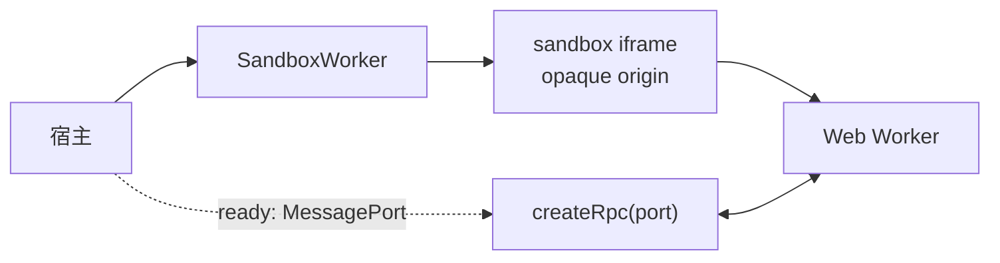

# @mica-js/sandbox

在不透明源 iframe 与 Web Worker 中运行不可信 JavaScript。`SandboxWorker` 只负责隔离环境和生命周期；RPC 由调用方使用 `@mica-js/core/rpc` 创建。

## 快速上手

```ts
import { createRpc, defineRpcService } from '@mica-js/core/rpc';
import { SandboxWorker } from '@mica-js/sandbox';

interface GuestApi {
  add(a: number, b: number): number;
}

const guest = defineRpcService<GuestApi>('guest');
const sandbox = new SandboxWorker({
  type: 'module',
  code: 'export function setup() { return { add: (a, b) => a + b }; }',
});
const rpc = createRpc(await sandbox.ready, { timeoutMs: 2_000 });
const api = rpc.getProxy(guest);
await api.add(1, 2); // 3

rpc.dispose();
await sandbox.terminate();
```

`ready` 在 iframe 创建 Worker、Worker 初始化 RPC 传输后解析为内部 `MessagePort`。调用方负责在该端口上注册宿主服务、创建代理和释放 RPC endpoint。`SandboxWorker` 不提供 RPC 方法。

## `SandboxWorker(source, options)`

| 参数                                           | 说明                                                                                |
| ---------------------------------------------- | ----------------------------------------------------------------------------------- |
| `source`                                       | `{ type: 'module', code \| url }` 或 `{ type: 'script', code \| url, globalName? }` |
| `options.name`                                 | 诊断名称                                                                            |
| `options.container`                            | iframe 挂载点；iframe 始终使用屏幕外样式                                            |
| `options.bootTimeoutMs`                        | iframe/Worker 握手预算，默认 `10_000`                                               |
| `options.frameUrl`                             | 宿主托管的帧文档 URL                                                                |
| `options.nonce` / `trustedTypesPolicy` / `csp` | `srcdoc` 安全策略配置                                                               |
| `options.runtime`                              | 覆盖内联 Worker runtime                                                             |
| `options.captureConsole`                       | 是否通过 RPC host-control 服务转发 guest console，默认开启                          |

实例提供：

```ts
readonly ready: Promise<MessagePort>;
readonly id: string;
readonly name: string;
readonly state: 'ready' | 'terminated';
terminate(reason?: string): Promise<void>;
```

## 隔离模型



iframe 只负责创建 Worker 和转发启动/终止消息；客户代码没有 DOM、cookie、存储或网络访问。Worker 可被 `terminate()` 强制终止。

无 CSP 的页面默认使用 `srcdoc`。严格 CSP 页面可通过 `frameUrl` 托管 `SANDBOX_FRAME_HTML`，并允许 Worker 所需的 `blob:` 来源。Node/SSR 中导入安全，但构造 `SandboxWorker` 会抛出 `SandboxError('unsupported-environment')`。

## 传输与 RPC

RPC 服务必须使用 `defineRpcService` 创建 typed service ID，并将同一个 `MessagePort` 传给 `createRpc`。二进制参数和结果通过 RPC transfer hooks 传递；sandbox 本身不复制或包装 RPC。

```ts
const buffers = defineRpcService<{ read(): ArrayBuffer }>('buffers');
const rpc = createRpc(await sandbox.ready);
rpc.register(buffers, implementation, {
  transfer: (_member, value) => [value as ArrayBuffer],
});
const remote = rpc.getProxy(buffers);
```

## GuestContext

Guest 的 `setup(ctx)` 仍可通过 `ctx.handle` 暴露 RPC 方法，通过 `ctx.invoke` 调用宿主服务，通过 `ctx.on`/`ctx.emit` 处理业务事件。服务注册、超时、事件订阅和 transfer 语义均由 `@mica-js/core/rpc` 定义。

`SANDBOX_FRAME_HTML` 可用于服务器托管的 `frameUrl` 文档，`transferable` 用于声明 sandbox 内部能力传输标记。
