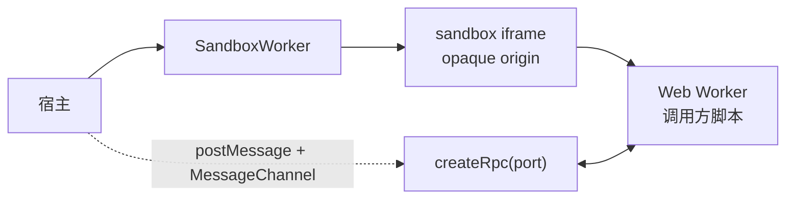

# @mica-js/sandbox

在不透明源 iframe 与 Web Worker 中运行不可信 JavaScript。`SandboxWorker` 只负责隔离环境和生命周期；worker 脚本本身由调用方提供（通常是打包器输出的单文件产物），RPC 由调用方使用 `@mica-js/core/rpc` 创建。

## 快速上手

```ts
import { createRpc, defineRpcService } from '@mica-js/core/rpc';
import { SandboxWorker } from '@mica-js/sandbox';

interface GuestApi {
  add(a: number, b: number): number;
}

const guest = defineRpcService<GuestApi>('guest');

// guest.ts —— 打包后的单文件 worker 脚本，自己注册 message 处理器
// self.addEventListener('message', (event) => {
//   const rpc = createRpc(event.ports[0]);
//   rpc.register(guest, { add: (a, b) => a + b });
// });

const sandbox = new SandboxWorker(guestCode, { name: 'guest' });
await sandbox.ready;
const channel = new MessageChannel();
sandbox.postMessage({ mode: 'default' }, [channel.port2]);
const rpc = createRpc(channel.port1, { timeoutMs: 2_000 });
const api = rpc.getProxy(guest);
await api.add(1, 2); // 3

rpc.dispose();
await sandbox.terminate();
```

`ready` 在 iframe 创建真实 Worker 后解析为 `void`。调用方通过 `MessageChannel` 创建 RPC endpoint，并使用 `postMessage(message, transferList)` 将端口交给 worker；`SandboxWorker` 不提供 RPC 方法。

## `new SandboxWorker(code, options)`

| 参数      | 说明                                                    |
| --------- | ------------------------------------------------------- |
| `code`    | 自包含 worker 脚本；iframe 内的原生 `Worker` 直接执行它 |
| `options` | 见下表，全部可选                                        |

| 选项                                           | 说明                                     |
| ---------------------------------------------- | ---------------------------------------- |
| `options.name`                                 | 诊断名称                                 |
| `options.container`                            | iframe 挂载点；iframe 始终使用屏幕外样式 |
| `options.bootTimeoutMs`                        | iframe/Worker 握手预算，默认 `10_000`    |
| `options.frameUrl`                             | 宿主托管的帧文档 URL                     |
| `options.nonce` / `trustedTypesPolicy` / `csp` | `srcdoc` 安全策略配置                    |

实例提供：

```ts
readonly ready: Promise<void>;
readonly id: string;
readonly name: string;
readonly state: 'ready' | 'terminated';
onmessage: ((event: MessageEvent) => void) | null;
onerror: ((event: ErrorEvent) => void) | null;
onmessageerror: ((event: MessageEvent) => void) | null;
postMessage(message: unknown, transfer?: Transferable[] | StructuredSerializeOptions): void;
addEventListener(type, listener): void;
removeEventListener(type, listener): void;
onError(listener: (error: SandboxWorkerError) => void): () => void;
terminate(reason?: string): Promise<void>;
```

## 消息与事件

iframe 引导脚本只做「创建 / 终止 Worker」和跨 iframe 转发。调用方发出的每条消息都会以原生 `message` 事件到达 guest，转移端口保持在 `event.ports` 中；guest 发出的 `message`、`messageerror` 和未捕获错误会转发到 `SandboxWorker` 对应的事件处理器。

```ts
await sandbox.ready;
const channel = new MessageChannel();
sandbox.postMessage({ mode: 'default' }, { transfer: [channel.port2] });
const rpc = createRpc(channel.port1);
```

`worker.terminate()` 由 `sandbox.terminate()` 触发，同时释放 blob URL 并移除 iframe。worker 未捕获的异常通过 `worker.onerror` 转发给 `onError` 订阅者；若启动阶段就出错，`ready` 会被拒绝。

## 隔离模型



iframe 只负责创建 Worker 和转发启动/终止消息；客户代码没有 DOM、cookie、存储或网络访问，Worker 可被 `terminate()` 强制终止。

无 CSP 的页面默认使用内联 `srcdoc`。严格 CSP 页面仍可通过 `frameUrl` 使用自行托管的帧文档，并允许 Worker 所需的 `blob:` 来源。Node/SSR 中导入安全，但构造 `SandboxWorker` 会抛出 `SandboxError('unsupported-environment')`。

## 传输与 RPC

RPC 服务必须使用 `defineRpcService` 创建 typed service ID，并将同一个 `MessagePort` 传给 `createRpc`。二进制参数和结果通过 RPC transfer hooks 传递；sandbox 本身不复制或包装 RPC。

```ts
const buffers = defineRpcService<{ read(): ArrayBuffer }>('buffers');
await sandbox.ready;
const channel = new MessageChannel();
sandbox.postMessage(null, [channel.port2]);
const rpc = createRpc(channel.port1);
rpc.register(buffers, implementation, {
  transfer: (_member, value) => [value as ArrayBuffer],
});
const remote = rpc.getProxy(buffers);
```

## 错误

`SandboxError.code` 区分 `invalid-options`、`unsupported-environment`、`trusted-types`、`boot-failed`、`boot-timeout` 与 `terminated`。worker 运行期未捕获的错误不会终止沙箱，而是以 `SandboxWorkerError` 形式交给 `onError` 订阅者（没有订阅者时回落到 `console.error`）。

## Vite 插件

`@mica-js/sandbox/vite` 的 `micaSandboxPlugins()` 识别带 `?sandbox-worker` 查询的普通模块导入：把该模块打成自包含的 IIFE，并把导入替换为 `SandboxWorker` 子类的默认导出。查询与源码扩展名无关，`.ts`、`.js` 与无扩展名的模块都可以使用。

被打包的模块就是 worker 脚本本身，因此它必须自包含并自己注册消息处理器：

```ts
// guest.ts
self.addEventListener('message', (event) => {
  const rpc = createRpc(event.ports[0]);
  /* ... */
});

// host.ts —— 三种写法等价
import GuestSandbox from './guest.ts?sandbox-worker';
import GuestSandbox from './guest.js?sandbox-worker';
import GuestSandbox from './guest?sandbox-worker';

const sandbox = new GuestSandbox({ name: 'guest' });
```

生成的类继承 `SandboxWorker`，构造函数自带打包后的 worker 代码，调用方只传隔离选项；`postMessage`、事件处理器、`id`、`name`、`ready`、`state`、`onError` 与 `terminate` 都由基类提供。

### 包内内联：`?sandbox-worker-code`

发布一个公共入口的库通常不希望为此额外发布 `*.sandbox.js` 文件。同一个插件还识别 `?sandbox-worker-code`：它返回**脚本字符串**而不是类，库可以把它内联自己的模块里，运行时再 `new SandboxWorker(code)`。`@mica-js/widget` 与 `@mica-js/simulator` 就是这样把 guest 打进各自公共 `index.js` / `sandbox.js` 的。

```ts
// guest-script.ts（包内私有模块）
import code from './guest.ts?sandbox-worker-code';

export function createGuestSandbox(options: SandboxWorkerOptions = {}): SandboxWorker {
  return new SandboxWorker(code, { name: 'guest', ...options });
}
```

两种查询共享内存中的打包结果：使用单文件 IIFE 输出，生产构建会压缩脚本。
