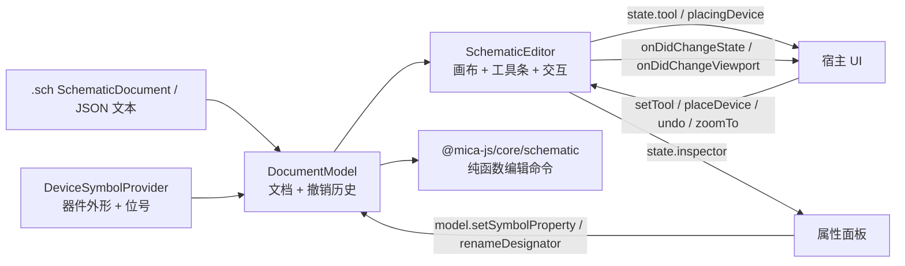
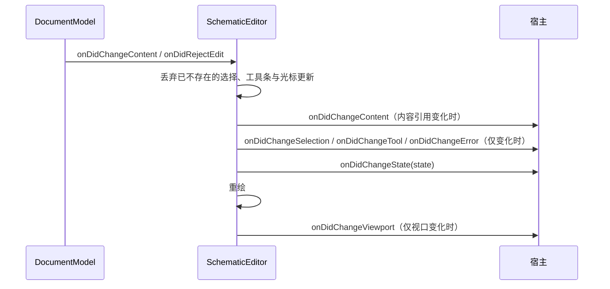

# @mica-js/schematic-editor

原理图编辑器：把 `@mica-js/core/schematic` 的 `.sch` 文档渲染成可编辑的 Canvas 画布。

包内分两层：`DocumentModel` 持有文档与撤销历史，`SchematicEditor` 在它上面提供画布、交互与视图状态。属性面板、器件库、文件操作等宿主 UI 通过读编辑器状态、调模型与编辑器的方法自行实现。

## 架构



## 边界

- `DocumentModel` 是文档的唯一写入者：每条编辑都是可撤销的一步，失败时不改内容并记录 `getLastError()`。
- `SchematicEditor` 不复制文档，只把模型当前快照画出来；选择、工具、显示选项与视口是编辑器状态，不写入 `.sch`。
- 几何容差、器件外形、撤销上限与位号策略属于模型；主题、网格绘制、缩放范围与只读模式属于编辑器。
- 不传 `model` 时编辑器自己建模型并负责 `dispose()`；传入 `model` 时模型归宿主所有。

## 安装

```bash
pnpm add @mica-js/schematic-editor @mica-js/core
```

编辑器**不注入样式**：用一个显式的样式导入把画布、工具条与主题变量的样式交给应用打包器，什么时候加载、是否裁剪都由宿主决定。

```ts
import '@mica-js/schematic-editor/style.css';
```

## 快速上手

```ts
import { createSchematicEditor } from '@mica-js/schematic-editor';
import { parseSchematic } from '@mica-js/core/schematic';

// 编辑器自己建模型：value 收已解析的 .sch 文档或它的 JSON 文本，省略时是空图纸。
const editor = createSchematicEditor({
  container: document.querySelector('#host')!,
  value: parseSchematic(schText),
  devices, // 可选：器件外形、位号前缀与属性声明
});

editor.onDidChangeState((state) => renderStatus(state));
editor.placeDevice('stm32-package:stm32g431rbt6-lqfp64'); // 抓到光标上，下一次点击落地
editor.fitToContent();

// 属性面板写模型；编辑器随即收到通知并重绘。
editor.getModel().setSymbolProperty(symbolId, 'speed', 120);

// 卸载：editor.dispose()
```

需要挂多个视图或跨视图共享历史时再自己建模型：

```ts
import { DocumentModel, createSchematicEditor } from '@mica-js/schematic-editor';

const model = new DocumentModel({ value: schText, devices });
const editor = createSchematicEditor({ container, model }); // model 优先于 value
```

`createSchematicEditor()` 是 `new SchematicEditor(options)` 的便利入口。构造是同步的，不涉及异步资源；容器需要有确定的尺寸，编辑器把 root 撑满容器并按 `devicePixelRatio` 放大画布。

## DocumentModel

```ts
new DocumentModel({
  value, // 可选；初始内容：已解析的 .sch 文档或它的 JSON 文本，省略时为空图纸
  devices, // 可选；DeviceSymbolProvider
  tolerance, // 可选；命中 / 几何容差（页面单位）
  historyLimit, // 可选；撤销栈上限，默认 200
  createId, // 可选；元素 id 工厂
  createDesignator, // 可选；(device, document) => string，接管新器件位号
});
```

| 成员                                         | 说明                                                                         |
| -------------------------------------------- | ---------------------------------------------------------------------------- |
| `getValue()`                                 | 当前内容；每次提交替换引用                                                   |
| `getDevices()`                               | 建模型时传入的器件 provider                                                  |
| `getCanUndo()` / `getCanRedo()`              | 是否可撤销 / 重做                                                            |
| `getLastError()`                             | 最近一次被拒绝的编辑；下一次成功编辑或撤销 / 重做后清空                      |
| `getTopology()`                              | 由当前文档推导的连通关系，按文档引用缓存                                     |
| `toJSON()`                                   | 序列化为 `.sch` JSON                                                         |
| `applyCommand(command)`                      | 执行一条核心命令，作为一步历史                                               |
| `setValue(value, { keepHistory? })`          | 换内容（文档或 `.sch` 文本）；默认清空历史，`keepHistory` 记为一步可撤销编辑 |
| `undo()` / `redo()`                          | 历史                                                                         |
| `transaction(run)`                           | 把多次编辑合成一步历史；任一失败整步回滚                                     |
| `onDidChangeContent(listener)`               | 每次提交后以新内容调用；返回 `Disposable`                                    |
| `onDidRejectEdit(listener)`                  | 每次编辑被拒绝时以错误调用；内容不变                                         |
| `dispose()`                                  | 释放事件；之后仍可编辑，但不再通知                                           |
| `nextDesignator(device)`                     | 下一个位号                                                                   |
| `moveTargets(targets, dx, dy)`               | 按页面坐标移动目标元素                                                       |
| `rotateTargets(targets, degrees)`            | 顺时针旋转目标器件                                                           |
| `removeTargets(targets)`                     | 删除目标器件、导线、交点与导线顶点                                           |
| `moveReferenceBy(symbolId, dx, dy)`          | 移动位号                                                                     |
| `setSymbolProperty` / `removeSymbolProperty` | 写入 / 移除器件属性覆盖                                                      |
| `renameDesignator` / `renameNet`             | 改名位号 / 网名                                                              |
| `addWire(points)`                            | 追加导线，端点落在导线上会拆线建交点                                         |
| `connectWireAt(wireId, point, otherWireId?)` | 在导线上建交点                                                               |
| `moveWireSegment(wireId, segment, delta)`    | 沿法线移动一段导线                                                           |
| `previewWireSegment(wireId, segment, delta)` | 只推导拖动结果，不提交                                                       |
| `hitTest(point, options?)`                   | 命中测试                                                                     |

`SchematicTarget` 是文档里可被选择或编辑的元素：

```ts
type SchematicTarget =
  | { kind: 'symbol'; id: string }
  | { kind: 'reference'; symbolId: string }
  | { kind: 'wire'; id: string }
  | { kind: 'junction'; id: string }
  | { kind: 'vertex'; wireId: string; index: number };
```

被拒绝的编辑先在 `onDidRejectEdit` 通知，再重新抛出；`transaction` 内的失败会回滚整步，并保留 `getLastError()` 供 UI 展示。

## 事件

对外事件都是 VS Code 同款 `Event<T>`：订阅直接返回 `Disposable`，可以推入 `disposables` 数组或交给 `DisposableStore`。这些类型与实现来自 `@mica-js/core/lifecycle`，本包只 re-export，不再自带一份。

```ts
type Event<T> = (
  listener: (e: T) => unknown,
  thisArgs?: unknown,
  disposables?: Disposable[],
) => Disposable;

const subscriptions = new DisposableStore();
subscriptions.add(editor.onDidChangeState((state) => renderStatus(state)));

// 也可以把订阅交给调用方自己的释放列表
const extra: Disposable[] = [];
editor.onDidChangeContent((document) => renderTitle(document), undefined, extra);

// thisArgs 会作为监听函数的 this
editor.onDidChangeViewport(function (this: StatusBar, viewport) {
  this.showZoom(viewport.scale);
}, statusBar);

// 卸载：subscriptions.dispose()、逐个 dispose，或释放 extra 里的条目
```

- `Emitter<T>`（`@mica-js/core/lifecycle`）：包内事件源，`event` 就是 `Event<T>`，`fire(value)` 送达当前监听者。
- `DisposableStore` / `Disposable` / `toDisposable`（`@mica-js/core/lifecycle`）：把多条订阅（或任何带 `dispose()` 的东西）打包释放；`add()` 在 store 已释放时会立即释放传入值，`toDisposable(fn)` 把清理函数包成只执行一次的 `Disposable`。

## 编辑器选项

`SchematicEditorOptions`（`SchematicEditor` 与 `createSchematicEditor` 共用）：

| 选项                            | 说明                                                                  |
| ------------------------------- | --------------------------------------------------------------------- |
| `container`                     | 必填；编辑器只往里 append 自己的 root                                 |
| `model`                         | 可选；`DocumentModel`，传入时 `value` 与模型构造选项被忽略            |
| `value`                         | 可选；编辑器自建模型的初始内容（`.sch` 文档或 JSON 文本），默认空图纸 |
| `devices`                       | 可选；自建模型的 `DeviceSymbolProvider`                               |
| `tolerance`                     | 可选；自建模型的命中 / 几何容差（页面单位）                           |
| `historyLimit`                  | 可选；自建模型的撤销栈上限                                            |
| `createId` / `createDesignator` | 可选；自建模型的元素 id 工厂 / 位号策略                               |
| `theme`                         | `Partial<SchematicTheme>`，默认深色                                   |
| `display`                       | 网格、吸附、引脚标签、网格尺寸与细分                                  |
| `zoomLimits`                    | `{ minScale, maxScale }`，默认 `0.25`–`4`                             |
| `readOnly`                      | 禁用内建交互；编辑器与模型的方法仍可写                                |
| `toolbar`                       | 是否渲染画布右上角的悬浮工具条，默认 `true`                           |

优先级：`model` > `value` > 空图纸；只有编辑器自建的模型会读取 `devices` / `tolerance` / `historyLimit` / `createId` / `createDesignator`。

编辑器事件：

| 事件                   | 载荷                          | 触发时机                                      |
| ---------------------- | ----------------------------- | --------------------------------------------- |
| `onDidChangeContent`   | `SchematicDocument`           | 每次内容提交（编辑、撤销 / 重做、`setValue`） |
| `onDidChangeState`     | `EditorState`                 | 任何编辑器或文档变化；宿主 UI 的主要订阅点    |
| `onDidChangeSelection` | `readonly EditorSelection[]`  | 选择变化                                      |
| `onDidChangeTool`      | `EditorTool`                  | 工具或待放置器件变化                          |
| `onDidChangeError`     | `SchematicError \| undefined` | 最近一次错误变化；编辑成功后回到 `undefined`  |
| `onDidChangeViewport`  | `ViewportState`               | 滚轮 / 平移 / 适应 / `zoomTo` / `setViewport` |



内建交互触发的失败写入 `state.lastError` 并触发 `onDidChangeError`，不会中断页面；直接调用模型方法时错误仍会抛出（`onDidChangeError` 先触发）。

## 编辑器成员

| 成员                                                                   | 说明                                                      |
| ---------------------------------------------------------------------- | --------------------------------------------------------- |
| `getModel()`                                                           | 编辑器当前的 `DocumentModel`（自建或宿主传入）            |
| `getValue()`                                                           | 模型当前内容                                              |
| `getState()` / `getRenderState()`                                      | 完整状态（含 inspector）/ 绘制所需子集                    |
| `getSelection()` / `setSelection(targets)`                             | 选择；文档里不存在的目标会被丢弃                          |
| `getTool()` / `setTool(tool)`                                          | `select` / `wire` / `power` / `ground` / `label` / `text` |
| `getDisplay()` / `setDisplayOptions(patch)`                            | 网格、吸附、引脚标签、网格尺寸与细分                      |
| `getCanUndo()` / `getCanRedo()`                                        | 转发模型的历史状态                                        |
| `placeDevice(device)` / `cancelPlacement()`                            | 抓取一个器件 / 取消抓取                                   |
| `getPlacingDevice()` / `nextDesignator()`                              | 当前抓取 / 下一个位号                                     |
| `applyCommand(command)`                                                | 转发给模型；效果与一次手势提交相同                        |
| `setValue(value, { keepHistory? })`                                    | 转发给模型；默认清空选择并重新适应内容                    |
| `transaction(run)`                                                     | 转发给模型，把多次编辑合成一步                            |
| `undo()` / `redo()` / `deleteSelection()`                              | 历史 / 删除当前选择                                       |
| `moveSelectionBy(dx, dy)` / `rotateSelection(degrees)`                 | 移动 / 旋转当前选择                                       |
| `moveReferenceBy(symbolId, dx, dy)`                                    | 移动位号                                                  |
| `addWire` / `connectWireAt` / `moveWireSegment` / `previewWireSegment` | 导线编辑                                                  |
| `hitTest(point, options?)`                                             | 命中测试                                                  |
| `getTopology()` / `toJSON()`                                           | 转发模型的推导结果 / 序列化                               |
| `fitToContent()` / `zoomTo(scale)`                                     | 适应内容 / 按比例缩放（夹到 `zoomLimits`）                |
| `getViewport()` / `setViewport(state)`                                 | 读回 / 恢复缩放与平移                                     |
| `toPage(point)` / `toScreen(point)`                                    | 客户端坐标 ↔ 页面坐标，宿主定位浮层时用                   |
| `setTheme(partial)` / `getTheme()`                                     | 增量换主题 / 读回当前主题                                 |
| `root` / `canvas`                                                      | 编辑器创建的两个 DOM 节点                                 |
| `focus()`                                                              | 把键盘焦点交还画布                                        |
| `resize()` / `invalidate()`                                            | 容器显隐后重新测量 / 只重绘不改布局                       |
| `cancelInteraction()`                                                  | 取消进行中的导线、拖动或框选，选择与工具保留              |
| `dispose()`                                                            | 解绑监听、释放事件并移除 root；自建的模型一并释放；幂等   |

## 宿主 UI 合同

| 宿主 UI     | 读                                     | 写                                                                                         |
| ----------- | -------------------------------------- | ------------------------------------------------------------------------------------------ |
| 工具条      | `state.tool`、`state.placingDevice`    | `setTool()` / `placeDevice()` / `cancelPlacement()`（`toolbar: false` 时自建）             |
| 撤销 / 重做 | `state.canUndo` / `state.canRedo`      | `undo()` / `redo()`                                                                        |
| 缩放 / 适应 | `onDidChangeViewport`、`getViewport()` | `zoomTo()` / `fitToContent()` / `setViewport()`                                            |
| 网格与吸附  | `state.display`                        | `setDisplayOptions()`                                                                      |
| 属性面板    | `state.inspector`                      | `getModel().setSymbolProperty` / `removeSymbolProperty` / `renameDesignator` / `renameNet` |
| 错误提示    | `state.lastError`、`onDidChangeError`  | —                                                                                          |

`state.inspector` 的渲染约定：

- `kind === 'wire'`：只读信息（`id`、`netName`、`points`）；选中交点、多选或空选时为 `undefined`。
- `SymbolInspector`：`role` 决定标题，`designator`（器件）与 `net`（网标 / 电源 / 地）可编辑，`x` / `y` / `rotation` 只读。
- `properties` 是 `PropertyField[]`，直接对应器件属性声明：`type` 为 `string` / `integer` / `number` / `boolean` / `color` / `enum` / `image` / `binary`，并带 `title`、`description`、`options`、`min` / `max` / `exclusiveMin` / `step` / `unit`、`maxLength`、`alpha`、`maxBytes` / `maxPixels` 等约束。
- `value` 缺省表示继承 `defaultValue`，`null` 表示显式空值（仅 `nullable` 属性）。
- `image` / `binary` 的值是资源引用 `{ src, mode }`；编辑器只传递引用，读取与预览由宿主负责。

### 网格与吸附

| 选项               | 默认 | 作用                                   |
| ------------------ | ---- | -------------------------------------- |
| `gridSize`         | `10` | 吸附步长（页面单位），也决定每格大小   |
| `gridSubdivisions` | `2`  | 每格画几条可见网格线，`1` 只画吸附网格 |

强调线每 5 格一条；缩得太小时渲染器会自动丢掉细分。

## 器件放置

编辑器不内建器件库：

- `placeDevice(device)` 后光标变为十字，幽灵随指针移动（只吸附网格；`builtin:label` / `power` / `ground` 仍吸附引脚并引出一段导线）。
- 空格旋转幽灵，`Esc` 或 `cancelPlacement()` 取消；放下后自动切回 `select`，一次抓取只放一个。
- 位号来自 `DocumentModel` 的策略：器件定义的 `designatorPrefix`（取该前缀下最小的未占用编号），可用 `createDesignator` 接管。
- 非法器件引用直接抛 `SchematicError`，同时写入 `state.lastError`、触发 `onDidChangeError`。

## 指针与键盘

- 单击引脚（整条引脚线）以引脚端起笔；画导线时吸附到附近导线并垂直落下，接点沿导线方向仍对齐网格，可直接点出 T 型连接（落在导线内部会拆线建交点）。
- 单击器件、网标、电源 / 地、文本会选中实体，不会误起笔；拖动网标、电源 / 地时，相连导线按「沿导线方向只改长度、有垂直位移则折一段」跟随。
- 拖动导线段沿法线移动并吸附网格，平行连续段一起移动；端点连着引脚 / 锚点 / 交点 / 导线时保持不动并折出 dogleg。一次拖动一步历史。
- 拖动器件按落点吸附网格，单轴拖动时另一轴不动；位号可拖动。
- `Delete` 删除、空格或 `R` 旋转、`F` 适应内容、`Enter` / 双击结束导线、`Esc` 取消、`Ctrl/Cmd+Z` 撤销、`Ctrl/Cmd+Shift+Z` 重做、滚轮缩放、中键或空格拖拽平移。
- 宿主在自己的 UI 里抓取器件时（焦点不在编辑器内），编辑器会在 document 上兜底监听 `Esc`。

## 内部结构

| 目录                   | 职责                                                                         |
| ---------------------- | ---------------------------------------------------------------------------- |
| `model/`               | `DocumentModel`、`SchematicContent`、命令桥接、历史、连通关系、inspector     |
| `editor/interactions/` | 指针与键盘状态机：`input.ts` 分发，`move` / `segment` / `wire` / `placement` |
| `editor/snapping/`     | 吸附与放置辅助（节点、导线本体、网格、label stub），无 DOM 的纯函数          |
| `render/`              | 场景构建（`scene.ts`）与 canvas 绘制（`canvas-renderer.ts`）                 |
| `styles/`              | 编辑器 CSS（工具条与画布容器），构建发布为 `dist/style.css`，由宿主显式导入  |
