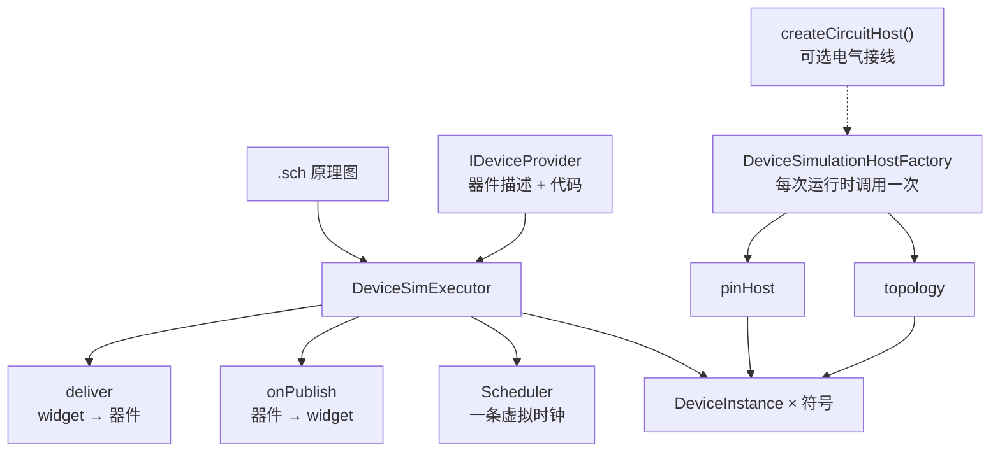
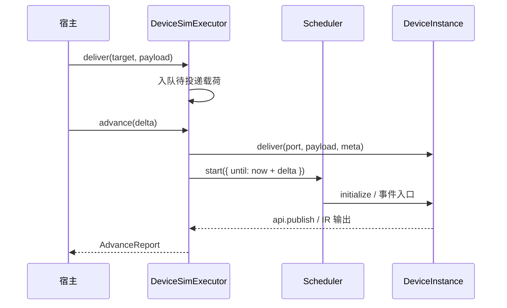

# @mica-js/simulator

在一条虚拟时钟上运行原理图里的全部器件实例：`loadSchematic` 建实例，`advance` 推进时间，`onPublish` / `deliver` 与画布互投载荷。

依赖方向：`@mica-js/simulator` → `@mica-js/core`（及其底层的 `@mica-js/ir`）；`@mica-js/simulator/sandbox` 入口另依赖 `@mica-js/sandbox`。

> **本包不含器件实现。** `@mica-js/simulator` 只提供引擎、`DeviceSimulationHost` 契约与通用器件绑定契约，不导出任何具体器件模型（没有 `createLedDescription` / `createMcuDescription`，也没有内建类型到访问器的映射）。Playground 自己拥有器件**契约**（`apps/playground/public/devices`：pins / topics / connections / reset）与统一 IR **模型**（`apps/playground/src/sim/device-contracts.ts`、`apps/playground/src/sim/device-models.ts` 用 `description.behaviors` 实现 button-ir / relay-ir 等）；它们都不使用 `DeviceAccessor`，宿主通过通用状态面收发载荷。

## DeviceSimulationHost（RFC 0018）

本包拥有 `DeviceSimulationHost`、`DeviceTopic` 与 `SimulationPublish` 契约，并提供三个实现入口：

| 入口                                                                    | 运行位置                  | 用途                                                                            |
| ----------------------------------------------------------------------- | ------------------------- | ------------------------------------------------------------------------------- |
| `createSchematicDeviceSimulationHost({ read, devices, resolveDevice })` | 当前线程                  | 读取并编译原理图，`Circuit` 由实现自己持有；器件由调用方的 `resolveDevice` 提供 |
| `createCircuitDeviceSimulationHost({ circuit, topics, deliver })`       | 当前线程                  | 包装一个已经加载好的 `Circuit`                                                  |
| `createDeviceSimulationHostFromSandbox({ sandbox, fs })`                | `@mica-js/sandbox` worker | `Circuit` 留在 worker 内，宿主只通过 typed RPC 调用契约                         |

sandbox 入口从 `@mica-js/simulator/sandbox` 导入，主入口不包含 DOM 与 worker 脚本。该入口已把默认 guest 脚本**压缩并内联**在 `sandbox.js` 里，`createDeviceSimulationHostGuestSandbox()` 直接给出可直接启动的 `SandboxWorker`，不需要任何构建期插件：

```ts
import { createWidgetHost } from '@mica-js/widget';
import {
  createDeviceSimulationHostFromSandbox,
  createDeviceSimulationHostGuestSandbox,
} from '@mica-js/simulator/sandbox';

// 默认 guest 不含任何器件；自带器件库时换成自己的 worker（见下）。
const sandbox = createDeviceSimulationHostGuestSandbox({ name: 'device' });
const deviceHost = await createDeviceSimulationHostFromSandbox({ sandbox, fs });
const host = createWidgetHost({ widgetProvider, deviceHost, fs });
```

`DeviceSimulationHostGuestSandbox`（`new DeviceSimulationHostGuestSandbox(options)`）与工厂等价，保留给用 `new` 的调用方。默认 guest 不含器件；自带器件库的包写自己的 worker 脚本，用 `startDeviceSimulationHostGuest` 注册，并用 `@mica-js/sandbox/vite` 的 `?sandbox-worker` 打成自包含产物：

```ts
// device-host.sandbox.ts —— worker 脚本本身，由 ?sandbox-worker 打成自包含产物
import { startDeviceSimulationHostGuest } from '@mica-js/simulator';

self.addEventListener('message', (event) => {
  const port = event.ports[0];
  if (port === undefined) return;
  startDeviceSimulationHostGuest(port, {
    // `event.ports[1]` 是直连主题通道（RFC 0018），widget guest 持有另一端。
    ports: event.ports.slice(1),
    devices: () => library.symbols,
    resolveDevice: (reference) => library.resolve(reference.raw),
    prepare: async () => {
      /* 通过 host 文件系统读器件库 */
    },
  });
});
```

```ts
import { createDeviceSimulationHostFromSandbox } from '@mica-js/simulator/sandbox';
import DeviceHostSandbox from './device-host.sandbox.ts?sandbox-worker';

const sandbox = new DeviceHostSandbox({ name: 'device-simulation-host' });
const deviceHost = await createDeviceSimulationHostFromSandbox({ sandbox, fs });
```

worker 脚本用 `event.ports[0]` 建 `createRpc`，通过 `host-capabilities` typed RPC 读取原理图字节；
二进制结果使用 transfer hook 传递。`event.ports[1..]` 是调用方随启动消息转移的额外端口，按顺序
原样交给 guest；第一个额外端口是直连主题通道，guest 在其上注册同一套约定，widget guest 因此可以
不经宿主直接 `deliver` 与订阅发布。发布事件沿用 `onDidPublish` 订阅约定，`Circuit` 不出现在 RPC
或调用方。

`createSchematicDeviceSimulationHost` 每步采集器件声明的 output topic，只在取值变化时发布：`level` 语义下重复的同值不是新消息，逐帧重发只会让订阅方白白重绘。`loadSchematic` 与 `reset` 会清空这份记录，因此新装载或复位后的第一步会把每个 topic 的当前值重新发布一次，后挂载的订阅方由 `WidgetHost` 用最近一次发布补齐。

### 器件绑定契约

`createSchematicCircuit` / `createSchematicDeviceSimulationHost` 只认识一个通用契约
`SchematicDeviceBinding`：

```ts
import type { SchematicDeviceBinding } from '@mica-js/simulator';

const binding: SchematicDeviceBinding = {
  type: 'counter-ir',
  description: { pins: { clk: { direction: 'input' } }, behaviors: {/* … */} },
  topics: [
    { port: 'step', direction: 'input', type: 'number' },
    { port: 'count', direction: 'output', type: 'number' },
  ],
  deliver: (accessor, port, payload) => accessor.setState('step', payload),
  read: (accessor, port) => accessor.getState('count'),
};
```

同上，原理图的符号几何来自调用方传给 `devices` 的 `DeviceSymbolProvider`，本包不合成任何内建符号。

## 两条执行路径

本包同时提供两条执行路径。**新电路代码请使用统一 IR**；调度器路径处于维护模式，为现有的原理图/画布集成保留。

| 路径                | 入口                                                | 适用场景                                            | 状态                            |
| ------------------- | --------------------------------------------------- | --------------------------------------------------- | ------------------------------- |
| **统一 IR（推荐）** | `Circuit.create()`                                  | 程序化电路、批处理仿真、类型化器件访问              | 稳定，新增功能只落在这条路径    |
| 调度器（维护模式）  | `createDeviceSimExecutor()` + `createCircuitHost()` | 原理图文档 → 器件模块实例、与 `WidgetHost` 互投消息 | 弃用但继续支持，不早于 1.0 移除 |

统一 IR 把整块电路（器件 tick、电气解算、主循环）编译进**一个** `@mica-js/ir` module，
一次 `runBatch(n)` 只付一次引擎调用开销，实测比"每器件一个 module + 调度器 + JS 解网"快 10–1000×。
完整迁移步骤见 [docs/MIGRATION.md](./docs/MIGRATION.md)，弃用与移除时间表见
[docs/DEPRECATIONS.md](./docs/DEPRECATIONS.md)。

## 统一 IR 快速开始

本包不携带任何器件模型：每个 `description`（pins / states / behaviors 或 `kernel`）都来自调用方，
器件包才是唯一知道"LED / 按键 / MCU 是什么"的地方。

```ts
import { Circuit } from '@mica-js/simulator';

const circuit = await Circuit.create({
  devices: [
    { id: 'drive1', type: 'push-pull-driver', description: driverDescription() },
    { id: 'sink1', type: 'lamp-sink', description: sinkDescription() },
  ],
  connections: [
    { from: 'drive1.PA0', to: 'sink1.anode' },
    { from: 'sink1.cathode', to: 'GND' },
  ],
});

circuit.step(); // 一次引擎调用：driver -> 电气解算 -> sink
circuit.devices.sink1.getState('lamp'); // 通用状态面，布尔 lamp 由 description 声明

circuit.runBatch(1_000_000); // 整批一次引擎调用
circuit.tickCount; // 1000001n

circuit.dispose();
```

- **器件用 `<id>.<pin>` 连线**：`connections` 描述导线，编译器分配全局引脚空间，不需要手写偏移。
- **访问器是通用的**：`DeviceAccessor` 提供 `readPin` / `writePin` / `getState` / `setState`；
  需要更丰富表面的器件包通过 `description.accessor` 自带一个，并在已知端点处断言。
- **自带器件**：把 `description` 连同 `kernel` / `accessor` / `updateResources` 一起传入，或用
  `DeviceIRGenerator` 生成 module 后交给 `Circuit`。器件包只需要 `@mica-js/simulator` 与 `@mica-js/ir`。
- **两种推进方式**：`step()` 用于调试，`runBatch(n)` 走模块内循环，是吞吐路径。
- **错误带稳定 code**：`CircuitError`（运行时）与 `UnifiedIRCompilerError`（编译期）。

Playground 的 `apps/playground/public/devices` 目前只有契约；`apps/playground/src/sim/device-contracts.ts` 与 `device-models.ts` 自己提供 `ideal-led` / `teaching-mcu` 等器件描述，本包不再内建任何模型。按钮、继电器等带 `DeviceAccessor` 的模型尚未实现。

### 性能

同一张 driver + sink 电路（Ryzen 5 5600G / Node.js 24）：

| 变体                      |    每 tick | 相对调度器 |
| ------------------------- | ---------: | ---------: |
| 调度器：每器件一个 module | 6.3–8.1 µs |       1.0× |
| 统一 IR：`step()`         | 318–371 ns |     20–22× |
| 统一 IR：`runBatch(2000)` | 6.6–6.8 ns | ~960–1200× |

完整场景、器件组合与复现步骤见 [docs/PERFORMANCE.md](./docs/PERFORMANCE.md)。

## 架构



## 调度器路径用法

> 维护模式：新代码请用上面的统一 IR。本节保留给"原理图 → 器件模块实例 + WidgetHost 消息"的
> 现有集成，移除时间表见 [docs/DEPRECATIONS.md](./docs/DEPRECATIONS.md)。

推荐直接挂到 `WidgetHost` 上：宿主按 `bindings` 完成双向路由，应用侧不再手写转发。

```ts
import { createPowerRuntime, timePs } from '@mica-js/core';
import { toDisposable } from '@mica-js/core/lifecycle';
import { parseSchematic, type SchematicDocument } from '@mica-js/core/schematic';
import type { TopicPayload } from '@mica-js/device';
import { createDeviceSimExecutor, type DeviceSimulationHost } from '@mica-js/simulator';
import { createWidgetHost } from '@mica-js/widget';

const executor = createDeviceSimExecutor({
  devices: provider, // IDeviceProvider：原理图里只写 device id
  onDiagnostic: (diagnostic) => console.warn(diagnostic.code, diagnostic.message),
  host: ({ scheduler }) => {
    const power = createPowerRuntime(scheduler, board, { instanceId: 'power', pinStates });
    return {
      pinHost: power,
      topology: power,
      dispose: () => power.destroy(),
    };
  },
});

// 执行器是同线程的同步接口；装配层把它按 RFC 0018 的 DeviceSimulationHost 暴露给宿主。
const readSchematic = async (uri: string): Promise<SchematicDocument> =>
  parseSchematic(readText(uri)); // 读取 URI 由装配层负责
const deviceHost: DeviceSimulationHost = {
  loadSchematic: async (uri) => {
    if (uri !== undefined) await executor.loadSchematic(await readSchematic(uri));
  },
  tick: async (dt) => {
    executor.advance(timePs(dt));
    return { simTime: executor.getSimTime(), executed: 1 };
  },
  deliver: async (target, payload, simTime) => {
    executor.deliver(
      target,
      payload as TopicPayload,
      simTime === undefined ? undefined : timePs(simTime),
    );
  },
  onDidPublish: (listener) => toDisposable(executor.onPublish((publish) => listener(publish))),
  getTopics: async () => executor.getTopics(),
  getSimTime: async () => executor.getSimTime(),
  getSchematic: async () => executor.getSchematic(),
  dispose: async () => executor.dispose(),
};

const host = createWidgetHost({ provider, deviceHost, assets });

await executor.loadSchematic(parseSchematic(schText)); // 文本由调用方解析
const report = executor.advance(timePs(100_000)); // 100 ns，同步完成
```

`DeviceSimulationHost` 的方法全部返回 Promise；映射一是 `advance → tick`、`onPublish → onDidPublish`，二是同步返回值包一层 Promise。`onDidPublish` 是 `@mica-js/core/lifecycle` 的 `Event<SimulationPublish>`，订阅返回 `Disposable`，这里用 `toDisposable` 把执行器的取消订阅函数接上去。宿主之外也可以自己订阅 `onPublish` / 调用 `deliver`。

## 宿主接线

执行器不拥有电路：它只把宿主建的 `pinHost` 与 `topology` 透传给每个实例。

| 字段              | 说明                                                                          |
| ----------------- | ----------------------------------------------------------------------------- |
| `pinHost`         | 逐实例的 `pinHost`；`b.pin.*` / `b.observeDigital` 依赖它                     |
| `topology`        | 逐实例的 `connections.topology`；`b.connection.apply` 依赖它                  |
| `instanceOptions` | 逐符号补充实例选项（`updateResources` / `messaging`）；身份、属性与接线不开放 |
| `dispose`         | 实例全部销毁后调用，用来释放电源 / 拓扑运行时                                 |

- 工厂在每次 `loadSchematic` 和 `reset()` 建运行时各调用一次；每次运行时都有**自己的新调度器**，所以工厂里的实例 id 不会跨运行时冲突。
- `DeviceSimulationHostContext` 提供 `scheduler`、`schematic` 与按 device id 索引的 `modules`，接线宿主直接读引脚几何而不必重复加载器件。
- `@mica-js/core` 的 `createPowerRuntime` 同时满足 `DevicePinHost` 与 `TopologyRuntime`，所以一块板只需要一个运行时。
- 工厂或 `dispose` 抛错时：构建阶段直接让 `loadSchematic` / `reset` 抛错（旧运行时原样保留），释放阶段转成 `simulator/dispose-failed` 诊断。
- 不配置 `host` 时实例没有 `pinHost` 也没有拓扑，用到引脚或连接的器件会在加载时报器件层错误，并被包成 `simulator/instance-create-failed`。

## DeviceSimExecutor 接口

| 成员                                 | 说明                                                                   |
| ------------------------------------ | ---------------------------------------------------------------------- |
| `getState()`                         | `'idle'` / `'ready'` / `'faulted'` / `'disposed'`；只有 `ready` 能推进 |
| `getSimTime()`                       | 当前虚拟时间；首次加载前为 `0`                                         |
| `getSchematic()`                     | 当前运行时的来源文档；首次加载前是空图                                 |
| `getTopics()`                        | 每个实例的 `symbol`（绑定用的就是它）、`designator`（位号）与 `port`   |
| `loadSchematic(document)`            | 按符号建实例并跑 `initialize`，时钟归零；构建失败时旧运行时原样保留    |
| `advance(delta)`                     | 同步推进 `delta` 皮秒，返回 `{ from, to, executed, reason }`           |
| `onPublish(listener)`                | 器件发布 `(target, payload, simTime)`；返回取消订阅函数                |
| `deliver(target, payload, simTime?)` | 排入下一次 `advance` 的开头，按 RFC 0017 的 `delivery` 语义入队        |
| `reset()`                            | 丢弃实例、按当前原理图重建，时钟归零；同步                             |
| `dispose()`                          | 销毁全部实例并释放运行时；同步、幂等                                   |

`DeviceTopic` 的 `direction` / `type` 与 `DevicePortDescriptor` 同构，另外带上解析好的 `delivery`，宿主可以直接用 `getTopics()` 生成画布的绑定候选。`symbol` 是原理图里的符号 id（绑定存的就是它），`designator` 是给人看的位号（符号自己的 `designator`，没写时回退到 id），两者在界面上不要混用。

## DeviceSimExecutor 语义

- **除 `loadSchematic` 之外全是同步的。** 加载之所以返回 promise，只因为器件模块要经 provider 取；模块随后被缓存，`reset()` 直接用缓存重建实例。仿真与 `WidgetHost` 跑在同一个 JS 线程上，没有 worker，也没有消息通道。
- **先建后换。** `loadSchematic` 在新调度器上建好实例、跑完 `initialize` 后才替换旧运行时，因此器件解析失败或工厂抛错时，正在跑的仿真不受影响，时钟也不回退。
- **`advance` 是同步的。** 整个时间片在调用内跑完，宿主可以在帧循环里直接调用并立刻拿到报告；推进失败时 `getState()` 变成 `'faulted'` 并原样抛出底层 `SchedulerError`。
- **发布在步末交付。** 器件在时间片内产生的发布先攒着，等时间片跑完再按发布顺序交给 `onPublish`（RFC 0017 的步屏障）；每条发布保留自己的 `simTime`，失败的时间片不交付任何发布。`initialize` 阶段的发布不在步内，立即交给监听者。
- **一步对应一次 `advance`。** 顺序是：投递队列进入实例 → 各实例 `applyInputs()` → 调度器执行 → 各实例 `flushOutputs()` → 交付发布。钩子抛错只上报 `simulator/hook-failed` 并继续推进；器件侧的诊断（`device/*`、`topic/*`）经 `onDiagnostic` 以 `simulator/device-diagnostic` 转发，`message` 里保留原始错误码。
- **`deliver` 收 `unknown`，延迟到时间片开头。** 端口类型由器件层校验；入队语义按 RFC 0017 的 `delivery` 决定：`level` 端口一步只保留最后一条（静默的步不补投），`message` 端口按发布顺序全部保留，超过 `deliveryCapacity`（默认 64）的新载荷被拒绝并上报 `simulator/topic-backpressure`。器件层仍然拒绝的载荷（类型不符、它自己的背压）上报 `simulator/topic-backpressure` / `simulator/topic-rejected` 后继续推进，不会把执行器置为 `'faulted'`（故障只由调度器决定）。
- **`simTime` 由执行器负责。** 器件发布时的时间戳取自调度器；`deliver` 的 `simTime` 可选，省略时用执行器的当前虚拟时间，给了就原样进入器件的投递信封。
- **诊断不中断仿真。** `onDiagnostic` 抛错会被吞掉；只有 `advance` 的调度器故障才会把状态置为 `'faulted'`。



## 错误

- 诊断码以 `simulator/` 开头：`device-load-failed`、`instance-create-failed`、`advance-failed`、`publish-failed`、`topic-backpressure`、`topic-rejected`、`hook-failed`、`device-diagnostic`、`dispose-failed`。
- 宿主调用的参数错误抛 `SimulatorError`，`code` 为 `simulator/disposed`、`simulator/not-ready`、`simulator/invalid-delta`、`simulator/invalid-capacity`、`simulator/unknown-target`、`simulator/unknown-port`、`simulator/device-load-failed` 或 `simulator/instance-create-failed`。

## 电气层（调度器路径）

原理图里的导线就是电路。`createCircuitHost()` 返回一个宿主接线工厂，用 `deriveSchematicTopology` 把每个器件引脚按合成符号的几何位置落到网，折成 `TopologyDefinition` 交给 `createPowerRuntime` 解算，再把结果作为 `pinHost` / `topology` 交给执行器。

```ts
const executor = createDeviceSimExecutor({
  devices: provider,
  host: createCircuitHost(), // 5 V 供电；createCircuitHost({ supplyVoltage: 3.3 }) 可改
});
```

- **网 → 外部导线。** 每张网一条 `wireId`，成员是网里的全部引脚；带地符号的网标 `globalGnd`。
- **电源符号 → 电源实例。** `builtin:power` / `builtin:ground` 属于合成实例 `power`：供电网的引脚按 `supplyVoltage`（默认 5 V）模拟输出，接地网的引脚按逻辑低电压强驱动。
- **器件引脚 → 拓扑引脚。** 引脚种类取自器件描述（`signal` / `power` / `gnd`）；描述里的 `connections` 变成可开关的内部连接，`connection.apply` 直接作用在这张网上。
- **引脚初值一条不少。** `PowerOptions.pinStates` 要求每个已声明引脚一条，默认高阻、无上下拉；器件在 `initialize` 里 `pin.configure` 之后由器件层覆盖。
- **生命周期跟着运行时走。** 实例先销毁（退订、停观察者），工厂的 `dispose` 最后销毁电气网络；构建失败时同样按这个顺序回收。

## 边界

- **电路定义归宿主所有。** 执行器只透传 `pinHost` / `topology`，不解析板级电源、上拉或网络拓扑；引脚与电气观测由宿主读自己的运行时。`createCircuitHost` 是可选的实现之一，手写电路可以直接实现 `DeviceSimulationHostFactory`。
- **模拟量只有理想电压源。** `createCircuitHost` 的引脚模型固定为 `ideal-voltage`（0–5 V，低 0.8 V、高 2 V），没有电流、RC 或器件间负载；需要更细的电气行为时要往 `@mica-js/core` 的电气层加模型，或换一个自定义宿主。
- **器件代码在宿主 realm 里求值**（与 `loadDeviceModule` 相同，等同可信扩展），不做沙箱化。

## 文档

| 文档                                                   | 内容                                                     |
| ------------------------------------------------------ | -------------------------------------------------------- |
| [docs/MIGRATION.md](./docs/MIGRATION.md)               | 从 v0 原型 / 调度器路径迁移到统一 IR，API 对照与常见问题 |
| [docs/PERFORMANCE.md](./docs/PERFORMANCE.md)           | 基准场景、结果与复现步骤                                 |
| [src/unified-ir/README.md](./src/unified-ir/README.md) | 编译器与运行时的内部结构                                 |

## 源码结构

guest 与 host 分开：`src/guest/device-simulation-host.ts` 是 worker 脚本本身（构建期内联进 `src/sandbox.ts` 对应的 `dist/sandbox.js`），`src/host/` 是宿主侧的 `DeviceSimulationHost` 实现（`sandbox-host` / `circuit-host` / `guest` / `runtime` 与 RPC），`src/unified-ir/` 是编译器与运行时。
