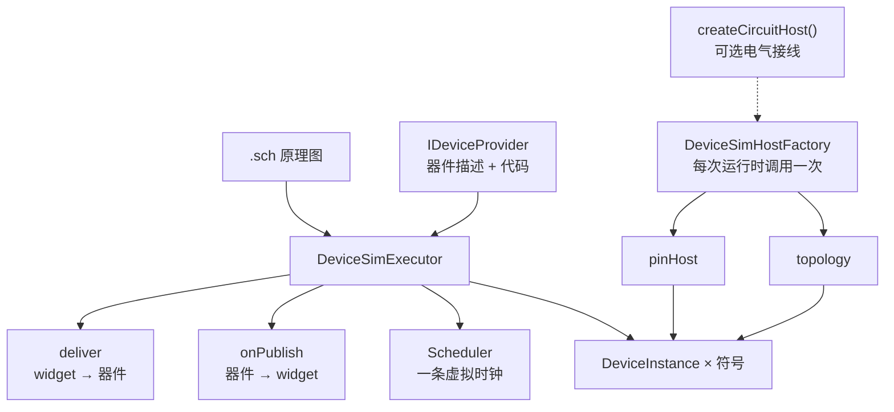
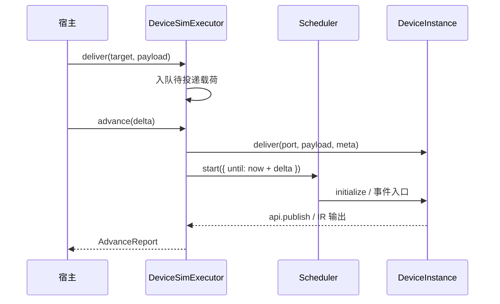

# @mica-js/simulator

在一条虚拟时钟上运行原理图里的全部器件实例：`loadSchematic` 建实例，`advance` 推进时间，`onPublish` / `deliver` 与画布互投载荷。

依赖方向：`@mica-js/simulator` → `@mica-js/device`，两者都建立在 `@mica-js/core`（及其底层的 `@mica-js/ir`）之上。

## 两条执行路径

本包同时提供两条执行路径。**新电路代码请使用统一 IR**；调度器路径处于维护模式，为现有的原理图/画布集成保留。

| 路径                | 入口                                                | 适用场景                                            | 状态                            |
| ------------------- | --------------------------------------------------- | --------------------------------------------------- | ------------------------------- |
| **统一 IR（推荐）** | `Circuit.create()`                                  | 程序化电路、批处理仿真、类型化器件访问              | 稳定，新增功能只落在这条路径    |
| 调度器（维护模式）  | `createDeviceSimExecutor()` + `createCircuitHost()` | 原理图文档 → 器件模块实例、与 `WidgetHost` 互投消息 | 弃用但继续支持，不早于 1.0 移除 |

统一 IR 把整块电路（器件 tick、电气解算、主循环）编译进**一个** `@mica-js/ir` module，
一次 `runBatch(n)` 只付一次引擎调用开销，实测比"每器件一个 module + 调度器 + JS 解网"快 10–1000×。
完整迁移步骤见 [docs/MIGRATION.md](./docs/MIGRATION.md)，弃用与移除时间表见
[docs/DEPRECATIONS.md](./docs/DEPRECATIONS.md)。

## 架构



## 用法

推荐直接挂到 `WidgetHost` 上：宿主按 `bindings` 完成双向路由，应用侧不再手写转发。

```ts
import { createPowerRuntime, timePs } from '@mica-js/core';
import { parseSchematic } from '@mica-js/core/schematic';
import { createDeviceSimExecutor } from '@mica-js/simulator';
import { createWidgetHost } from '@mica-js/widget';

const executor = createDeviceSimExecutor({
  devices: provider, // IDeviceProvider：原理图里只写 device id
  onDiagnostic: (diagnostic) => console.warn(diagnostic.code, diagnostic.message),
  host: ({ scheduler }) => {
    const power = createPowerRuntime(scheduler, board, { instanceId: 'power', pinStates });
    return {
      pinHost: power,
      topology: power,
      dispose: () => power.destroy(),
    };
  },
});

const host = createWidgetHost({ provider, assets, simulation: executor });

await executor.loadSchematic(parseSchematic(schText)); // 文本由调用方解析
const report = executor.advance(timePs(100_000)); // 100 ns，同步完成
```

`DeviceSimExecutor` 结构上满足 `@mica-js/widget` 的 `WidgetHostSimulation`，不需要适配层；宿主之外也可以自己订阅 `onPublish` / 调用 `deliver`。

## 宿主接线

执行器不拥有电路：它只把宿主建的 `pinHost` 与 `topology` 透传给每个实例。

| 字段              | 说明                                                                          |
| ----------------- | ----------------------------------------------------------------------------- |
| `pinHost`         | 逐实例的 `pinHost`；`b.pin.*` / `b.observeDigital` 依赖它                     |
| `topology`        | 逐实例的 `connections.topology`；`b.connection.apply` 依赖它                  |
| `instanceOptions` | 逐符号补充实例选项（`updateResources` / `messaging`）；身份、属性与接线不开放 |
| `dispose`         | 实例全部销毁后调用，用来释放电源 / 拓扑运行时                                 |

- 工厂在每次 `loadSchematic` 和 `reset()` 建运行时各调用一次；每次运行时都有**自己的新调度器**，所以工厂里的实例 id 不会跨运行时冲突。
- `DeviceSimHostContext` 提供 `scheduler`、`schematic` 与按 device id 索引的 `modules`，接线宿主直接读引脚几何而不必重复加载器件。
- `@mica-js/core` 的 `createPowerRuntime` 同时满足 `DevicePinHost` 与 `TopologyRuntime`，所以一块板只需要一个运行时。
- 工厂或 `dispose` 抛错时：构建阶段直接让 `loadSchematic` / `reset` 抛错（旧运行时原样保留），释放阶段转成 `simulator/dispose-failed` 诊断。
- 不配置 `host` 时实例没有 `pinHost` 也没有拓扑，用到引脚或连接的器件会在加载时报器件层错误，并被包成 `simulator/instance-create-failed`。

## 接口

| 成员                       | 说明                                                                   |
| -------------------------- | ---------------------------------------------------------------------- |
| `getState()`               | `'idle'` / `'ready'` / `'faulted'` / `'disposed'`；只有 `ready` 能推进 |
| `getSimTime()`             | 当前虚拟时间；首次加载前为 `0`                                         |
| `getSchematic()`           | 当前运行时的来源文档；首次加载前是空图                                 |
| `getTopics()`              | 每个实例的 `symbol`（绑定用的就是它）、`designator`（位号）与 `port`   |
| `loadSchematic(document)`  | 按符号建实例并跑 `initialize`，时钟归零；构建失败时旧运行时原样保留    |
| `advance(delta)`           | 同步推进 `delta` 皮秒，返回 `{ from, to, executed, reason }`           |
| `onPublish(listener)`      | 器件发布 `(target, payload, simTime)`；返回取消订阅函数                |
| `deliver(target, payload)` | 排入下一次 `advance` 的开头，同一时刻多次调用按调用顺序被器件看到      |
| `reset()`                  | 丢弃实例、按当前原理图重建，时钟归零；同步                             |
| `dispose()`                | 销毁全部实例并释放运行时；同步、幂等                                   |

`DeviceTopic` 的 `direction` / `type` 与 `DevicePortDescriptor` 同构，宿主可以直接用 `getTopics()` 生成画布的绑定候选。`symbol` 是原理图里的符号 id（绑定存的就是它），`designator` 是给人看的位号（符号自己的 `designator`，没写时回退到 id），两者在界面上不要混用。

## 语义

- **除 `loadSchematic` 之外全是同步的。** 加载之所以返回 promise，只因为器件模块要经 provider 取；模块随后被缓存，`reset()` 直接用缓存重建实例。仿真与 `WidgetHost` 跑在同一个 JS 线程上，没有 worker，也没有消息通道。
- **先建后换。** `loadSchematic` 在新调度器上建好实例、跑完 `initialize` 后才替换旧运行时，因此器件解析失败或工厂抛错时，正在跑的仿真不受影响，时钟也不回退。
- **`advance` 是同步的。** 整个时间片在调用内跑完，宿主可以在帧循环里直接调用并立刻拿到报告；推进失败时 `getState()` 变成 `'faulted'` 并原样抛出底层 `SchedulerError`。
- **`deliver` 收 `unknown`，延迟到时间片开头。** 端口类型由器件层校验；同一时刻多次投递按调用顺序被器件看到。载荷被器件层拒绝时 `advance` 抛出，但不会把执行器置为 `'faulted'`（故障只由调度器决定），宿主应当把这次输入记为被拒绝。
- **`simTime` 由执行器负责。** 器件发布时的时间戳取自调度器，画布侧不需要传时间。
- **诊断不中断仿真。** `onDiagnostic` 抛错会被吞掉；只有 `advance` 的调度器故障才会把状态置为 `'faulted'`。



## 错误

- 诊断码以 `simulator/` 开头：`device-load-failed`、`instance-create-failed`、`advance-failed`、`publish-failed`、`dispose-failed`。
- 宿主调用的参数错误抛 `SimulatorError`，`code` 为 `simulator/disposed`、`simulator/not-ready`、`simulator/invalid-delta`、`simulator/unknown-target`、`simulator/unknown-port`、`simulator/device-load-failed` 或 `simulator/instance-create-failed`。

## 电气层

原理图里的导线就是电路。`createCircuitHost()` 返回一个宿主接线工厂，用 `deriveSchematicTopology` 把每个器件引脚按合成符号的几何位置落到网，折成 `TopologyDefinition` 交给 `createPowerRuntime` 解算，再把结果作为 `pinHost` / `topology` 交给执行器。

```ts
const executor = createDeviceSimExecutor({
  devices: provider,
  host: createCircuitHost(), // 5 V 供电；createCircuitHost({ supplyVoltage: 3.3 }) 可改
});
```

- **网 → 外部导线。** 每张网一条 `wireId`，成员是网里的全部引脚；带地符号的网标 `globalGnd`。
- **电源符号 → 电源实例。** `builtin:power` / `builtin:ground` 属于合成实例 `power`：供电网的引脚按 `supplyVoltage`（默认 5 V）模拟输出，接地网的引脚按逻辑低电压强驱动。
- **器件引脚 → 拓扑引脚。** 引脚种类取自器件描述（`signal` / `power` / `gnd`）；描述里的 `connections` 变成可开关的内部连接，`connection.apply` 直接作用在这张网上。
- **引脚初值一条不少。** `PowerOptions.pinStates` 要求每个已声明引脚一条，默认高阻、无上下拉；器件在 `initialize` 里 `pin.configure` 之后由器件层覆盖。
- **生命周期跟着运行时走。** 实例先销毁（退订、停观察者），工厂的 `dispose` 最后销毁电气网络；构建失败时同样按这个顺序回收。

## 边界

- **电路定义归宿主所有。** 执行器只透传 `pinHost` / `topology`，不解析板级电源、上拉或网络拓扑；引脚与电气观测由宿主读自己的运行时。`createCircuitHost` 是可选的实现之一，手写电路可以直接实现 `DeviceSimHostFactory`。
- **模拟量只有理想电压源。** `createCircuitHost` 的引脚模型固定为 `ideal-voltage`（0–5 V，低 0.8 V、高 2 V），没有电流、RC 或器件间负载；需要更细的电气行为时要往 `@mica-js/core` 的电气层加模型，或换一个自定义宿主。
- **器件代码在宿主 realm 里求值**（与 `loadDeviceModule` 相同，等同可信扩展），不做沙箱化。
