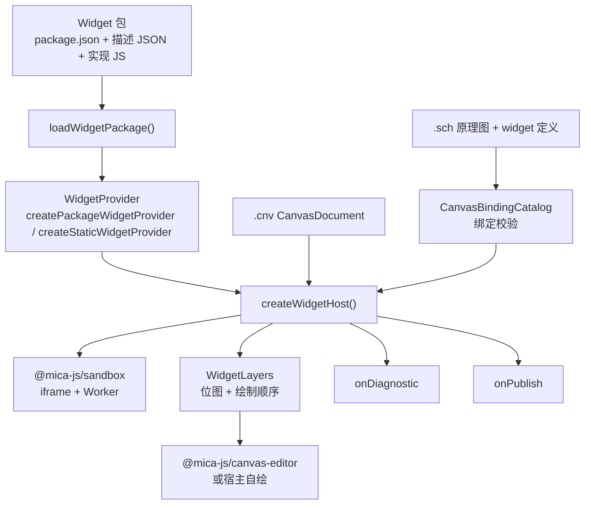
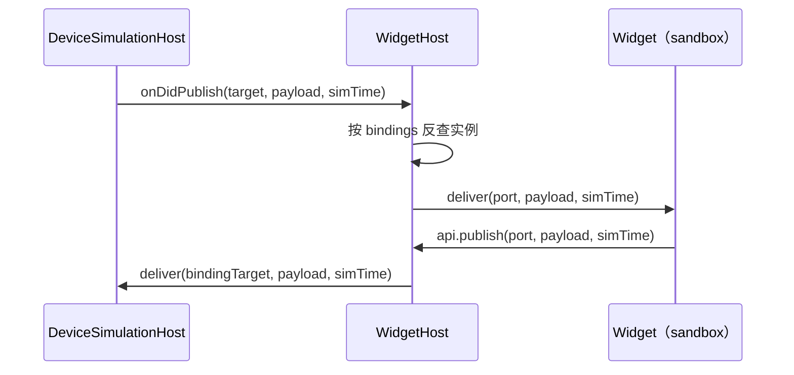

# @mica-js/widget

Widget 的契约与运行时：把 Widget 变成**纯数据**（定义 + 单文件源码），再把这些纯数据跑起来。运行时只认识 `WidgetProvider`，「包」只是分发方式；执行隔离完全交给 `@mica-js/sandbox`。

## 架构



## 安装

```bash
pnpm add @mica-js/widget
```

## 沙箱接入

`WidgetHost` 不自己创建 worker：`createWidgetHost(options, createSandbox)` 要求调用方给出 `WidgetSandboxFactory`。本包把 guest worker 与音频 worklet 的构建结果**内联在自己的 `index.js` 里**，所以接入方既不需要构建期插件，也不需要导入任何 `?sandbox-worker` / `?audio-worklet` 查询：

| 子入口                 | 内容                                                                         |
| ---------------------- | ---------------------------------------------------------------------------- |
| `@mica-js/widget`      | 契约、`WidgetHost`、`createWidgetSandboxFromWorker` 与两个内联工厂           |
| `@mica-js/widget/vite` | `micaWidgetPlugins()`：把自定义 `?audio-worklet` 入口打成单文件 Worklet 资源 |

| 工厂                                            | 作用                                                                      |
| ----------------------------------------------- | ------------------------------------------------------------------------- |
| `createWidgetHostGuestSandbox(options?)`        | 创建本包自带的 guest worker（`SandboxWorker`），脚本已压缩并内联          |
| `createWidgetSandboxFromWorker(worker, o)`      | 把该 worker 适配成 `WidgetSandbox`：注册 RPC 服务、接好音频与直连器件通道 |
| `createWidgetAudioWorklet(context)`             | 把自带的 `AudioWorkletProcessor` 从 Blob URL 装入 `context` 并返回节点    |
| `widgetGuestScript` / `widgetAudioWorkletUrl()` | 内联脚本本身与它的 Blob URL，供需要自定义装配的宿主使用                   |

```ts
import {
  createWidgetHost,
  createWidgetHostGuestSandbox,
  createWidgetSandboxFromWorker,
} from '@mica-js/widget';

// 不需要任何构建期插件：worker 脚本随包内联，直接 new SandboxWorker 即可。
const host = createWidgetHost(options, async ({ container, fs, devicePort }) =>
  createWidgetSandboxFromWorker(createWidgetHostGuestSandbox({ name: 'widget', container }), {
    container,
    fs,
    devicePort,
  }),
);

// 音频：默认就使用内置 worklet；也可以把它显式交给 host / CanvasEditor。
const hostWithAudio = createWidgetHost(
  { ...options, audio: { context, getAudioWorklet: createWidgetAudioWorklet } },
  createSandbox,
);
```

- guest worker 与 worklet 都是**单文件、已压缩**的经典脚本：没有静态 `import` / `export` / `import.meta`，也没有带字面量 specifier 的 `import()`（guest 只用 `import(<blob url>)` 求值 widget 模块源码，不加载任何外部模块）。构建时由 `@mica-js/sandbox/vite` 与 `micaWidgetPlugins()` 在内存中打包，再作为字符串内联进 `index.js`；`dist/` 里不出现 `*.sandbox.js`、`*.worklet.js`、`runtime.js` 或共享 chunk。
- `@mica-js/widget/vite` 只为**自定义** worklet 准备：`?audio-worklet` 把入口打成资源并返回 URL，`?audio-worklet-code` 返回脚本文本（包内部就是这样内联的）。
- 想换成自己的 guest（例如自带器件库的 widget 运行时），用 `?sandbox-worker` 生成 `SandboxWorker` 子类，再交给 `createWidgetSandboxFromWorker`。

自定义 guest 或自定义 worklet 时才需要构建期插件，插件本身不进入运行时代码：

```ts
// vite.config.ts
import { micaSandboxPlugins } from '@mica-js/sandbox/vite';
import { micaWidgetPlugins } from '@mica-js/widget/vite';

export default { plugins: [...micaSandboxPlugins(), ...micaWidgetPlugins()] };
```

```ts
// 自定义 guest：模块本身就是 worker 脚本，`?sandbox-worker` 给出一个 SandboxWorker 子类。
import MyWidgetSandbox from './my-widget-runtime.ts?sandbox-worker';

const host = createWidgetHost(options, async ({ container, fs, devicePort }) =>
  createWidgetSandboxFromWorker(new MyWidgetSandbox({ name: 'widget', container }), {
    container,
    fs,
    devicePort,
  }),
);
```

## 公共入口

| 导出                                                | 作用                                                                                     |
| --------------------------------------------------- | ---------------------------------------------------------------------------------------- |
| `WidgetModule`                                      | `{ definition, code }`：定义与单文件 ESM 源码                                            |
| `WidgetDefinition`                                  | `properties`、`ports` 及可选的 `displayName` / `description`                             |
| `WidgetProvider`                                    | 唯一方法 `resolve(ref): Promise<WidgetModule \| undefined>`                              |
| `createStaticWidgetProvider(modules)`               | 固定模块表，用于内置 Widget 与测试                                                       |
| `createPackageWidgetProvider({ files })`            | 读取包并建立 `<包ID>:<widgetID>` 索引                                                    |
| `loadWidgetPackage(files)`                          | 把单个包的字节来源解析为 `WidgetPackage`                                                 |
| `PackageFiles` / `WidgetPackage`                    | 字节读取抽象与包解析结果                                                                 |
| `WidgetLoadError`                                   | 带 `code`、`packageId`、`path` 的加载错误                                                |
| `createWidgetHost(options, createSandbox)`          | 创建 `WidgetHost`；由 `HostProvider` 提供 sandbox factory                                |
| `WidgetHost`                                        | 装配点：持有 `.cnv` 文档、实例、帧时钟、投递与 `dispose`                                 |
| `Widget` / `WidgetInstance`                         | 实例的完整绘制状态与不含位图的批量投影（见 RFC 0018）                                    |
| `WidgetLayers` / `WidgetLayer`                      | 按文档顺序的层位图与 `sequence`（兼容视图）                                              |
| `DeviceSimulationHost`（来自 `@mica-js/simulator`） | 跨线程仿真接口：`loadSchematic` / `tick` / `deliver` / `getTopics`                       |
| `WidgetDiagnostic`                                  | 不打断调用方的失败上报                                                                   |
| `WidgetInstanceApi` / `WidgetImplementation`        | Widget 工厂收到的实例 API 与可选钩子                                                     |
| `WidgetAssetRef` / `WidgetAssetProvider`            | 资源引用与宿主侧解析                                                                     |
| `HostFs`                                            | 宿主侧只读资源读取：`read(uri)` 返回绝对 URI 的完整字节                                  |
| `HostFsError` / `HostFsErrorCode`                   | 读取失败分类（`FileNotFound` 等）与出错 URI                                              |
| `isAbsoluteHostUri(uri)`                            | 判断引用是否带 scheme，即是否已是绝对 URI                                                |
| `resolveHostUri(base, reference)`                   | 把文档内的相对引用解析为绝对 URI，保留基准的 scheme 与 authority                         |
| `decodeDataUri(uri)` / `decodeDataUriText(uri)`     | 本地解码自包含的 `data:` URI：字节或 UTF-8 文本                                          |
| `toHostFsErrorPayload` / `fromHostFsErrorPayload`   | `HostFsError` 跨线程传输与按 `code` 重建                                                 |
| `WidgetPublish`                                     | `{ instanceId, port, payload, simTime }`                                                 |
| `WidgetSandbox` / `WidgetSandboxFactory`            | 可注入的最小沙箱接口（`call` / `on` / `terminate` / `audio`，直连时报告 `directDevice`） |
| `createWidgetSandboxFromWorker(worker, options)`    | 把沙箱 worker 适配成 `WidgetSandbox`：注册 RPC 服务、接好音频与直连器件通道              |
| `createWidgetHostGuestSandbox(options?)`            | 创建本包自带的 guest `SandboxWorker`（脚本已压缩内联）                                   |
| `createWidgetAudioWorklet(context)`                 | 把自带的音频 worklet 从 Blob URL 装入 `context` 并返回 `AudioWorkletNode`                |
| `widgetGuestScript` / `widgetAudioWorkletUrl()`     | 内联的 guest 脚本文本与 worklet 的 Blob URL                                              |
| `Event<T>` / `Disposable`                           | 从 `@mica-js/core/lifecycle` 重导出：四个 `onDidXxx` 事件与所有订阅的类型                |
| `WidgetAudioApi` / `WidgetAudioOptions`             | 实例级音频 API 与宿主侧配置（RFC 0016）                                                  |
| `WidgetAudioControls`                               | `host.audio`：静音、实例音量、冻结与恢复                                                 |

`PayloadType` 由 `@mica-js/core/canvas` 提供，本包不重复定义。

## 资源读取

`HostFs` 规定宿主侧的资源读取契约：`read` 接收绝对 URI，返回完整字节，失败以 `HostFsError` 拒绝。scheme 的映射、授权、缓存与上限由宿主决定；`data:` 由调用方本地解码，不进入 `read`。`WidgetHost` 预取实例属性资源时优先用 `assets`（`WidgetAssetProvider`）；没有它时按画布文档 URI 解析 `image` / `binary` 引用并经 `fs` 读取。

```ts
import {
  HostFsError,
  decodeDataUri,
  isAbsoluteHostUri,
  resolveHostUri,
  type HostFs,
} from '@mica-js/widget';

const files = new Map<string, Uint8Array>();
const fs: HostFs = {
  async read(uri) {
    const bytes = files.get(uri);
    if (bytes === undefined) throw new HostFsError('FileNotFound', uri);
    return bytes;
  },
};

// 文档内的引用先按文档 URI 解析成绝对 URI，再交给 HostFs。
const ref = 'art/x.png';
const uri = isAbsoluteHostUri(ref) ? ref : resolveHostUri('workspace://root/dir/panel.cnv', ref);
const bytes = await fs.read(uri);

// data: 自包含，由调用方就地解码，不进入 read。
const icon = decodeDataUri('data:image/svg+xml,<svg />');
```

`WidgetHost` 的 URI 入口使用同一个 `fs`；`data:` URI 自包含，不经过 `read`：

```ts
const host = createWidgetHost({ provider, deviceHost, fs }, createSandbox);
await host.loadDocument('workspace://root/panel.cnv'); // 读取 + 解析 + 装载
await host.loadDocument(canvasDocument); // 已解析的文档入口保持可用
```

## 快速上手

```ts
import { createPackageWidgetProvider } from '@mica-js/widget';

const provider = await createPackageWidgetProvider({
  files: {
    label: 'gauge-package',
    async read(path) {
      return readFromDisk(`node_modules/gauge-package/${path}`);
    },
  },
});

const widget = await provider.resolve('gauge-package:brightness');
if (widget === undefined) {
  // 未知引用：调用方决定回退策略，这里不抛错。
} else {
  // widget.definition 是纯数据；widget.code 交给沙箱执行。
}
```

包只在构造 provider 时读取；之后每次 `resolve` 都命中内存索引，不再访问文件系统。坏包在构造阶段抛 `WidgetLoadError`，未知引用返回 `undefined`。

## 包格式

`loadWidgetPackage` 只读取三类路径，从不遍历目录：

1. `package.json`；
2. 清单 `widgets[*].path` 声明的 Widget 描述 `.json`；
3. 与描述同目录同名的 `.js` 实现。

```json
{
  "name": "gauge-package",
  "version": "1.0.0",
  "widgets": {
    "brightness": {
      "path": "widgets/brightness.json",
      "displayName": "亮度指示",
      "description": "亮度条指示"
    }
  }
}
```

- `name` 必填且为 kebab-case（`[a-z0-9][a-z0-9-]*`），同时也是包 ID；`version` 必填且非空。
- `widgets` 可省略，省略视为空索引；键是稳定 Widget ID，同样使用 kebab-case。
- 路径必须是包内相对 POSIX 路径：绝对路径、盘符、反斜杠与 `..` 片段一律报 `widget/invalid-manifest`。
- 实现路径由描述路径把 `.json` 换成 `.js` 得到；缺少实现报 `widget/no-implementation`。
- 实现源码按原样交给调用方，本包不解析、不执行、不做静态检查。
- `contentHash` 是按 Widget ID 排序的 `[id, 源码]` 对经 `JSON.stringify` 后的 SHA-256，可用于判断包内容是否变化。

## WidgetHost

```ts
import { createStaticWidgetProvider, createWidgetHost } from '@mica-js/widget';

const host = createWidgetHost(
  {
    widgetProvider: createStaticWidgetProvider({ 'gauge:brightness': widgetModule }),
    deviceHost,
    fs,
    onDidReportDiagnostic: (diagnostic) => console.warn(diagnostic.code, diagnostic.message),
  },
  createSandbox,
);

await host.loadDocument('file:///project/main.cnv'); // 装载画布与原理图，成功后自动推进
host.applyCommand({ type: 'set-z', instanceId: gaugeId, z: 0 });
host.dispatch(gaugeId, { type: 'pointerdown', x: 12, y: 8 });

for (const instance of host.listInstances())
  console.log(instance.instanceId, instance.x, instance.y);
```

### 选项

| 选项                    | 说明                                                                              |
| ----------------------- | --------------------------------------------------------------------------------- |
| `widgetProvider`        | 必填；解析 `WidgetModule`（旧名 `provider` 保留为别名）                           |
| `deviceHost`            | 必填；`DeviceSimulationHost`，装载文档里的原理图并由宿主自持帧时钟推进            |
| `fs`                    | `HostFs`；`loadDocument(uri)` 读取文档字节，`data:` 不经过它                      |
| `container`/`dpr`       | 沙箱 iframe 挂载点与实例的设备像素比                                              |
| `frame`                 | 帧时钟策略 `{ stepMs?, requestFrame? }`                                           |
| `onDidReportDiagnostic` | 接收不打断调用方的失败（旧名 `onDiagnostic`）                                     |
| `onDidPublish`          | 接收落在绑定范围之外的 widget 发布（旧名 `onPublish`）                            |
| `assets`                | 挂载时预取 `image` / `binary` 资源；缺失时 `readBinary` 一律 reject               |
| `catalog`               | 覆盖宿主自动装配的绑定目录；缺失时由 provider 与 `deviceHost` 组装                |
| `devicePort`            | 直连器件通道的一端；随第一个沙箱的启动消息 transfer，用掉后宿主回到中转模式       |
| `audio`                 | `{ context, destination?, limits? }`；缺失时 `api.audio.state` 恒为 `unavailable` |

### 接口

```ts
interface WidgetHost {
  getDocument(): CanvasDocument;
  loadDocument(document: CanvasDocument): Promise<void>;
  loadDocument(uri: string): Promise<void>;
  applyCommand(command: CanvasCommand): void;
  onDocumentChange(listener: (document: CanvasDocument) => void): () => void;
  reset(): Promise<void>;
  deliver(instanceId: string, port: string, payload: unknown, simTime: number): void;
  dispatch(instanceId: string, event: WidgetInputEvent): void;
  listInstances(): readonly WidgetInstance[];
  readonly onDidAddWidget: Event<Widget>;
  readonly onDidChangeWidget: Event<Widget>;
  readonly onDidRemoveWidget: Event<string>;
  readonly onDidReorderWidgets: Event<readonly string[]>;
  invalidate(): void;
  getLayers(): WidgetLayers;
  resize(dpr: number): void;
  pause(): void;
  resume(): void;
  dispose(): Promise<void>;
}
```

- `getDocument()` 初始返回空文档，之后每次都是当前快照。
- `loadDocument` 接受解析好的 `CanvasDocument`，或 `.cnv` 的绝对 URI；URI 形式经 `fs.read` 取得字节、按 UTF-8 解码并交给 `parseCanvas`，`data:` URI 在本地解码。坏文档抛 `SchematicError` 且不改变已挂载的实例；读取失败原样抛出 `HostFsError`。
- `applyCommand` 接受 `@mica-js/core/canvas` 的 `CanvasCommand`。
- 实例级操作（挂载、卸载、改尺寸、改属性）不公开：文档是唯一事实来源。
- `getLayers()` 返回宿主唯一的图层存储，多次调用拿到同一对象。

### 实例投影与事件

每个实例的绘制状态只以事件形式出现，每个事件只描述一件事：

```ts
interface Widget {
  readonly instanceId: string;
  readonly widget: string; // `<包ID>:<WidgetID>` 或 `builtin:<WidgetID>`
  readonly x: number;
  readonly y: number;
  readonly width: number;
  readonly height: number;
  readonly rotation: number;
  readonly dpr: number;
  readonly properties: Readonly<Record<string, unknown>>;
  readonly bindings: Readonly<Record<string, WidgetBinding>>;
  readonly bitmap: ImageBitmap | undefined;
  readonly sequence: number;
}
```

- `onDidAddWidget` 在实例挂载后发出，`bitmap` 仍可能是 `undefined`；首帧作为 `onDidChangeWidget` 到达。
- 四个事件都是 `@mica-js/core/lifecycle` 的 `Event<T>`：订阅返回 `Disposable`，可放进 `DisposableStore`；监听者抛错只记录到控制台，不打断文档流程。
- 几何、属性、绑定、像素比与同位图的新帧都走 `onDidChangeWidget`，载荷是完整状态，订阅方无需回读宿主。
- `onDidRemoveWidget` 只带 `instanceId`，`onDidReorderWidgets` 带新的绘制顺序。
- `invalidate()` 按当前顺序先逐个报移除、再逐个报新增，订阅方据此全量重建；位图不重新生成。
- `listInstances()` 是同一份数据的批量视图，去掉 `bitmap`：列表查询不搬运位图。

### 帧时钟

`loadDocument` 成功后宿主自动开始推进：每隔 `frame.stepMs`（默认 25 ms）通过 `setTimeout` 调度一次固定步，并调用一次 `deviceHost.tick(dt)`；仿真时间取自该次报告里的 `simTime`，权威来源仍是 `deviceHost`。

- 每个调度周期只推进一个固定步，默认 25 ms 仿真时间与 25 ms 墙上时间对应。
- `dispatch()` 的事件先入队，在下一个步首统一分发。
- `pause()` 冻结帧时钟，`resume()` 从恢复时刻重新计时；两者都不改动文档与实例状态。
- 文档里的 `schematic` 按画布 URI 解析成绝对 URI 后交给 `deviceHost.loadSchematic`；读取或解析失败时本次 `loadDocument` 拒绝，文档与实例保持装入前的状态。

### 绑定校验

宿主自己装配 `CanvasBindingCatalog`，`loadDocument` 与 `applyCommand` 都用它校验绑定：

- widget 侧来自 `widgetProvider.resolve(ref)`：端口声明（方向、载荷类型）与属性名取自 widget 定义；
- 器件侧来自 `deviceHost.getTopics()`：符号与端口的存在性、方向和载荷类型；
- 原理图侧来自 `deviceHost.getSchematic()` 与刚装入的 `schematic`：`hasSchematic` 认文档里的原始引用和解析后的绝对 URI，符号表以原理图为准。

顺序固定：`loadSchematic` 先解析，之后才读 `getTopics()` / `getSchematic()`，所以校验看到的是本次装入后的运行时。`applyCommand` 是同步的，用最近一次装配的目录校验；新出现的 widget 引用还没解析时不校验 widget 侧，等挂载解析出定义后，后续命令再按完整规则校验。

`options.catalog` 一旦给出就整份取代自动装配。

### 重置

`reset()` 让全部 widget 回到初始状态：

1. 同步清空实例与 `layers`（编辑器立刻画占位框）；
2. 在协调队列里先调用 guest 的 `reset-runtime`：卸载所有 session（释放画布、清订阅），**工厂与定义保留**，模块不会被重新求值；
3. 再按**当前文档**重新 `load` + `mount` 每个实例，`props` / `assets` 重新合并与预取。

- guest 本身不重启（iframe / Worker 保留），所以重置比销毁重建便宜得多。
- `reset()` 与 `applyCommand` / `loadDocument` 共用同一条协调队列，不会与进行中的协调交错。
- 重置失败只上报 `widget/runtime-failed`，不 reject，随后的重挂载照常进行。
- **实例状态写在工厂闭包里**，模块级变量会跨重置保留。

### 执行模型

- `createWidgetHost()` 同步返回，沙箱在**第一个实例挂载时**启动，同一次协调里的并发挂载共享这次启动。
- 挂载是异步的；文档驱动的挂载失败不向调用方 reject，新快照就是结果。
- `instanceId` 在挂载入口**同步预留**，同一 id 不会被两个挂载尝试同时占用。
- 工厂抛错、`render` 抛错、订阅回调抛错都在实例边界捕获：该实例停止渲染，其余实例继续工作。

### 层

- `layers.list()` 按 `document.widgets` 顺序返回（即绘制顺序）。
- `get()` 返回**同一份活对象**：尺寸变化立即改变 `width` / `height`，新帧到达时 `sequence` 递增并把上一帧 `close()`。
- 实例被移除时关闭当前帧，`dispose` 关闭全部帧。
- `list()` 顺序即合成顺序，`set-z` 之后无需重新合成位图。

### 资源预取

widget 通过 `api.assets.readBinary(src)` 读取：

```js
const bytes = await api.assets.readBinary(api.props.texture.src);
```

每次调用返回**副本**，widget 可以随意修改。未预取的 `src` 会被 reject，并在同一实例、同一 `src` 的首次失败时上报一条 `widget/asset-failed`。**这个 Promise 必须由 widget 自己 `catch`**：不 await 也不 catch 会在 guest worker 里留下 unhandled rejection。

引用按 RFC 0018 在实例挂载前解析：`assets` 给出时由它取字节（`inline` 引用在宿主侧 base64 解码）；没有 `assets` 时用 `fs` 按画布文档 URI 解析引用，`data:` 引用自包含、不进入 `read`。

### 音频

`WidgetHostOptions.audio` 打开实例级音频（RFC 0016）。不给 `audio` 时 `api.audio.state` 是 `unavailable`，全部方法仍可调用并返回有效句柄，只是没有声音。

```ts
const audioContext = new AudioContext();
const host = createWidgetHost(
  {
    provider,
    deviceHost,
    assets,
    audio: { context: audioContext },
  },
  createSandbox,
);

host.audio.setMuted(true);
host.audio.setInstanceVolume(instanceId, 0.5);
host.audio.suspend(); // 冻结全部实例音频，PCM 缓冲保留
host.audio.resume();
```

widget 侧只有 `api.audio`，没有 Web Audio 节点图：

```js
const beep = api.audio.tone({ type: 'square', frequency: 2700, volume: 0 });
beep.set({ volume: 0.5 }, { rampMs: 5 });
beep.stop({ fadeMs: 10 });

const stream = api.audio.createStream({ sampleRate: 22050, format: 's16', bufferMs: 300 });
stream.onDrain(() => {
  void stream.write(new Int16Array(240));
});
```

`audio.getAudioWorklet` 可接管 Worklet 加载：它接收同一个 `AudioContext`，返回已加载的 `AudioWorkletNode`。省略时使用包内内联的处理器：脚本在构建期被压缩进 `index.js`，运行时用一次 `URL.createObjectURL()` 生成 Blob URL 再 `addModule()`，因此不需要任何额外资源文件，也可以部署在任意子路径。`createWidgetAudioWorklet` 就是这个默认加载器，显式传入即可。

- 参数非法同步抛出（类型 `TypeError`、取值 `RangeError`）；运行期失败（配额、设备）异步体现在句柄状态与诊断里。
- `write` 返回 `Promise<boolean>`：`true` 表示整块进入 worklet 缓冲，`false` 表示缓冲不足、整块丢弃。`bufferedFrames` 是已接纳与在途帧数减去 worklet 的消费信用，信用由 worklet 每约 20 ms 回传一次。
- 配额默认每实例 8 个声部、4 条 PCM 流，宿主可用 `limits` 收紧；超出上报 `widget/audio-limit`。
- 振荡器合成、PCM 缓冲、重采样、混音与音量都在 `AudioWorklet` 内完成；guest 经宿主转交的 `MessagePort` 直连 worklet，宿主主线程不接触样本。worklet 是单文件 module 资源，由宿主以 URL 加载；部署时需允许该资源来源，且要求安全上下文。
- 实例卸载时声部与流自动以 `disposed` 结束，widget 不必在 `dispose` 里清理。

### 接入仿真

`WidgetHostOptions.deviceHost` 是 RFC 0018 的装配方式：宿主装载文档里的原理图并自持帧时钟推进，同时完成 `symbol.port` ↔ widget 端口的双向路由：

```ts
const host = createWidgetHost({ provider, deviceHost, assets }, createSandbox);
```

`DeviceSimulationHost` 由 `@mica-js/simulator` 定义，方法全部返回 Promise；同线程实现与跨线程实现的调用方式一致，由装配层构建后传入。



- 同一端点绑了多个实例就逐个投递；widget 发布的端口有绑定就调用 `deviceHost.deliver`。
- 没绑定的端口仍只在宿主侧上报 `onDidPublish`；转发失败上报 `widget/deliver-failed`，不影响 `onDidPublish` 的派发。

### 直连器件通道

装配层若把一端 `MessagePort` 交给 device guest、另一端交给 widget guest（RFC 0018），宿主就通过 `WidgetHostOptions.devicePort` 把这一端随启动消息 transfer 给沙箱，沙箱创建时报告 `directDevice: true`。此后主题数据面直连，宿主只保留权威状态：

| 方向                        | 直连时的处理                                                                                         |
| --------------------------- | ---------------------------------------------------------------------------------------------------- |
| widget guest → device guest | guest 按 `set-bindings` 收到的绑定直接 `deliver`，发布事件仍带 `direct: true` 上报宿主，宿主不再转发 |
| device guest → widget guest | guest 订阅器件发布并自行分发到实例；宿主只维护 level 缓存，用于给之后挂载的实例补发                  |

宿主始终持有绑定目录、启动时的 `set-bindings` 与 level 缓存，因此：

- 没有 `devicePort` 的 guest（端口已在旧 worker 上用掉、崩溃后重启的沙箱）仍由宿主中转，行为与未开启直连时一致；
- 崩溃后重启的 guest 拿不到端口（一个端口只能 transfer 一次），宿主自动回到中转模式，不重复投递。

### 诊断

失败通过 `onDiagnostic` 上报，不抛给调用方；`loadDocument` 只在文档或绑定校验失败时 reject，`applyCommand` 只在命令被拒绝时抛错。

| `code`                      | 场景                                               |
| --------------------------- | -------------------------------------------------- |
| `widget/runtime-failed`     | sandbox 启动失败或运行中终止（层被清空）           |
| `widget/unknown-widget`     | provider 未注册该引用，或引用不是 `<包>:<widget>`  |
| `widget/instance-exists`    | 同一 `instanceId` 已被占用                         |
| `widget/instance-not-found` | 对未挂载实例调用实例作用域方法                     |
| `widget/mount-failed`       | 工厂或 guest `mount` 抛出                          |
| `widget/render-failed`      | `render` 抛错，或 `resize` / `set-properties` 失败 |
| `widget/deliver-failed`     | 订阅回调、输入回调或 `deliver` 调用抛错            |
| `widget/asset-failed`       | 资源预取失败，或 widget 读取了未预取的资源         |
| `widget/audio-failed`       | worklet 加载失败、非法指令，或音频设备错误         |
| `widget/audio-limit`        | 超出声部或流配额，或丢弃了超出容量的 PCM 数据块    |

### 崩溃与重建

sandbox 终止时不自动重建实例：`dispose()` 主动终止沙箱；其它终止在**下一次调用**时被发现，此时清空 `layers` 并上报 `widget/runtime-failed`。之后的 `loadDocument` / `applyCommand` 会启动新的 `SandboxWorker` 并重新 `load`。

## 编写 widget

```js
export default function indicator(api) {
  let value = 0;
  api.subscribe('brightness', (payload) => {
    value = Number(payload) || 0;
    api.invalidate();
  });

  return {
    render(ctx) {
      ctx.fillStyle = api.props.color ?? '#22AA55FF';
      ctx.fillRect(0, 0, api.width * value, api.height);
    },
    input(event) {
      if (event.type === 'pointerdown') api.publish('clicked', { x: event.x, y: event.y });
    },
    dispose() {},
  };
}
```

```ts
interface WidgetInstanceApi {
  readonly instanceId: string;
  readonly width: number;
  readonly height: number;
  readonly props: Readonly<Record<string, unknown>>;
  readonly assets: WidgetAssetApi;
  readonly audio: WidgetAudioApi;
  subscribe(port: string, listener: WidgetPortListener): () => void;
  publish(port: string, payload: unknown, simTime?: number): void;
  invalidate(): void;
}

interface WidgetImplementation {
  render?(context: OffscreenCanvasRenderingContext2D): void;
  input?(event: WidgetInputEvent): void;
  dispose?(): void;
}
```

- 尺寸是逻辑单位：guest 运行时负责设备像素比，widget 不自己乘 DPR。
- `render` / `input` / `dispose` 都可省略，纯逻辑 widget 不提供 `render`。
- `invalidate()` 在同一 tick 内多次调用会合并成一帧。

## 类型

```ts
interface WidgetModule {
  readonly definition: WidgetDefinition;
  readonly code: string;
}

interface WidgetDefinition {
  readonly properties: Readonly<Record<string, PropertyDefinition>>;
  readonly ports: Readonly<Record<string, PortDefinition>>;
  readonly displayName?: string;
  readonly description?: string;
}

interface PortDefinition {
  readonly title?: string;
  readonly description?: string;
  readonly direction: 'input' | 'output';
  readonly type: PayloadType;
  /** RFC 0017；省略时按 `type` 取默认值 */
  readonly delivery?: 'level' | 'message';
}

interface WidgetPublish {
  readonly instanceId: string;
  readonly port: string;
  readonly payload: unknown;
  readonly simTime: number;
}
```

属性描述沿用 `@mica-js/core` 的共享契约，本包只合并 `properties[*].default`，其余字段原样保留、不解析语义；`ports[*].type` 必须是 `PAYLOAD_TYPES` 的成员。`properties` 与 `ports` 都是无原型对象，定义里的 `__proto__` 键会被忽略。`ports[*].delivery` 是 RFC 0017 的可选字段，只接受 `level` 或 `message`，与 `type` 正交；省略时不写入结果，留给宿主按载荷类型取默认值。

## 加载错误

`WidgetLoadError` 的 `code` 是稳定契约，`packageId` 与 `path` 指向出错的包和包内路径：

| `code`                      | 场景                                           |
| --------------------------- | ---------------------------------------------- |
| `widget/package-not-found`  | `package.json` 缺失或不可读                    |
| `widget/invalid-manifest`   | 清单或索引非法、路径越界、描述文件缺失         |
| `widget/invalid-definition` | 描述不是对象或非法 JSON，或 `ports` 类型不合法 |
| `widget/no-implementation`  | 同名 `.js` 实现缺失或不可读                    |
| `widget/not-self-contained` | 保留错误码；加载器不检查源码，供执行侧使用     |
| `widget/load-failed`        | 其它加载失败（例如环境缺少 `crypto.subtle`）   |
| `schema/invalid-value`      | 描述字段取值越界，例如 `ports[*].delivery`     |

## 边界

- 加载器不执行源码、不创建 Worker；执行与隔离由 `WidgetHost` 交给 `@mica-js/sandbox`。
- 不解析实现源码：`import` / `export` 是否合法留给 guest 的 `import()` 决定。
- 只合并属性默认值，不解析其它字段语义、不建立端口连接、不持久化实例配置。
- 不按端口声明校验 `publish` / `subscribe`：这两个方法目前接受任意端口名，`WidgetDefinition.ports` 在运行时基本未被使用。
- 不合成多层位图：`WidgetLayers` 只给位图与绘制顺序，合成交给宿主或 `@mica-js/canvas-editor`。
- 文档只用于协调实例：不做视口、选择、命中测试与命令生成，也不持久化 `.cnv`——这些属于编辑器与宿主。
- 不自动重建终止后的实例。
- 不枚举包目录，不跟随重定向或符号链接；读取哪些文件完全由清单决定。
- 音频不含麦克风/音频输入、效果器、空间音频与向 guest 暴露的 Web Audio 节点图；振荡器与 PCM 只在 worklet 内合成与混音，PCM 经 `MessagePort` + transferable 传递，不使用 `SharedArrayBuffer`。
- 音频是实时语义：指令到达宿主后尽快执行，与仿真时间无关；`api.audio` 也不校验 `WidgetDefinition`，可用性只由宿主配置决定。

## 源码结构

| 目录                | 职责                                                                                           |
| ------------------- | ---------------------------------------------------------------------------------------------- |
| `src/guest/widget/` | guest worker 入口（`entry.ts`）与它启动的 widget 运行时；`protocol.ts` / `props.ts` 是双端协议 |
| `src/guest/audio/`  | guest 侧音频控制器与 `AudioWorkletProcessor`（`entry.ts`），协议与校验                         |
| `src/host/`         | `WidgetHost`、`WidgetSandbox` 适配、内联 guest 工厂（`guest.ts`）与音频引擎                    |
| `src/host-fs/`      | RFC 0019 的 HostFs 错误、URI 与 data URI 解码                                                  |
| `src/package/`      | Widget 包加载与两个 `WidgetProvider` 实现                                                      |
| `src/build/`        | 构建期代码：`vite.ts` 入口、`?audio-worklet(-code)` 插件、打包与产物断言                       |
