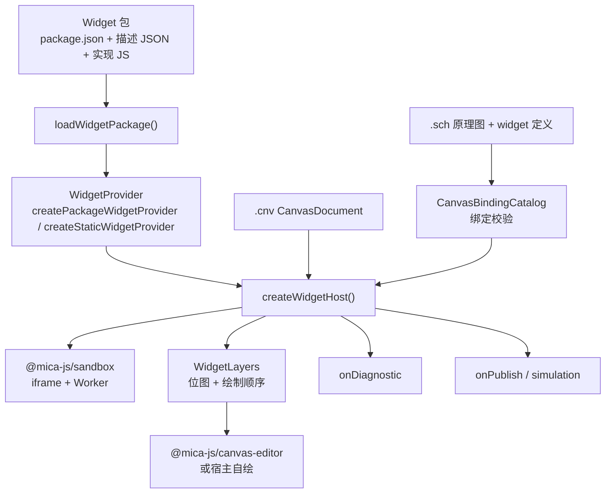
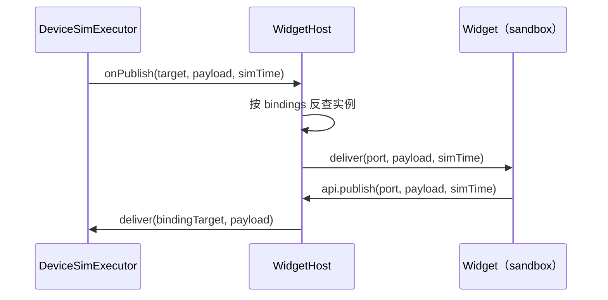

# @mica-js/widget

Widget 的契约与运行时：把 Widget 变成**纯数据**（定义 + 单文件源码），再把这些纯数据跑起来。运行时只认识 `WidgetProvider`，「包」只是分发方式；执行隔离完全交给 `@mica-js/sandbox`。

## 架构



## 安装

```bash
pnpm add @mica-js/widget
```

## 公共入口

| 导出                                     | 作用                                                         |
| ---------------------------------------- | ------------------------------------------------------------ |
| `WidgetModule`                           | `{ definition, code }`：定义与单文件 ESM 源码                |
| `WidgetDefinition`                       | `properties`、`ports` 及可选的 `displayName` / `description` |
| `WidgetProvider`                         | 唯一方法 `resolve(ref): Promise<WidgetModule \| undefined>`  |
| `createStaticWidgetProvider(modules)`    | 固定模块表，用于内置 Widget 与测试                           |
| `createPackageWidgetProvider({ files })` | 读取包并建立 `<包ID>:<widgetID>` 索引                        |
| `loadWidgetPackage(files)`               | 把单个包的字节来源解析为 `WidgetPackage`                     |
| `PackageFiles` / `WidgetPackage`         | 字节读取抽象与包解析结果                                     |
| `WidgetLoadError`                        | 带 `code`、`packageId`、`path` 的加载错误                    |
| `createWidgetHost({ provider, ... })`    | 创建 `WidgetHost`；沙箱在第一个实例挂载时惰性启动            |
| `WidgetHost`                             | 持有 `.cnv` 文档、编排实例、投递、输入分发与 `dispose`       |
| `WidgetLayers` / `WidgetLayer`           | 按文档顺序的层位图与 `sequence`                              |
| `WidgetDiagnostic`                       | 不打断调用方的失败上报                                       |
| `WidgetInstanceApi` / `WidgetInstance`   | Widget 工厂收到的实例 API 与可选钩子                         |
| `WidgetAssetRef` / `WidgetAssetProvider` | 资源引用与宿主侧解析                                         |
| `WidgetPublish`                          | `{ instanceId, port, payload, simTime }`                     |
| `WidgetSandbox` / `WidgetSandboxFactory` | 可注入的最小沙箱接口（`call` / `on` / `terminate`）          |

`PayloadType` 由 `@mica-js/core/canvas` 提供，本包不重复定义。

## 快速上手

```ts
import { createPackageWidgetProvider } from '@mica-js/widget';

const provider = await createPackageWidgetProvider({
  files: {
    label: 'gauge-package',
    async read(path) {
      return readFromDisk(`node_modules/gauge-package/${path}`);
    },
  },
});

const widget = await provider.resolve('gauge-package:brightness');
if (widget === undefined) {
  // 未知引用：调用方决定回退策略，这里不抛错。
} else {
  // widget.definition 是纯数据；widget.code 交给沙箱执行。
}
```

包只在构造 provider 时读取；之后每次 `resolve` 都命中内存索引，不再访问文件系统。坏包在构造阶段抛 `WidgetLoadError`，未知引用返回 `undefined`。

## 包格式

`loadWidgetPackage` 只读取三类路径，从不遍历目录：

1. `package.json`；
2. 清单 `widgets[*].path` 声明的 Widget 描述 `.json`；
3. 与描述同目录同名的 `.js` 实现。

```json
{
  "name": "gauge-package",
  "version": "1.0.0",
  "widgets": {
    "brightness": {
      "path": "widgets/brightness.json",
      "displayName": "亮度指示",
      "description": "亮度条指示"
    }
  }
}
```

- `name` 必填且为 kebab-case（`[a-z0-9][a-z0-9-]*`），同时也是包 ID；`version` 必填且非空。
- `widgets` 可省略，省略视为空索引；键是稳定 Widget ID，同样使用 kebab-case。
- 路径必须是包内相对 POSIX 路径：绝对路径、盘符、反斜杠与 `..` 片段一律报 `widget/invalid-manifest`。
- 实现路径由描述路径把 `.json` 换成 `.js` 得到；缺少实现报 `widget/no-implementation`。
- 实现源码按原样交给调用方，本包不解析、不执行、不做静态检查。
- `contentHash` 是按 Widget ID 排序的 `[id, 源码]` 对经 `JSON.stringify` 后的 SHA-256，可用于判断包内容是否变化。

## WidgetHost

```ts
import { createStaticWidgetProvider, createWidgetHost } from '@mica-js/widget';

const host = createWidgetHost({
  provider: createStaticWidgetProvider({ 'gauge:brightness': widgetModule }),
  onDiagnostic: (diagnostic) => console.warn(diagnostic.code, diagnostic.message),
});

await host.loadDocument(canvasDocument); // 已解析的 CanvasDocument
host.applyCommand({ type: 'set-z', instanceId: gaugeId, z: 0 });
host.deliver(gaugeId, 'brightness', 0.42, 1280);
host.dispatch(gaugeId, { type: 'pointerdown', x: 12, y: 8 });
```

### 选项

| 选项              | 说明                                                                |
| ----------------- | ------------------------------------------------------------------- |
| `provider`        | 必填；解析 `WidgetModule`                                           |
| `container`/`dpr` | 沙箱 iframe 挂载点与新图层的设备像素比                              |
| `onDiagnostic`    | 接收不打断调用方的失败                                              |
| `onPublish`       | 接收 widget 发布的端口载荷                                          |
| `simulation`      | 双向路由到仿真执行器，见下                                          |
| `assets`          | 挂载时预取 `image` / `binary` 资源；缺失时 `readBinary` 一律 reject |
| `catalog`         | 绑定校验所需的 widget 定义与原理图符号；缺失时只做格式检查          |
| `sandbox`         | 替换沙箱实现，默认惰性启动 `@mica-js/sandbox`                       |

### 接口

```ts
interface WidgetHost {
  getDocument(): CanvasDocument;
  loadDocument(document: CanvasDocument): Promise<void>;
  applyCommand(command: CanvasCommand): void;
  onDocumentChange(listener: (document: CanvasDocument) => void): () => void;
  reset(): Promise<void>;
  deliver(instanceId: string, port: string, payload: unknown, simTime: number): void;
  dispatch(instanceId: string, event: WidgetInputEvent): void;
  getLayers(): WidgetLayers;
  resize(dpr: number): void;
  dispose(): Promise<void>;
}
```

- `getDocument()` 初始返回空文档，之后每次都是当前快照。
- `loadDocument` 只接收解析好的 `CanvasDocument`（`.cnv` 文本请先用 `parseCanvas` 解析）；坏文档抛 `SchematicError` 且不改变已挂载的实例。
- `applyCommand` 接受 `@mica-js/core/canvas` 的 `CanvasCommand`。
- 实例级操作（挂载、卸载、改尺寸、改属性）不公开：文档是唯一事实来源。
- `getLayers()` 返回宿主唯一的图层存储，多次调用拿到同一对象。

### 重置

`reset()` 让全部 widget 回到初始状态：

1. 同步清空实例与 `layers`（编辑器立刻画占位框）；
2. 在协调队列里先调用 guest 的 `reset-runtime`：卸载所有 session（释放画布、清订阅），**工厂与定义保留**，模块不会被重新求值；
3. 再按**当前文档**重新 `load` + `mount` 每个实例，`props` / `assets` 重新合并与预取。

- guest 本身不重启（iframe / Worker 保留），所以重置比销毁重建便宜得多。
- `reset()` 与 `applyCommand` / `loadDocument` 共用同一条协调队列，不会与进行中的协调交错。
- 重置失败只上报 `widget/runtime-failed`，不 reject，随后的重挂载照常进行。
- **实例状态写在工厂闭包里**，模块级变量会跨重置保留。

### 执行模型

- `createWidgetHost()` 同步返回，沙箱在**第一个实例挂载时**启动，同一次协调里的并发挂载共享这次启动。
- 挂载是异步的；文档驱动的挂载失败不向调用方 reject，新快照就是结果。
- `instanceId` 在挂载入口**同步预留**，同一 id 不会被两个挂载尝试同时占用。
- 工厂抛错、`render` 抛错、订阅回调抛错都在实例边界捕获：该实例停止渲染，其余实例继续工作。

### 层

- `layers.list()` 按 `document.widgets` 顺序返回（即绘制顺序）。
- `get()` 返回**同一份活对象**：尺寸变化立即改变 `width` / `height`，新帧到达时 `sequence` 递增并把上一帧 `close()`。
- 实例被移除时关闭当前帧，`dispose` 关闭全部帧。
- `list()` 顺序即合成顺序，`set-z` 之后无需重新合成位图。

### 资源预取

widget 通过 `api.assets.readBinary(src)` 读取：

```js
const bytes = await api.assets.readBinary(api.props.texture.src);
```

每次调用返回**副本**，widget 可以随意修改。未预取的 `src` 会被 reject，并在同一实例、同一 `src` 的首次失败时上报一条 `widget/asset-failed`。**这个 Promise 必须由 widget 自己 `catch`**：不 await 也不 catch 会在 guest worker 里留下 unhandled rejection。

### 接入仿真

`WidgetHostOptions.simulation` 让宿主完成 `symbol.port` ↔ widget 端口的双向路由：

```ts
import { createDeviceSimExecutor } from '@mica-js/simulator';

const executor = createDeviceSimExecutor({ devices: provider });
const host = createWidgetHost({ provider, assets, simulation: executor });
```



- 同一端点绑了多个实例就逐个投递；widget 发布的端口有绑定就调用 `simulation.deliver`。
- 没绑定的端口仍只在宿主侧上报 `onPublish`；转发抛错上报 `widget/deliver-failed`，不影响 `onPublish` 的派发。
- `WidgetHostSimulation` 只有 `onPublish` / `deliver` 两个同步方法；`@mica-js/simulator` 的 `DeviceSimExecutor` 结构上直接满足它。
- 未显式传入 `simTime` 时按 `0` 发布。

### 诊断

失败通过 `onDiagnostic` 上报，不抛给调用方；`loadDocument` 只在文档或绑定校验失败时 reject，`applyCommand` 只在命令被拒绝时抛错。

| `code`                      | 场景                                               |
| --------------------------- | -------------------------------------------------- |
| `widget/runtime-failed`     | sandbox 启动失败或运行中终止（层被清空）           |
| `widget/unknown-widget`     | provider 未注册该引用，或引用不是 `<包>:<widget>`  |
| `widget/instance-exists`    | 同一 `instanceId` 已被占用                         |
| `widget/instance-not-found` | 对未挂载实例调用实例作用域方法                     |
| `widget/mount-failed`       | 工厂或 guest `mount` 抛出                          |
| `widget/render-failed`      | `render` 抛错，或 `resize` / `set-properties` 失败 |
| `widget/deliver-failed`     | 订阅回调、输入回调或 `deliver` 调用抛错            |
| `widget/asset-failed`       | 资源预取失败，或 widget 读取了未预取的资源         |

### 崩溃与重建

sandbox 终止时不自动重建实例：`dispose()` 主动终止沙箱；其它终止在**下一次调用**时被发现（`SandboxHandle` 没有终止事件），此时清空 `layers` 并上报 `widget/runtime-failed`。之后的 `loadDocument` / `applyCommand` 会启动新的 sandbox 并重新 `load`。

## 编写 widget

```js
export default function indicator(api) {
  let value = 0;
  api.subscribe('brightness', (payload) => {
    value = Number(payload) || 0;
    api.invalidate();
  });

  return {
    render(ctx) {
      ctx.fillStyle = api.props.color ?? '#22AA55FF';
      ctx.fillRect(0, 0, api.width * value, api.height);
    },
    input(event) {
      if (event.type === 'pointerdown') api.publish('clicked', { x: event.x, y: event.y });
    },
    dispose() {},
  };
}
```

```ts
interface WidgetInstanceApi {
  readonly instanceId: string;
  readonly width: number;
  readonly height: number;
  readonly props: Readonly<Record<string, unknown>>;
  readonly assets: WidgetAssetApi;
  subscribe(port: string, listener: WidgetPortListener): () => void;
  publish(port: string, payload: unknown, simTime?: number): void;
  invalidate(): void;
}

interface WidgetInstance {
  render?(context: OffscreenCanvasRenderingContext2D): void;
  input?(event: WidgetInputEvent): void;
  dispose?(): void;
}
```

- 尺寸是逻辑单位：guest 运行时负责设备像素比，widget 不自己乘 DPR。
- `render` / `input` / `dispose` 都可省略，纯逻辑 widget 不提供 `render`。
- `invalidate()` 在同一 tick 内多次调用会合并成一帧。

## 类型

```ts
interface WidgetModule {
  readonly definition: WidgetDefinition;
  readonly code: string;
}

interface WidgetDefinition {
  readonly properties: Readonly<Record<string, PropertyDefinition>>;
  readonly ports: Readonly<Record<string, PortDefinition>>;
  readonly displayName?: string;
  readonly description?: string;
}

interface PortDefinition {
  readonly title?: string;
  readonly description?: string;
  readonly direction: 'input' | 'output';
  readonly type: PayloadType;
}

interface WidgetPublish {
  readonly instanceId: string;
  readonly port: string;
  readonly payload: unknown;
  readonly simTime: number;
}
```

属性描述沿用 `@mica-js/core` 的共享契约，本包只合并 `properties[*].default`，其余字段原样保留、不解析语义；`ports[*].type` 必须是 `PAYLOAD_TYPES` 的成员。`properties` 与 `ports` 都是无原型对象，定义里的 `__proto__` 键会被忽略。

## 加载错误

`WidgetLoadError` 的 `code` 是稳定契约，`packageId` 与 `path` 指向出错的包和包内路径：

| `code`                      | 场景                                           |
| --------------------------- | ---------------------------------------------- |
| `widget/package-not-found`  | `package.json` 缺失或不可读                    |
| `widget/invalid-manifest`   | 清单或索引非法、路径越界、描述文件缺失         |
| `widget/invalid-definition` | 描述不是对象或非法 JSON，或 `ports` 类型不合法 |
| `widget/no-implementation`  | 同名 `.js` 实现缺失或不可读                    |
| `widget/not-self-contained` | 保留错误码；加载器不检查源码，供执行侧使用     |
| `widget/load-failed`        | 其它加载失败（例如环境缺少 `crypto.subtle`）   |

## 边界

- 加载器不执行源码、不创建 Worker；执行与隔离由 `WidgetHost` 交给 `@mica-js/sandbox`。
- 不解析实现源码：`import` / `export` 是否合法留给 guest 的 `import()` 决定。
- 只合并属性默认值，不解析其它字段语义、不建立端口连接、不持久化实例配置。
- 不按端口声明校验 `publish` / `subscribe`：这两个方法目前接受任意端口名，`WidgetDefinition.ports` 在运行时基本未被使用。
- 不合成多层位图：`WidgetLayers` 只给位图与绘制顺序，合成交给宿主或 `@mica-js/canvas-editor`。
- 文档只用于协调实例：不做视口、选择、命中测试与命令生成，也不持久化 `.cnv`——这些属于编辑器与宿主。
- 不自动重建终止后的实例。
- 不枚举包目录，不跟随重定向或符号链接；读取哪些文件完全由清单决定。
